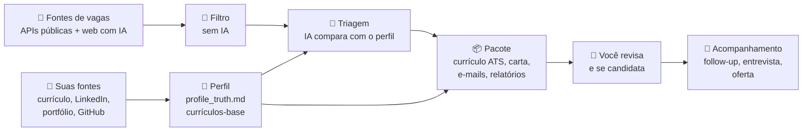
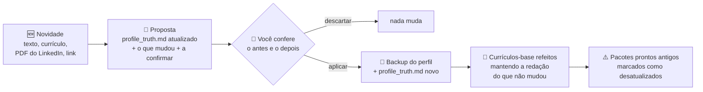
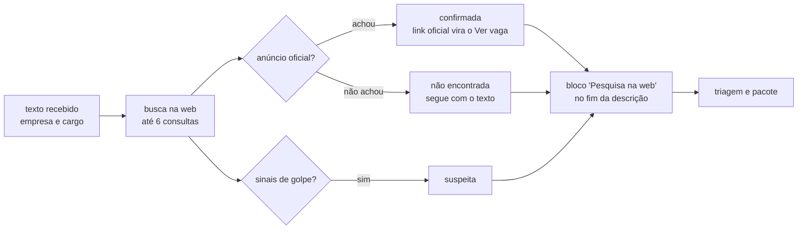
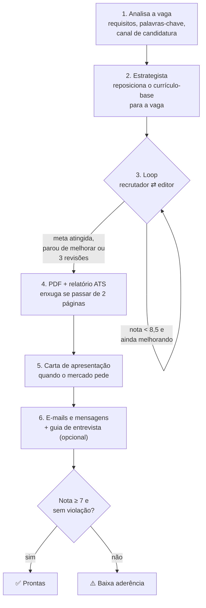
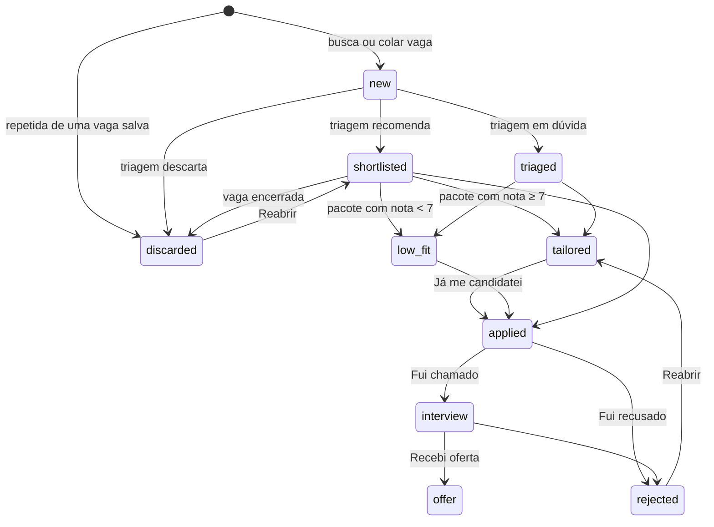
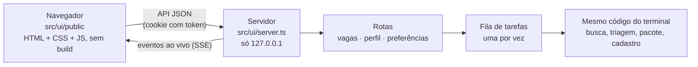

# Como funciona

[English](how-it-works.md) · **Português**

Como o auto-job-finder vai de "tenho um currículo" a "pacote pronto para enviar", e como o código está organizado. Para usar, veja o [guia de uso](guia-de-uso.md).

- [Visão geral](#visão-geral)
- [1. Perfil: a fonte única de verdade](#1-perfil-a-fonte-única-de-verdade)
- [2. Busca e filtro](#2-busca-e-filtro)
- [3. Triagem pela IA](#3-triagem-pela-ia)
- [4. O pacote de cada vaga](#4-o-pacote-de-cada-vaga)
- [Anti-invenção](#anti-invenção)
- [O caminho de uma vaga](#o-caminho-de-uma-vaga)
- [Resultados e acompanhamento](#resultados-e-acompanhamento)
- [Perguntas do formulário](#perguntas-do-formulário)
- [LinkedIn](#linkedin)
- [As IAs](#as-ias)
- [A interface local](#a-interface-local)
- [Pesquisas por trás das funções](#pesquisas-por-trás-das-funções)
- [Organização do código](#organização-do-código)

## Visão geral



O agente **prepara**; quem envia é sempre você. Ele não envia candidatura, não manda e-mail e não muda o seu LinkedIn.

## 1. Perfil: a fonte única de verdade

O cadastro (pela interface ou `ajf init`, em `src/onboarding/`) transforma o que você mandou em arquivos que o resto do agente consulta:

| Arquivo | O que é |
|---|---|
| `profile/profile_truth.md` | Os fatos da sua carreira, em seções: experiências, projetos, formação, competências, idiomas. Também tem **Lacunas**, **A confirmar**, **Nunca afirmar** e **Regras de comunicação**, que **não** contam como evidência |
| `profile/base_resume.pt.json` · `.en.json` | Currículos-base estruturados em português e inglês |
| `profile/rules.json` | Frases que o agente nunca pode escrever (ex.: "inglês fluente" quando o nível é intermediário) |
| `profile/preferences.json` | Cargos, termos de busca, filtros, regiões, cidades e fontes |

Como funciona a montagem:
1. A IA lê as fontes e devolve o que entendeu, mais até 8 perguntas sobre o que falta (`readIntake`).
2. Com as respostas e as suas escolhas, monta o `profile_truth.md`, as regras e os termos de busca (`buildProfile`).
3. Escreve os currículos-base (`buildBaseResume`).

A instrução para a IA é a mesma em todas as etapas: **só registrar o que está nas fontes**. O que falta ou diverge entre as fontes vira "A confirmar".

### Atualizar sem montar de novo

Quando a carreira muda, `src/onboarding/update.ts` atualiza o perfil a partir de uma novidade:



- **A proposta** fica salva em `profile/atualizacao/proposta.json`, então dá para fechar o `ajf` e voltar depois. Ela guarda um hash do perfil da hora em que foi feita: se você editar o perfil depois, ela não pode mais ser aplicada, para nada do que você editou à mão se perder.
- **Regras para a IA:**
  - mantém os títulos das seções e o texto que não mudou;
  - experiência nova entra em ordem cronológica;
  - curso não vira certificação;
  - o que faltar vai para "A confirmar";
  - uma proposta que tire alguma seção do perfil é recusada.
- **Regras de "nunca afirmar":** uma novidade pode tornar uma regra falsa (barrava "ISO 27001" e agora há evidência) ou pedir uma nova (curso que não é certificação). A IA só aponta o que tirar, copiando a regra exata, e o que acrescentar; `applyRuleChanges` aplica isso no `rules.json` ao aplicar a proposta, e as outras regras, inclusive as escritas à mão, ficam como estão. As mudanças entram na lista do que muda.
- **Por que refazer os currículos-base:** as travas só aceitam experiências que estão nos currículos-base. Um emprego novo só no `profile_truth.md` faria o pacote sair com violação. O `rebuildBaseResumes` passa o currículo-base atual para a IA atualizar, em vez de escrever do zero; também dá para chamar sozinho, depois de editar o perfil à mão.
- **Pacote desatualizado:** um pacote pronto ou de baixa aderência é marcado quando o perfil ou os currículos-base mudaram depois que ele foi gerado. A comparação é entre as datas de modificação dos arquivos.
- **Números que faltam** (`src/onboarding/numbers.ts`): `bulletsWithoutNumbers` lista os tópicos do currículo-base (25+ caracteres) sem nenhum dígito, até 12. `analyzeNumbers` faz uma chamada à IA para todos (com os cargos-alvo, esforço baixo, limite de 3 minutos) e devolve, para cada tópico, quanto um número ajudaria (`alto`, `medio`, `baixo`), o que medir, uma pergunta sobre o impacto (pessoas atendidas, tempo ganho, erros evitados, dinheiro) e não sobre o esforço, formatos de resposta e o porquê. O prompt proíbe sugerir valor; `withoutFigures` troca qualquer dígito dos formatos por N, e `splitExamples` separa os formatos que algumas IAs põem dentro da pergunta. O resultado fica em `profile/numeros_que_faltam.json`, por texto do tópico: roda uma vez ("Analisar de novo" força) e tópico que saiu do currículo some. A página roda sozinha na primeira vez (`POST /api/profile/numbers/analyze`, fora da fila de tarefas) e ordena pelo peso; `ajf numeros` faz as mesmas perguntas. A pessoa escreve o número real ou aproximado; `numbersNews` transforma as respostas, com a pergunta que cada uma responde, numa novidade que segue o mesmo caminho (proposta, antes e depois, aplicar). Resposta vazia é ignorada, e nada chega ao perfil sem essa conferência.

## 2. Busca e filtro

`src/jobs/search.ts` junta as vagas de todas as fontes ligadas nas preferências (`src/jobs/sources/`) e, se você pedir, da busca na web feita pela IA.

A **Gupy** (`sources/gupy.ts`) é o portal de vagas que boa parte das empresas do Brasil usa, em todas as áreas. A página de busca do portal (`portal.gupy.io/job-search/term=...`) já traz as vagas em JSON (`__NEXT_DATA__`), 12 por página; a fonte lê até 3 páginas por termo e pula as vagas com prazo de inscrição vencido ou de página de carreira desativada. Ela só acha vagas com termos em português, por isso o cadastro gera termos no idioma do país e liga a Gupy para quem mora no Brasil.

Antes de gastar IA, um **filtro determinístico** (`src/jobs/filter.ts`) corta as vagas que não fazem sentido:
- título sem nenhum dos cargos-alvo, ou com palavra excluída;
- empresa que você não quer;
- vaga publicada há mais dias que o limite;
- presencial ou híbrida fora das suas cidades;
- remota, mas restrita a países que você não aceitou.

As vagas que passam vão para `data/jobs.json` com status `new`.

### Vaga repetida

A mesma vaga aparece em vários sites: Remotive e We Work Remotely, dois repositórios do GitHub, a Gupy e um agregador que copiou dela. `src/jobs/dedupe.ts` compara cada vaga achada com todas as salvas, inclusive as que você já enviou, sem IA:

1. **Mesmo link.** O link é reduzido à forma que identifica a vaga (`canonicalUrl`): sem rastreio (`utm_*`, `ref`, `trackingId`...), sem `www.` e sem barra no fim, mantendo os parâmetros que importam, como o `jk` do Indeed. LinkedIn (`/jobs/view/slug-123`, `?currentJobId=123`), Gupy (`/job/<token>` e `/jobs/123`) e Indeed (`jk`, `vjk`) viram uma forma só. O ID da vaga sai desse link (`sources/index.ts#jobId`). Mesmo link é ignorado.
2. **Mesma vaga em outro link.** As três coisas precisam bater:
   - **título:** as palavras de um estão todas no outro, ou quase todas batem, sem acento, pontuação, marca de gênero ("Desenvolvedor(a)") e com Sr/Jr/Pl por extenso; "full stack" e "fullstack" contam iguais. **Nível diferente** (júnior × pleno, "Software Engineer" × "Senior Software Engineer", II × III) é sempre outra vaga;
   - **empresa:** a mesma, sem "Ltda", "Inc.", "Group" e afins. Quando a fonte não informou ("(ver na vaga)", "Confidencial"), a empresa não é comparada e o texto precisa bater mais;
   - **texto:** pelo menos 60% dos trechos de três palavras da descrição menor aparecem na maior (75% sem empresa conhecida). É o que separa a mesma vaga de vagas diferentes da mesma empresa, que repetem a apresentação da empresa mas não os requisitos.

   Com a mesma empresa e o **mesmo título** (depois de normalizar), o texto não decide em dois casos:
   - **não dá para comparar:** descrição curta, ou **resumo da busca na web**, que a IA escreve com outras palavras (`page.ts#isWebSummary`);
   - **você já tratou a outra** (pacote, candidatura, entrevista, oferta ou recusa): repetir uma candidatura custa mais que esconder uma vaga, que dá para reabrir.

   A repetida entra **descartada**, com `duplicateOf` apontando para a original (a primeira, se a achada já era repetida de outra), para não gastar triagem nem virar outro pacote. Reabrir, ou "Não é a mesma vaga", tira a marca e grava `notDuplicate`, para não marcar de novo. Vaga **colada** por você entra normal, só marcada, e o aviso diz qual é a parecida; o piloto automático não gera pacote de vaga marcada.

   **Vaga reaberta.** Os itens acima só valem dentro de uma janela (`AJF_REPEAT_WINDOW_DAYS`, 90 dias) contada da sua candidatura, ou do dia em que a outra vaga foi salva. Fora dela, ou se a vaga achada foi publicada pelo menos 14 dias depois da sua candidatura, é **outra abertura** da mesma vaga: entra normal, e se você já tinha tratado a antiga ganha `reopenedFrom` e o aviso "📨 vaga reaberta". Mesmo link continua sendo o mesmo anúncio, não importa quando.
3. **Vagas já salvas.** Depois de cada busca, `store.ts#flagHandledTwins` procura, entre as vagas ainda não enviadas, a mesma de uma que você já tratou (`dedupe.ts#handledTwins`): pega o que escapou e o que foi salvo antes desta checagem. Sem pacote, vai para "Encerradas"; com pacote, só fica marcada. Entre duas com pacote, a mais nova é a repetida. O piloto automático confere de novo antes de cada pacote (`handledTwin`).

Os limites foram calibrados em vagas reais: as repetidas entre sites foram achadas (inclusive três vagas em que a pessoa já tinha se candidatado, que voltaram por outro site via busca na web), e vagas diferentes da mesma empresa com o mesmo texto de apresentação (até 80% de trechos em comum) ficaram separadas pelo título.

### Vaga encerrada

`src/jobs/open.ts` abre o link da vaga e decide (`pageVerdict`, testado offline):

| O que o site responde | Resultado |
|---|---|
| Erro 404 ou 410 | encerrada |
| Link que agora leva para a lista de vagas (`?error=true` do Greenhouse) ou para a página inicial | encerrada |
| Vaga da Gupy com status diferente de publicada, ou prazo de inscrição vencido | encerrada |
| `validThrough` do JobPosting no passado | encerrada |
| Texto visível com "vaga encerrada", "inscrições encerradas", "no longer accepting applications" e afins (em português, inglês e espanhol; texto escondido em script não conta) | encerrada |
| Issue fechada no GitHub (vagas das comunidades) | encerrada |
| Erro 403, 429, login, página só com JavaScript, demora | sem confirmação |
| O resto | aberta |

Sem certeza, nunca bloqueia: "sem confirmação" segue como aberta. O resultado fica em `Job.openCheck`. Quando roda:
- **antes de cada pacote** (`tailorJob`): encerrada, o pacote não é gerado (`JobClosedError`), a não ser com "Gerar mesmo assim" (`ignoreClosed`, `--mesmo-encerrada`). O piloto automático descarta a vaga e passa para a próxima da lista, sem gastar uma das vagas do limite;
- **quando você pede** (`ajf conferir`, menu, botão na interface): todas as vagas ainda não enviadas, quatro de cada vez. Encerrada sem pacote vai para "Encerradas"; com pacote, só fica marcada.

### Texto da página da vaga

A busca na web com IA traz só um resumo de cada vaga, e a busca da Gupy só a descrição, sem os requisitos. Antes do pacote (na mesma visita da conferência), e quando você cola só o link, o agente baixa a página e tira dela o texto da vaga (`src/jobs/page.ts#jobPageText`):

1. **JobPosting em JSON-LD**, o formato que os sites de vaga publicam para o Google (Greenhouse, Lever, Workday, Wellfound, Indeed...). Vem a descrição limpa, mais empresa, local, países aceitos, tipo de contrato, salário e data.
2. **Página de vaga da Gupy**, que não tem JSON-LD: os dados da vaga (`__NEXT_DATA__`) trazem descrição, responsabilidades, requisitos e informações adicionais separados.
3. **Página de vaga do LinkedIn**: o bloco da descrição (`show-more-less-html__markup`), com título, empresa, local e critérios, sem as vagas semelhantes.
4. Sem isso, só o **conteúdo principal** da página (`<main>`, ou `<article>`), sem cabeçalho, menu, rodapé, barras laterais e formulários.

Sites de vagas põem no conteúdo principal também o resto da página. `cleanJobText` tira esse resto, sem IA:
- corta no começo de "Vagas semelhantes", "As pessoas também visualizaram", "Pesquisas semelhantes" e afins (português, inglês e espanhol; só títulos curtos, depois das primeiras linhas);
- tira linhas de interface: botões ("Salvar", "Denunciar esta vaga"), contadores ("Há 14 horas", "143 candidaturas"), menu, tela de login e convites do site;
- tira o cabeçalho repetido (cargo, empresa e local duas vezes no topo);
- deixa o bloco "Pesquisa na web" como está e pode rodar de novo sem mudar nada.

Vale para a página baixada, para o texto colado (quem copia a página inteira do LinkedIn) e, na leitura, para vagas já salvas: triagem, pacote, respostas do formulário, pesquisa na web e a descrição na interface.

Um marcador de lista sozinho numa linha é juntado ao texto da linha seguinte (feeds RSS mandam `<li><p>texto</p></li>`); marcadores seguidos, de itens vazios de menu, saem. Linhas em branco repetidas também saem (`util/text.ts#tidyText`), inclusive na hora de mostrar vagas antigas.

### Vaga colada e vaga sem link

Uma vaga colada (`src/jobs/search.ts#addJob`) entra direto, sem o filtro: você já decidiu que ela interessa. Quando ela chega sem link (indicação, e-mail, WhatsApp), `src/jobs/research.ts#researchJob` pode pesquisá-la antes da triagem. Precisa de uma IA com busca na web (`llm.ts#canWebSearch`).



- A IA devolve um objeto validado (`JobResearchSchema`): anúncio oficial, site e resumo da empresa, detalhes que o texto não trazia, como se candidatar, domínios de e-mail da empresa, veredito e observações.
- O resultado entra no fim da descrição, separado por `---` e com o título `## Pesquisa na web`, avisando que veio da web e não de quem passou a vaga. Pesquisar de novo troca esse bloco (`withoutResearch`) em vez de acumular.
- O veredito e os links ficam em `Job.research` para a interface mostrar o selo (confirmada, não encontrada, suspeita). Só links `http(s)` são guardados.
- **Missão e valores** (`companyCulture`): o que a empresa declara na página oficial, cada item com o link da página. O `officialCulture` só guarda links do domínio do site da empresa ou do anúncio oficial, um endereço com o nome da empresa, ou a página de carreiras dela numa plataforma de recrutamento (Gupy, Greenhouse, Lever...). Glassdoor, notícias, LinkedIn e item sem link saem. Vão para o bloco da pesquisa e para `Job.research.culture` (vazio quando a página oficial não fala disso, para o agente não sugerir pesquisar de novo).
- A pesquisa não inventa: o que não aparece na web fica como "não encontrado", e a vaga segue com o texto recebido. Os fatos sobre você continuam vindo só do perfil.

## 3. Triagem pela IA

`src/jobs/triage.ts` manda as vagas novas para a IA em lotes de 6, junto com o seu perfil. Para cada uma, ela devolve:

- **aderência** (alta, média ou baixa) e uma **nota de 0 a 100**;
- **evidências:** trechos do seu perfil que comprovam os requisitos;
- **lacunas:** requisitos obrigatórios sem evidência. São só registradas, nunca preenchidas;
- **sinais de golpe:** pedido de pagamento ou documentos, salário irreal, teste que manda baixar e rodar código;
- **critérios eliminatórios** (`knockouts`): o que a vaga põe como requisito obrigatório e que as plataformas usam como filtro antes de alguém ler o currículo (anos de experiência, nível de idioma, local ou trabalho presencial, autorização de trabalho ou visto, formação, certificação). Cada um ganha `sim` (o perfil comprova), `nao` (o perfil mostra que não atende) ou `incerto` (o perfil não diz), com a evidência. As respostas fixas dos formulários nas preferências (pretensão, disponibilidade, aviso prévio, mudança de cidade, autorização de trabalho) contam como evidência;
- **mercado** (BR, US, UK, EU, LATAM...), idioma e senioridade;
- **recomendação:** `candidatar` vira "Para decidir" com ⭐, `decidir` fica em "Para decidir", e `descartar` vai para "Encerradas". Um eliminatório `nao` transforma `candidatar` em `decidir` (`priority.ts#applyKnockouts`): a vaga nunca é descartada sozinha, porque "5+ anos" com 4 às vezes passa.

### Prioridade

`src/jobs/priority.ts#priorityOf`, sem IA, define a ordem de "Para decidir" e quais vagas o piloto automático empacota primeiro (`auto.ts#candidatesForPackage`):

| Fator | Efeito |
|---|---|
| Nota da triagem | a base (40 quando a vaga não passou pela triagem) |
| Frescor | +5 até 3 dias depois da publicação; depois disso, -1,5 por dia, até -30 |
| Sinais de vaga fantasma | -10 por sinal, até -20 |
| Eliminatório `nao` | -25 |
| Indicação recebida | +10 |

- **Frescor** (`ageDays`, `freshness`): `nova` até 3 dias, `recente` até 14, `antiga` depois disso. Sem data de publicação, não conta.
- **Sinais de vaga fantasma** (`ghostSignals`): publicada há mais de 30 dias; a mesma vaga já vista antes (`reopenedFrom`); banco de talentos ou "oportunidades futuras"; menos de 400 caracteres depois do `cleanJobText`. Resumo da busca na web e vaga colada não contam como curtos, porque são curtos de propósito. Os sinais só avisam e baixam a ordem; quem decide é a pessoa.

## 4. O pacote de cada vaga

`src/tailor/index.ts#tailorJob` primeiro confere se a vaga ainda está aberta ([vaga encerrada](#vaga-encerrada)) e completa a descrição com a página, quando ela veio só com resumo. Depois gera o pacote em 6 passos:



- **Loop recrutador ⇄ editor** (`src/tailor/refine.ts`): um agente faz o papel de recrutador e dá nota ao currículo; outro corrige. O loop para quando:
  - atinge a meta (8,5);
  - atinge o limite de revisões (3);
  - ou **para de melhorar**, porque insistir numa lacuna real empurra o modelo a inventar.

  No fim, fica sempre a **melhor versão sem violações**, não necessariamente a última.
- **Mercado** (`src/market.ts`): define papel (A4 ou Letter), idioma, nome do arquivo e se vai carta. Nos EUA: currículo + carta, papel Letter, sem foto, idade ou estado civil.
- **ATS** (`src/tailor/ats.ts`): compara as palavras-chave da vaga com o currículo, em três grupos: *coberto*, *você tem mas não mostrou* e *lacuna real*.
- **LEIA-ME:** explica como se candidatar pelo canal certo (e-mail, LinkedIn, plataforma, site ou WhatsApp), com checklist antes de enviar.
- **Teste dos primeiros segundos** (`src/tailor/skim.ts`, sem IA): a primeira olhada do recrutador é curta e fica no topo da página. O `skimTest` lê o bloco do topo (título, resumo e a primeira experiência) e confere se o cargo da vaga aparece, quais das 8 primeiras palavras-chave ATS comprovadas estão ali e se há um resultado medido. O que falta vai para o editor como `<first_seconds_check>` em cada revisão, e o resultado entra no `rating_report.md`. Só sobe para o topo o que o perfil já comprova.
- **Mensagem curta de apresentação:** todo pacote ganha o item 6 no `emails.md` (`applicationNote`), com até 600 caracteres, para o campo "mensagem", "carta de apresentação" ou "por que você?" das plataformas ou para um e-mail curto. Mesmas regras dos outros e-mails: fatos do perfil, sem travessão.
- **Sem travessão:** "—" e "–" usados como pontuação soam como texto de IA. As instruções proíbem, e `util/text.ts#withoutDashes` garante sem IA: em títulos (projeto, cargo, empresa, formação), o resto vai entre parênteses ("TV Box Educacional — UENP — em desenvolvimento" vira "TV Box Educacional (UENP, em desenvolvimento)"); em texto, vira vírgula; em assunto de e-mail, hífen. Intervalos de data e número viram hífen comum ("02/2025 - atual", "10-20"): nenhum "—" ou "–" sobra. Vale para o currículo (`profile.ts#withoutDashesResume`: pacote, currículos-base, PDF e ficha), a carta, os e-mails e as respostas do formulário. O modelo do PDF também usa hífen entre as datas e vírgula entre curso e instituição.
- **Cargo em um idioma só:** no currículo em português, um cargo com a tradução entre parênteses ("Analista Desenvolvedor (Developer Analyst)") perde o trecho em inglês quando ele tem as palavras do cargo do currículo em inglês na mesma posição (`profile.ts#withoutTranslatedTitles`, sem IA; uma palavra só, como "(Sênior)", nunca sai). Vale para o pacote, os currículos-base e a ficha. O perfil guarda o nome em inglês numa linha "Cargo em inglês: ...".
- **Rascunho de e-mail** (`writers/emailDraft.ts`): `rascunho_candidatura.eml` com destinatário (o e-mail de contato da vaga), assunto, texto e os PDFs em base64. O cabeçalho `X-Unsent: 1` faz o Outlook abrir como e-mail novo, pronto para enviar; quebra de linha no assunto não vira cabeçalho. Para o Gmail pelo navegador, `gmailComposeUrl` monta o link de "escrever" com destinatário, assunto e texto (o anexo vai à mão). O agente nunca envia: quem clica em Enviar é a pessoa. "Gerar o PDF de novo" refaz o rascunho com o PDF novo.
- **Ficha de candidatura** (`writers/applicationSheet.ts`): os campos dos formulários de plataforma a partir do `resume.json` do pacote (ou do currículo-base no idioma da vaga): dados pessoais, resumo em 3 tamanhos (frases inteiras, `fitText`), cada experiência campo a campo, formação, certificações, idiomas, competências e projetos. Também traz a mensagem curta de apresentação (item 6 do `emails.md`) e as respostas fixas dos formulários das preferências (`extraSections`). Sem IA e sem nada novo; fica em `ficha_de_candidatura.md` e na aba Ficha.
- **Canal da candidatura:** "Já me candidatei" grava `Job.appliedVia` (plataforma, e-mail, LinkedIn, site, WhatsApp, indicação, outro), já marcado com o canal provável (`status.ts#guessApplyVia`: `applyChannel` da análise, senão o site do link). Vai para o `tracker.csv` como "via ...".

## Anti-invenção

A regra de ouro: **só fatos do `profile_truth.md` e dos currículos-base**. Ela não depende de a IA "se comportar"; está em código, em `src/tailor/guards.ts`, e roda em cada versão do currículo:

| Trava | O que barra |
|---|---|
| Número sem fonte | Qualquer número (%, valores, quantidades) que não aparece nas fontes |
| Posição removida ou inventada | Tirar uma experiência da base ou criar uma que não existe |
| Datas e cargos | Mudar datas ou o título de um cargo |
| Certificação e projeto sem fonte | Certificação ou projeto que não está no perfil |
| Frases proibidas | Tudo o que está em `rules.json → neverClaim` |

As seções "Lacunas", "A confirmar", "Nunca afirmar" e "Regras de comunicação" ficam **fora** do texto usado como evidência (`src/profile.ts#NON_EVIDENCE_HEADING`). Assim, "Kubernetes: sem experiência" não vira prova de que você sabe Kubernetes.

Um pacote com violação nunca fica "pronto". O `coverage_review.md` mostra o que foi barrado.

## O caminho de uma vaga



Cada mudança de status:
- passa por `src/jobs/status.ts#changeStatus`;
- fica registrada em `output/tracker.csv`;
- move a pasta do pacote para a subpasta da etapa (`src/jobs/folders.ts`), mantendo os caminhos em `data/jobs.json` em sincronia.

## Resultados e acompanhamento

O que acontece depois da candidatura fica registrado, para a pessoa ver o que funciona. Sem IA, menos na leitura do e-mail de recusa.

- **Etapa da recusa** (`Job.outcome`): "Fui recusado" pergunta até onde chegou (`sem_resposta`, `triagem`, `rh`, `tecnica`, `final`, `desconhecida`) e o motivo, se a empresa disse. A etapa sugerida vem de `funnel.ts#defaultStage`: sem resposta depois de `noReplyDays`, técnica depois de entrevista, triagem nos outros casos. Com o e-mail de recusa colado, `readRejectionEmail` pede à IA a etapa, o motivo (só se o e-mail disser) e se parece mensagem automática; a pessoa confirma.
- **Primeira resposta** (`Job.respondedAt`): gravada na primeira mudança de `applied` para entrevista, oferta ou recusa com resposta. Alimenta a mediana de dias até a resposta.
- **Follow-ups** (`Job.followUps`, `followUpDue`): o 1º depois de `AJF_FOLLOW_UP_DAYS` (7) dias sem resposta, o 2º o mesmo número de dias depois do 1º, no máximo dois. "Enviei o follow-up" grava a data (`status.ts#recordFollowUp`).
- **Sem retorno** (`isNoReply`): candidatura sem resposta depois de `AJF_NO_REPLY_DAYS` (30) conta como sem retorno nos números, sem mudar o status. "Fechar como sem retorno" registra uma recusa com a etapa `sem_resposta`.
- **Funil** (`funnel.ts#funnel`): enviadas, com resposta, com entrevista, sem retorno e aguardando, no total e por canal, fonte, dias entre a publicação e o envio e nota da triagem, mais onde as recusas aconteceram. As taxas contam só as candidaturas que já têm resultado; grupo com menos de 3 aparece como "poucas". As conclusões (`Insight`) saem como código e variáveis, para a página traduzir:

  | Código | Quando |
  |---|---|
  | `missing_outcome`, `missing_channel` | recusa sem etapa, ou candidatura sem canal |
  | `small_sample` | menos de 10 candidaturas com resultado |
  | `best_channel` | dois canais com 3+ resultados cada e 15+ pontos de diferença na taxa de resposta |
  | `early_better` | as enviadas até 7 dias depois da publicação responderam 10+ pontos a mais que as outras (3+ resultados de cada lado) |
  | `screening` | metade ou mais das recusas com etapa conhecida vieram na triagem |
  | `no_interviews` | 15+ resultados e nenhuma entrevista |

  Aparece na página Resultados (`js/results.js`, `GET /api/funnel`), no `ajf resultados` e no painel (`dashboard.ts#funnelSection`).
- **Indicação** (`src/jobs/referral.ts`): o agente nunca entra no LinkedIn. `referralLinks` monta dois links de busca no LinkedIn para a pessoa abrir logada: pessoas da empresa na rede dela (1º e 2º grau) e quem recruta na empresa. `referralMessages` escreve duas mensagens curtas só com fatos do perfil, uma para quem já conhece a pessoa e um convite de conexão para quem não conhece (até 300 caracteres, o limite do LinkedIn), conferidas pelas mesmas travas das respostas dos formulários; nunca inventa vínculo. `Job.referral` guarda a situação (pedida, recebida, sem resposta). Depois de `REFERRAL_WAIT_DAYS` (3) sem resposta, a página sugere se candidatar pela plataforma, porque chegar cedo pesa mais que esperar.

## Perguntas do formulário

`src/writers/answers.ts` responde as perguntas que o formulário de candidatura faz ("Por que você quer trabalhar aqui?"):

- **Contexto:** a vaga (com a pesquisa na web, se houver), o currículo enviado para ela (`resume.json` do pacote), o que a pessoa contou para aquela resposta e as outras respostas já dadas na mesma candidatura, para não repetir as mesmas provas.
- **Foco** (`jobFocus`): a análise do pacote (`analysis.json`: o que a empresa faz e valoriza, requisitos obrigatórios e diferenciais, responsabilidades), as provas e lacunas da triagem, e a missão e os valores da página oficial com os links. O prompt pede provas que atendem um requisito ou algo que a empresa valoriza e proíbe afirmar uma lacuna.
- **Pergunta de um print** (`readQuestionsFromImage`): uma chamada curta que só transcreve as perguntas abertas e o limite de caracteres da imagem (nada do perfil vai junto; campos de dados pessoais, botões e menus são ignorados), limpas por `cleanImageQuestions`. A página reduz prints grandes para 2000 px antes de mandar (`POST /api/jobs/:id/answers/image`); o terminal aceita `--imagem` ou o caminho do arquivo arrastado (`imageFile`). A pessoa confere o texto antes de responder.
- **Pesquisar antes** (`isCompanyQuestion`, `shouldSuggestResearch`, sem IA): pergunta sobre a empresa (por que ela, cultura, valores, missão, "o nosso produto", o nome da empresa; pistas em português, inglês e espanhol), numa vaga cuja missão e valores nunca foram pesquisados, com uma IA que busca na web. A rota devolve `{ suggestResearch }` em vez de escrever, e a página oferece pesquisar antes ou responder só com o anúncio (`skipResearch`). O `ajf responder` e o menu perguntam o mesmo; `--pesquisar` pesquisa sem perguntar.
- **Saída validada** (`AnswerSchema`): a resposta e `needsYou`, o que só a pessoa sabe e deixaria a resposta mais forte (motivação, opinião sobre o produto, pretensão salarial).
- **Travas:** número que não está no perfil, na vaga ou no que a pessoa contou, e as frases de `rules.json → neverClaim`. Com limite de caracteres, o tamanho também é conferido. Se algo falha, há uma rodada de correção; o que sobrar aparece como aviso.
- **Ajustes:** cada pedido ("mais curto", "uso o app há um ano") fica guardado em `adjustments` e continua valendo nos próximos, inclusive como fato contado pela pessoa.
- **Onde fica:** em `Job.answers` (`data/jobs.json`) e em `perguntas_e_respostas.md` na pasta da vaga, que também é gravado quando o pacote é gerado depois.
- Na interface, a resposta não entra na fila de tarefas: é uma conversa de segundos, e a fila pode estar ocupada com um pacote de vários minutos. Uma resposta por vaga de cada vez.

## LinkedIn

`src/writers/linkedin.ts` faz duas coisas, sem nunca acessar o LinkedIn: o LinkedIn bloqueia programas, e o agente não muda nada em nome da pessoa.
- **Plano:** headline, "Sobre" em português e inglês, experiências, competências, destaques, Open to Work e checklist, só com fatos do perfil.
- **Conferência:** recebe o LinkedIn de hoje (o PDF exportado com "Salvar como PDF", lido como no cadastro, ou o texto) e compara com o `profile_truth.md` e com o último plano. Devolve:
  - o que **corrigir**, com a correção;
  - o que **do plano ainda falta**;
  - o que **já está certo**.

Cada plano e cada conferência vira um arquivo em `output/linkedin/` com a data. A interface mostra os mais recentes, o histórico e avisa quando o perfil mudou depois do plano.

## As IAs

Todas as chamadas passam por `src/llm.ts`, então os provedores são intercambiáveis. A detecção (`src/providers/index.ts`) procura nesta ordem:

1. **Assinaturas**, sem custo extra:
   - `claude-code`: CLI `claude -p --json-schema`;
   - `codex`: `codex exec --output-schema`;
   - `gemini-cli`: `gemini -p -o json` + validação com Zod.
2. **APIs:**
   - `anthropic`, `bedrock` e `vertex`, pelos SDKs oficiais;
   - `openai`: Responses API, ou Chat Completions com `OPENAI_BASE_URL` para OpenRouter, Groq e Ollama;
   - `gemini`: REST.

As CLIs rodam numa pasta temporária vazia e isolada, sem acesso aos seus arquivos. `AJF_PROVIDER` força uma IA específica. Uma chamada pode ter limite de tempo (`CallOptions.timeoutMs`): as CLIs encerram o processo e `llm.ts#withTimeout` desiste em qualquer provedor; sem ele, as CLIs param em 15 minutos.

**Imagens** (`CallOptions.images`, `src/providers/images.ts`): uma chamada pode levar imagens, hoje o print de uma pergunta de formulário. As APIs recebem a imagem no corpo do pedido (blocos de conteúdo da Anthropic/Bedrock/Vertex, `input_image` ou `image_url` da OpenAI, `inline_data` do Gemini); o `codex exec` recebe `--image`; o Claude Code e o Gemini CLI recebem uma cópia na pasta isolada da chamada e abrem com a ferramenta de ler arquivos (`Read`, `read_file`), a única liberada além da busca na web. A cópia é apagada depois da chamada. O tipo é conferido pelos primeiros bytes (PNG, JPG, WEBP, GIF), até 5 MB.

## A interface local



- **Segurança:**
  - o servidor só escuta em `127.0.0.1`;
  - só aceita quem abriu pelo link com token, que vira um cookie `SameSite=Strict`;
  - confere Host e Origin, para nenhum site aberto no navegador conseguir mandar ações;
  - arquivos só são servidos de dentro de `output/`.
- **Fila de tarefas** (`src/ui/tasks.ts`): busca, pacotes e cadastro rodam um de cada vez, porque usam a mesma IA, o mesmo navegador para PDF e o mesmo `jobs.json`. O que a tarefa escreveria no terminal vira o andamento ao vivo na tela. Entre uma tarefa e outra, o navegador do PDF é fechado.
- **Mesmas ações do terminal:** a interface chama as mesmas funções do `ajf` e do menu (`src/menu.ts`). Nada de lógica duplicada.
- **Idioma (português e inglês):** o texto em português é a chave da tradução, no estilo gettext. O `src/ui/public/locales/en.json` liga cada texto em português ao inglês, com `{variáveis}`.
  - Na página, o `js/i18n.js` exporta `t("Texto {n}", { n })`. O `js/boot.js` carrega o dicionário antes do `main.js`, para os textos de nível de módulo também saírem traduzidos. A escolha fica no `localStorage` (`ajf.lang`); na primeira vez, vale o idioma do navegador. Trocar recarrega a página.
  - Toda chamada à API leva o cabeçalho `x-ajf-lang`. No servidor, o `src/ui/i18n.ts` lê o mesmo dicionário: as rotas usam `c.t(...)` no nome e no resultado das tarefas, e o `new HttpError(status, "Texto {x}", { x })` é traduzido na hora de responder.
  - Os rótulos que o servidor manda prontos (nome dos status, canais, fontes de vagas, nome das IAs) são traduzidos na página ou na rota.
  - O `scripts/i18n.ts` (`npm run i18n`) acha todas as chaves no código e lista o que falta ou sobra em cada dicionário; o `tests/i18n.test.ts` falha se um texto ficar sem tradução, se uma tradução tiver outras `{variáveis}` ou se uma chave não for mais usada.
  - Ainda não traduzido: o que vai para o recrutador segue o idioma da vaga; o texto escrito pela IA, os arquivos do pacote, o andamento das tarefas e o terminal estão em português.

## Pesquisas por trás das funções

O registro de resultados, a indicação, a prioridade, os critérios eliminatórios, o teste dos primeiros segundos, a mensagem curta, os números que faltam, os follow-ups e o alerta de vaga fantasma seguem o que as pesquisas sobre contratação mostram. Alguns números vêm de empresas que vendem serviços de recrutamento ou de currículo, sem revisão independente; quando é o caso, está dito abaixo. As funções seguem a direção das evidências, não os números exatos. Os links levam às fontes, em inglês.

- **Resultados e funil.** Sem registrar o que aconteceu com cada candidatura, não dá para saber o que mudar, e nenhuma das funções abaixo pode ser medida. O funil usa só o que a pessoa registrou e avisa quando a amostra é pequena.
- **Indicação primeiro.** Nos dados da Lever, com mais de 4 milhões de candidaturas, cerca de 1 em cada 16 indicados foi contratado, contra cerca de 1 em cada 152 de quem se candidatou pelo site da empresa ou por anúncio (dado de empresa do ramo, divulgado pela SHRM). Um estudo do Fed de Nova York com os dados de indicação de uma empresa mostrou que indicados tinham mais chance de ser contratados. [SHRM: Lever study shows 1 in 100 candidates is hired](https://shrm.org/topics-tools/news/talent-acquisition/lever-study-shows-1-100-candidates-hired); [New York Fed Staff Report 568 (Brown, Setren and Topa)](https://www.newyorkfed.org/medialibrary/media/research/staff_reports/sr568.html); [ERIN: employee referral statistics](https://erinapp.com/blog/employee-referral-statistics-you-need-to-know-for-2024-infographic).
- **Candidatar cedo (frescor na prioridade).** O Fed de St. Louis mostrou que boa parte das candidaturas chega nos primeiros dias depois do anúncio (cerca de 41% nas primeiras 48 horas). A TalentWorks relatou chances bem maiores para quem se candidata nas primeiras 96 horas (dado da empresa, sem revisão de outros pesquisadores), e uma pesquisa da Universidade de Boston sobre Indeed e LinkedIn também aponta que vale se candidatar cedo. [St. Louis Fed: How quickly do people apply for jobs?](https://www.stlouisfed.org/on-the-economy/2017/november/how-quickly-people-apply-jobs); [TalentWorks data on application timing (summary)](https://paulvanderlaken.com/2017/10/24/talent-works-data-science-to-improve-job-application-chances/); [Boston University: best to apply early on Indeed or LinkedIn](https://www.bu.edu/articles/2025/looking-for-jobs-on-indeed-or-linkedin).
- **Critérios eliminatórios na triagem.** Numa pesquisa da Enhancv com 25 recrutadores, 92% disseram que o sistema de candidaturas não rejeita currículo sozinho; o que filtra automaticamente são as perguntas eliminatórias que o recrutador configura (local, autorização de trabalho, formação). Pesquisa pequena, de empresa do ramo. Um estudo de 2025 também contradiz a ideia de que a IA elimina a maior parte das candidaturas. [Enhancv: does ATS reject resumes?](https://enhancv.com/blog/does-ats-reject-resumes/); [Betanews: study debunks claim that AI filters out most applicants](https://betanews.com/2025/11/10/study-debunks-viral-claim-that-ai-filters-out-most-job-applicants/).
- **Teste dos primeiros segundos.** No estudo de rastreamento ocular da Ladders (2018), a primeira olhada num currículo durou cerca de 7 segundos e se concentrou em cargos, empresas, datas e títulos de seção. O método é criticado (ERE), então a função usa só a parte consistente: o topo do currículo pesa mais. [Ladders eye-tracking study (PDF)](https://csuglobal.edu/sites/default/files/blog-files/theladders-eyetracking-studyc2.pdf); [HR Dive: recruiters look at resumes for 7 seconds](https://www.hrdive.com/news/eye-tracking-study-shows-recruiters-look-at-resumes-for-7-seconds/); [ERE: is the 6-second resume scan a myth?](https://www.ere.net/articles/is-the-6-second-resume-scan-a-myth).
- **Mensagem curta de apresentação.** Num experimento da ResumeGo com 7.287 candidaturas, o retorno foi de 10,7% sem carta, 12,5% com carta genérica e 16,4% com carta personalizada (pesquisa de empresa do ramo). [ResumeGo: cover letters study](https://www.resumego.net/research/cover-letters/).
- **Números que faltam.** Currículo com resultados medidos recebe mais retorno. Os percentuais vêm de empresas do ramo e variam; a direção é consistente. O agente só pergunta: o número só entra quando a pessoa escreve. [ResumeGeni: how to quantify achievements](https://resumegeni.com/blog/how-to-quantify-achievements-on-your-resume).
- **Dois follow-ups e "sem retorno".** A maioria dos gestores aprova o follow-up, prefere e-mail e espera receber em até umas duas semanas (Robert Half). Não há prova de que o follow-up aumente a taxa de resposta, então o agente sugere no máximo dois e depois conta a candidatura como sem retorno. [Robert Half: the art of following up](https://press.roberthalf.ca/2017-09-19-The-Art-of-Following-Up?asPDF=1); [Workforce: busy recruiters, job seekers should follow up](https://www.workforce.com/news/busy-recruiters-call-job-seekers-follow).
- **Alerta de vaga fantasma.** Numa pesquisa de 2024 com 649 gestores, cerca de 40% disseram que a empresa publicou uma vaga falsa no último ano, e em outra pesquisa quase metade dos profissionais de RH disse publicar vagas fantasma com frequência. Anúncio antigo, republicado ou de banco de talentos são os sinais comuns. [HRKatha: 40% admit posting at least one fake job](https://www.hrkatha.com/features/research/40-admit-to-have-posted-at-least-one-fake-job-in-the-past-year/); [HCAMag: HR professionals post ghost job ads](https://www.hcamag.com/ca/specialization/recruitment/nearly-half-of-hr-professionals-admit-they-regularly-post-ghost-job-ads-survey/537439).

## Organização do código

```
src/
  cli.ts                 comandos do terminal (commander)
  menu.ts                menu interativo no terminal
  auto.ts                piloto automático: busca → triagem → pacotes → painel
  dashboard.ts           output/painel.html (resumo estático)
  tracker.ts             output/tracker.csv (histórico de status)
  llm.ts                 ponto único de acesso à IA
  providers/             cada IA + detecção (spawn.ts acha as CLIs instaladas)
  onboarding/            cadastro: leitura de PDF/DOCX/LinkedIn/sites/GitHub, entrevista, montagem
    update.ts            atualizar com uma novidade (proposta, aplicar) e refazer os currículos-base
    numbers.ts           tópicos do currículo sem número: o que medir e o que perguntar (IA), respostas viram novidade
  profile.ts             leitura do perfil, preferências e regras
  prompts.ts · schemas.ts · market.ts
  jobs/
    sources/             fontes de vagas (APIs públicas, Gupy, páginas de carreira, web com IA)
    search.ts filter.ts  busca e filtro (addJob: vaga colada ou por link)
    dedupe.ts            vaga repetida: link canônico, título, empresa e texto
    open.ts              vaga encerrada: confere o link antes do pacote e no ajf conferir
    page.ts              texto da vaga a partir da página (JobPosting, Gupy, LinkedIn ou conteúdo principal) e cleanJobText
    research.ts          pesquisa na web de uma vaga recebida sem link
    triage.ts            triagem pela IA
    priority.ts          ordem das vagas: triagem, frescor, sinais de vaga fantasma, eliminatórios, indicação
    funnel.ts            resultados: etapa da recusa, follow-ups, sem retorno, o funil e as conclusões
    referral.ts          indicação: links de busca no LinkedIn e mensagens curtas
    store.ts             data/jobs.json
    status.ts folders.ts mudança de status e pastas por etapa
  tailor/
    index.ts             o pacote (tailorJob, guia de entrevista, PDF de novo)
    agents.ts            analista, estrategista, recrutador, editor, enxugador
    refine.ts            loop recrutador ⇄ editor
    guards.ts            travas anti-invenção
    ats.ts               relatório ATS
    skim.ts              teste dos primeiros segundos do topo do currículo
  writers/               carta, e-mails, guia de entrevista, perguntas do formulário, plano e conferência do LinkedIn
    emailDraft.ts        rascunho .eml com o currículo anexado e link do Gmail
    applicationSheet.ts  ficha de candidatura (campos dos formulários, sem IA)
  render/                template HTML → PDF (navegador headless)
  ui/
    server.ts http.ts    servidor local, segurança, arquivos
    i18n.ts              tradução no servidor (cabeçalho x-ajf-lang)
    routes/              API: vagas, perfil (cadastro e atualização), LinkedIn, preferências
    tasks.ts             fila de tarefas
    public/              a página: index.html, app.css, logo.svg, js/ (boot.js, i18n.js, results.js...), locales/en.json
  util/                  texto, comparação linha a linha (diff), abrir links e pastas (sem shell)
scripts/demo.ts          npm run demo: dados fictícios para testar a interface
scripts/i18n.ts          npm run i18n: textos da interface que faltam ou sobram em cada dicionário
examples/profile/        perfil fictício (referência de formato e testes)
tests/                   testes offline (npm test)
```

Quer contribuir? Veja o [CONTRIBUTING.pt-BR.md](../CONTRIBUTING.pt-BR.md).
