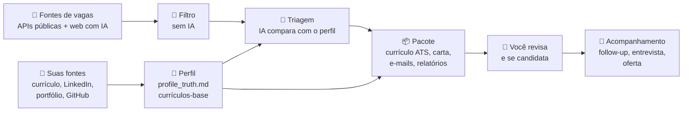
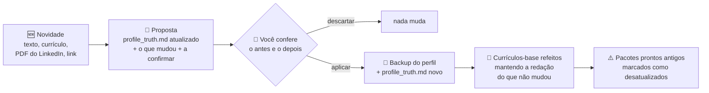
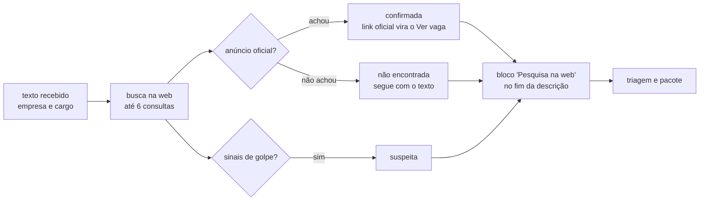
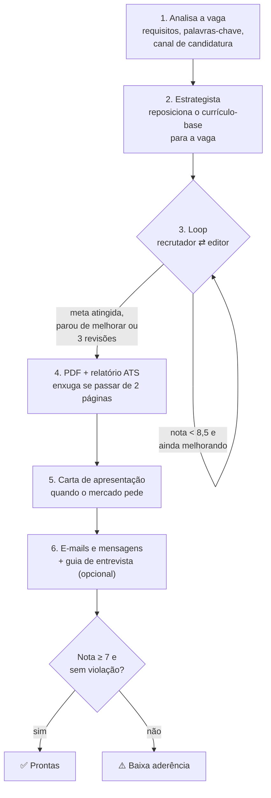
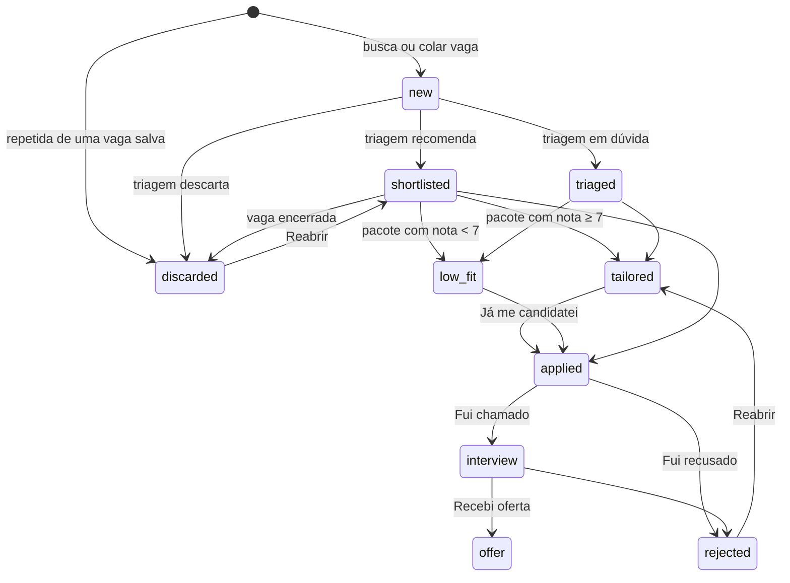
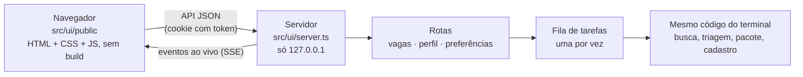

# Como funciona

Como o auto-job-finder vai de "tenho um currículo" a "pacote pronto para enviar", e como o código está organizado. Para usar, veja o [guia de uso](guia-de-uso.md).

- [Visão geral](#visão-geral)
- [1. Perfil: a fonte única de verdade](#1-perfil-a-fonte-única-de-verdade)
- [2. Busca e filtro](#2-busca-e-filtro)
- [3. Triagem pela IA](#3-triagem-pela-ia)
- [4. O pacote de cada vaga](#4-o-pacote-de-cada-vaga)
- [Anti-invenção](#anti-invenção)
- [O caminho de uma vaga](#o-caminho-de-uma-vaga)
- [LinkedIn](#linkedin)
- [As IAs](#as-ias)
- [A interface local](#a-interface-local)
- [Organização do código](#organização-do-código)

## Visão geral



O agente **prepara**; quem envia é sempre você. Ele não envia candidatura, não manda e-mail e não muda o seu LinkedIn.

## 1. Perfil: a fonte única de verdade

O cadastro (pela interface ou `ajf init`, em `src/onboarding/`) transforma o que você mandou em arquivos que o resto do agente consulta:

| Arquivo | O que é |
|---|---|
| `profile/profile_truth.md` | Os fatos da sua carreira, em seções: experiências, projetos, formação, competências, idiomas. Também tem **Lacunas**, **A confirmar**, **Nunca afirmar** e **Regras de comunicação**, que **não** contam como evidência |
| `profile/base_resume.pt.json` · `.en.json` | Currículos-base estruturados em português e inglês |
| `profile/rules.json` | Frases que o agente nunca pode escrever (ex.: "inglês fluente" quando o nível é intermediário) |
| `profile/preferences.json` | Cargos, termos de busca, filtros, regiões, cidades e fontes |

Como funciona a montagem:
1. A IA lê as fontes e devolve o que entendeu, mais até 8 perguntas sobre o que falta (`readIntake`).
2. Com as respostas e as suas escolhas, monta o `profile_truth.md`, as regras e os termos de busca (`buildProfile`).
3. Escreve os currículos-base (`buildBaseResume`).

A instrução para a IA é a mesma em todas as etapas: **só registrar o que está nas fontes**. O que falta ou diverge entre as fontes vira "A confirmar".

### Atualizar sem montar de novo

Quando a carreira muda, `src/onboarding/update.ts` atualiza o perfil a partir de uma novidade:



- **A proposta** fica salva em `profile/atualizacao/proposta.json`, então dá para fechar o `ajf` e voltar depois. Ela guarda um hash do perfil da hora em que foi feita: se você editar o perfil depois, ela não pode mais ser aplicada, para nada do que você editou à mão se perder.
- **Regras para a IA:**
  - mantém os títulos das seções e o texto que não mudou;
  - experiência nova entra em ordem cronológica;
  - curso não vira certificação;
  - o que faltar vai para "A confirmar";
  - uma proposta que tire alguma seção do perfil é recusada.
- **Regras de "nunca afirmar":** uma novidade pode tornar uma regra falsa (barrava "ISO 27001" e agora há evidência) ou pedir uma nova (curso que não é certificação). A IA só aponta o que tirar, copiando a regra exata, e o que acrescentar; `applyRuleChanges` aplica isso no `rules.json` ao aplicar a proposta, e as outras regras, inclusive as escritas à mão, ficam como estão. As mudanças entram na lista do que muda.
- **Por que refazer os currículos-base:** as travas só aceitam experiências que estão nos currículos-base. Um emprego novo só no `profile_truth.md` faria o pacote sair com violação. O `rebuildBaseResumes` passa o currículo-base atual para a IA atualizar, em vez de escrever do zero; também dá para chamar sozinho, depois de editar o perfil à mão.
- **Pacote desatualizado:** um pacote pronto ou de baixa aderência é marcado quando o perfil ou os currículos-base mudaram depois que ele foi gerado. A comparação é entre as datas de modificação dos arquivos.

## 2. Busca e filtro

`src/jobs/search.ts` junta as vagas de todas as fontes ligadas nas preferências (`src/jobs/sources/`) e, se você pedir, da busca na web feita pela IA.

A **Gupy** (`sources/gupy.ts`) é o portal de vagas que boa parte das empresas do Brasil usa, em todas as áreas. A página de busca do portal (`portal.gupy.io/job-search/term=...`) já traz as vagas em JSON (`__NEXT_DATA__`), 12 por página; a fonte lê até 3 páginas por termo e pula as vagas com prazo de inscrição vencido ou de página de carreira desativada. Ela só acha vagas com termos em português, por isso o cadastro gera termos no idioma do país e liga a Gupy para quem mora no Brasil.

Antes de gastar IA, um **filtro determinístico** (`src/jobs/filter.ts`) corta as vagas que não fazem sentido:
- título sem nenhum dos cargos-alvo, ou com palavra excluída;
- empresa que você não quer;
- vaga publicada há mais dias que o limite;
- presencial ou híbrida fora das suas cidades;
- remota, mas restrita a países que você não aceitou.

As vagas que passam vão para `data/jobs.json` com status `new`.

### Vaga repetida

A mesma vaga aparece em vários sites: Remotive e We Work Remotely, dois repositórios do GitHub, a Gupy e um agregador que copiou dela. `src/jobs/dedupe.ts` compara cada vaga achada com todas as salvas, inclusive as que você já enviou, sem IA:

1. **Mesmo link.** O link é reduzido à forma que identifica a vaga (`canonicalUrl`): sem rastreio (`utm_*`, `ref`, `trackingId`...), sem `www.` e sem barra no fim, mantendo os parâmetros que importam, como o `jk` do Indeed. LinkedIn (`/jobs/view/slug-123`, `?currentJobId=123`), Gupy (`/job/<token>` e `/jobs/123`) e Indeed (`jk`, `vjk`) viram uma forma só. O ID da vaga sai desse link (`sources/index.ts#jobId`). Mesmo link é ignorado.
2. **Mesma vaga em outro link.** As três coisas precisam bater:
   - **título:** as palavras de um estão todas no outro, ou quase todas batem, sem acento, pontuação, marca de gênero ("Desenvolvedor(a)") e com Sr/Jr/Pl por extenso; "full stack" e "fullstack" contam iguais. **Nível diferente** (júnior × pleno, "Software Engineer" × "Senior Software Engineer", II × III) é sempre outra vaga;
   - **empresa:** a mesma, sem "Ltda", "Inc.", "Group" e afins. Quando a fonte não informou ("(ver na vaga)", "Confidencial"), a empresa não é comparada e o texto precisa bater mais;
   - **texto:** pelo menos 60% dos trechos de três palavras da descrição menor aparecem na maior (75% sem empresa conhecida). É o que separa a mesma vaga de vagas diferentes da mesma empresa, que repetem a apresentação da empresa mas não os requisitos.

   Com a mesma empresa e o **mesmo título** (depois de normalizar), o texto não decide em dois casos:
   - **não dá para comparar:** descrição curta, ou **resumo da busca na web**, que a IA escreve com outras palavras (`page.ts#isWebSummary`);
   - **você já tratou a outra** (pacote, candidatura, entrevista, oferta ou recusa): repetir uma candidatura custa mais que esconder uma vaga, que dá para reabrir.

   A repetida entra **descartada**, com `duplicateOf` apontando para a original (a primeira, se a achada já era repetida de outra), para não gastar triagem nem virar outro pacote. Reabrir, ou "Não é a mesma vaga", tira a marca e grava `notDuplicate`, para não marcar de novo. Vaga **colada** por você entra normal, só marcada, e o aviso diz qual é a parecida; o piloto automático não gera pacote de vaga marcada.
   **Vaga reaberta.** Os itens acima só valem dentro de uma janela (`AJF_REPEAT_WINDOW_DAYS`, 90 dias) contada da sua candidatura, ou do dia em que a outra vaga foi salva. Fora dela, ou se a vaga achada foi publicada pelo menos 14 dias depois da sua candidatura, é **outra abertura** da mesma vaga: entra normal, e se você já tinha tratado a antiga ganha `reopenedFrom` e o aviso "📨 vaga reaberta". Mesmo link continua sendo o mesmo anúncio, não importa quando.
3. **Vagas já salvas.** Depois de cada busca, `store.ts#flagHandledTwins` procura, entre as vagas ainda não enviadas, a mesma de uma que você já tratou (`dedupe.ts#handledTwins`): pega o que escapou e o que foi salvo antes desta checagem. Sem pacote, vai para "Encerradas"; com pacote, só fica marcada. Entre duas com pacote, a mais nova é a repetida. O piloto automático confere de novo antes de cada pacote (`handledTwin`).

Os limites foram calibrados em vagas reais: as repetidas entre sites foram achadas (inclusive três vagas em que a pessoa já tinha se candidatado, que voltaram por outro site via busca na web), e vagas diferentes da mesma empresa com o mesmo texto de apresentação (até 80% de trechos em comum) ficaram separadas pelo título.

### Vaga encerrada

`src/jobs/open.ts` abre o link da vaga e decide (`pageVerdict`, testado offline):

| O que o site responde | Resultado |
|---|---|
| Erro 404 ou 410 | encerrada |
| Link que agora leva para a lista de vagas (`?error=true` do Greenhouse) ou para a página inicial | encerrada |
| Vaga da Gupy com status diferente de publicada, ou prazo de inscrição vencido | encerrada |
| `validThrough` do JobPosting no passado | encerrada |
| Texto visível com "vaga encerrada", "inscrições encerradas", "no longer accepting applications" e afins (em português, inglês e espanhol; texto escondido em script não conta) | encerrada |
| Issue fechada no GitHub (vagas das comunidades) | encerrada |
| Erro 403, 429, login, página só com JavaScript, demora | sem confirmação |
| O resto | aberta |

Sem certeza, nunca bloqueia: "sem confirmação" segue como aberta. O resultado fica em `Job.openCheck`. Quando roda:
- **antes de cada pacote** (`tailorJob`): encerrada, o pacote não é gerado (`JobClosedError`), a não ser com "Gerar mesmo assim" (`ignoreClosed`, `--mesmo-encerrada`). O piloto automático descarta a vaga e passa para a próxima da lista, sem gastar uma das vagas do limite;
- **quando você pede** (`ajf conferir`, menu, botão na interface): todas as vagas ainda não enviadas, quatro de cada vez. Encerrada sem pacote vai para "Encerradas"; com pacote, só fica marcada.

### Texto da página da vaga

A busca na web com IA traz só um resumo de cada vaga, e a busca da Gupy só a descrição, sem os requisitos. Antes do pacote (na mesma visita da conferência), e quando você cola só o link, o agente baixa a página e tira dela o texto da vaga (`src/jobs/page.ts#jobPageText`):

1. **JobPosting em JSON-LD**, o formato que os sites de vaga publicam para o Google (Greenhouse, Lever, Workday, Wellfound, Indeed...). Vem a descrição limpa, mais empresa, local, países aceitos, tipo de contrato, salário e data.
2. **Página de vaga da Gupy**, que não tem JSON-LD: os dados da vaga (`__NEXT_DATA__`) trazem descrição, responsabilidades, requisitos e informações adicionais separados.
3. Sem isso, só o **conteúdo principal** da página (`<main>`, ou `<article>`), sem cabeçalho, menu, rodapé, barras laterais e formulários.

Um marcador de lista sozinho numa linha é juntado ao texto da linha seguinte (feeds RSS mandam `<li><p>texto</p></li>`); marcadores seguidos, de itens vazios de menu, saem. Linhas em branco repetidas também saem (`util/text.ts#tidyText`), inclusive na hora de mostrar vagas antigas.

### Vaga colada e vaga sem link

Uma vaga colada (`src/jobs/search.ts#addJob`) entra direto, sem o filtro: você já decidiu que ela interessa. Quando ela chega sem link (indicação, e-mail, WhatsApp), `src/jobs/research.ts#researchJob` pode pesquisá-la antes da triagem. Precisa de uma IA com busca na web (`llm.ts#canWebSearch`).



- A IA devolve um objeto validado (`JobResearchSchema`): anúncio oficial, site e resumo da empresa, detalhes que o texto não trazia, como se candidatar, domínios de e-mail da empresa, veredito e observações.
- O resultado entra no fim da descrição, separado por `---` e com o título `## Pesquisa na web`, avisando que veio da web e não de quem passou a vaga. Pesquisar de novo troca esse bloco (`withoutResearch`) em vez de acumular.
- O veredito e os links ficam em `Job.research` para a interface mostrar o selo (confirmada, não encontrada, suspeita). Só links `http(s)` são guardados.
- A pesquisa não inventa: o que não aparece na web fica como "não encontrado", e a vaga segue com o texto recebido. Os fatos sobre você continuam vindo só do perfil.

## 3. Triagem pela IA

`src/jobs/triage.ts` manda as vagas novas para a IA em lotes de 6, junto com o seu perfil. Para cada uma, ela devolve:

- **aderência** (alta, média ou baixa) e uma **nota de 0 a 100**;
- **evidências:** trechos do seu perfil que comprovam os requisitos;
- **lacunas:** requisitos obrigatórios sem evidência. São só registradas, nunca preenchidas;
- **sinais de golpe:** pedido de pagamento ou documentos, salário irreal, teste que manda baixar e rodar código;
- **mercado** (BR, US, UK, EU, LATAM...), idioma e senioridade;
- **recomendação:** `candidatar` vira "Para decidir" com ⭐, `decidir` fica em "Para decidir", e `descartar` vai para "Encerradas".

## 4. O pacote de cada vaga

`src/tailor/index.ts#tailorJob` primeiro confere se a vaga ainda está aberta ([vaga encerrada](#vaga-encerrada)) e completa a descrição com a página, quando ela veio só com resumo. Depois gera o pacote em 6 passos:



- **Loop recrutador ⇄ editor** (`src/tailor/refine.ts`): um agente faz o papel de recrutador e dá nota ao currículo; outro corrige. O loop para quando:
  - atinge a meta (8,5);
  - atinge o limite de revisões (3);
  - ou **para de melhorar**, porque insistir numa lacuna real empurra o modelo a inventar.

  No fim, fica sempre a **melhor versão sem violações**, não necessariamente a última.
- **Mercado** (`src/market.ts`): define papel (A4 ou Letter), idioma, nome do arquivo e se vai carta. Nos EUA: currículo + carta, papel Letter, sem foto, idade ou estado civil.
- **ATS** (`src/tailor/ats.ts`): compara as palavras-chave da vaga com o currículo, em três grupos: *coberto*, *você tem mas não mostrou* e *lacuna real*.
- **LEIA-ME:** explica como se candidatar pelo canal certo (e-mail, LinkedIn, plataforma, site ou WhatsApp), com checklist antes de enviar.

## Anti-invenção

A regra de ouro: **só fatos do `profile_truth.md` e dos currículos-base**. Ela não depende de a IA "se comportar"; está em código, em `src/tailor/guards.ts`, e roda em cada versão do currículo:

| Trava | O que barra |
|---|---|
| Número sem fonte | Qualquer número (%, valores, quantidades) que não aparece nas fontes |
| Posição removida ou inventada | Tirar uma experiência da base ou criar uma que não existe |
| Datas e cargos | Mudar datas ou o título de um cargo |
| Certificação e projeto sem fonte | Certificação ou projeto que não está no perfil |
| Frases proibidas | Tudo o que está em `rules.json → neverClaim` |

As seções "Lacunas", "A confirmar", "Nunca afirmar" e "Regras de comunicação" ficam **fora** do texto usado como evidência (`src/profile.ts#NON_EVIDENCE_HEADING`). Assim, "Kubernetes: sem experiência" não vira prova de que você sabe Kubernetes.

Um pacote com violação nunca fica "pronto". O `coverage_review.md` mostra o que foi barrado.

## O caminho de uma vaga



Cada mudança de status:
- passa por `src/jobs/status.ts#changeStatus`;
- fica registrada em `output/tracker.csv`;
- move a pasta do pacote para a subpasta da etapa (`src/jobs/folders.ts`), mantendo os caminhos em `data/jobs.json` em sincronia.

## Perguntas do formulário

`src/writers/answers.ts` responde as perguntas que o formulário de candidatura faz ("Por que você quer trabalhar aqui?"):

- **Contexto:** a vaga (com a pesquisa na web, se houver), o currículo enviado para ela (`resume.json` do pacote), o que a pessoa contou para aquela resposta e as outras respostas já dadas na mesma candidatura, para não repetir as mesmas provas.
- **Saída validada** (`AnswerSchema`): a resposta e `needsYou`, o que só a pessoa sabe e deixaria a resposta mais forte (motivação, opinião sobre o produto, pretensão salarial).
- **Travas:** número que não está no perfil, na vaga ou no que a pessoa contou, e as frases de `rules.json → neverClaim`. Com limite de caracteres, o tamanho também é conferido. Se algo falha, há uma rodada de correção; o que sobrar aparece como aviso.
- **Ajustes:** cada pedido ("mais curto", "uso o app há um ano") fica guardado em `adjustments` e continua valendo nos próximos, inclusive como fato contado pela pessoa.
- **Onde fica:** em `Job.answers` (`data/jobs.json`) e em `perguntas_e_respostas.md` na pasta da vaga, que também é gravado quando o pacote é gerado depois.
- Na interface, a resposta não entra na fila de tarefas: é uma conversa de segundos, e a fila pode estar ocupada com um pacote de vários minutos. Uma resposta por vaga de cada vez.

## LinkedIn

`src/writers/linkedin.ts` faz duas coisas, sem nunca acessar o LinkedIn: o LinkedIn bloqueia programas, e o agente não muda nada em nome da pessoa.
- **Plano:** headline, "Sobre" em português e inglês, experiências, competências, destaques, Open to Work e checklist, só com fatos do perfil.
- **Conferência:** recebe o LinkedIn de hoje (o PDF exportado com "Salvar como PDF", lido como no cadastro, ou o texto) e compara com o `profile_truth.md` e com o último plano. Devolve:
  - o que **corrigir**, com a correção;
  - o que **do plano ainda falta**;
  - o que **já está certo**.

Cada plano e cada conferência vira um arquivo em `output/linkedin/` com a data. A interface mostra os mais recentes, o histórico e avisa quando o perfil mudou depois do plano.

## As IAs

Todas as chamadas passam por `src/llm.ts`, então os provedores são intercambiáveis. A detecção (`src/providers/index.ts`) procura nesta ordem:

1. **Assinaturas**, sem custo extra:
   - `claude-code`: CLI `claude -p --json-schema`;
   - `codex`: `codex exec --output-schema`;
   - `gemini-cli`: `gemini -p -o json` + validação com Zod.
2. **APIs:**
   - `anthropic`, `bedrock` e `vertex`, pelos SDKs oficiais;
   - `openai`: Responses API, ou Chat Completions com `OPENAI_BASE_URL` para OpenRouter, Groq e Ollama;
   - `gemini`: REST.

As CLIs rodam numa pasta temporária vazia e isolada, sem acesso aos seus arquivos. `AJF_PROVIDER` força uma IA específica.

## A interface local



- **Segurança:**
  - o servidor só escuta em `127.0.0.1`;
  - só aceita quem abriu pelo link com token, que vira um cookie `SameSite=Strict`;
  - confere Host e Origin, para nenhum site aberto no navegador conseguir mandar ações;
  - arquivos só são servidos de dentro de `output/`.
- **Fila de tarefas** (`src/ui/tasks.ts`): busca, pacotes e cadastro rodam um de cada vez, porque usam a mesma IA, o mesmo navegador para PDF e o mesmo `jobs.json`. O que a tarefa escreveria no terminal vira o andamento ao vivo na tela. Entre uma tarefa e outra, o navegador do PDF é fechado.
- **Mesmas ações do terminal:** a interface chama as mesmas funções do `ajf` e do menu (`src/menu.ts`). Nada de lógica duplicada.

## Organização do código

```
src/
  cli.ts                 comandos do terminal (commander)
  menu.ts                menu interativo no terminal
  auto.ts                piloto automático: busca → triagem → pacotes → painel
  dashboard.ts           output/painel.html (resumo estático)
  tracker.ts             output/tracker.csv (histórico de status)
  llm.ts                 ponto único de acesso à IA
  providers/             cada IA + detecção (spawn.ts acha as CLIs instaladas)
  onboarding/            cadastro: leitura de PDF/DOCX/LinkedIn/sites/GitHub, entrevista, montagem
    update.ts            atualizar com uma novidade (proposta, aplicar) e refazer os currículos-base
  profile.ts             leitura do perfil, preferências e regras
  prompts.ts · schemas.ts · market.ts
  jobs/
    sources/             fontes de vagas (APIs públicas, Gupy, páginas de carreira, web com IA)
    search.ts filter.ts  busca e filtro (addJob: vaga colada ou por link)
    dedupe.ts            vaga repetida: link canônico, título, empresa e texto
    open.ts              vaga encerrada: confere o link antes do pacote e no ajf conferir
    page.ts              texto da vaga a partir da página (JobPosting, Gupy ou conteúdo principal)
    research.ts          pesquisa na web de uma vaga recebida sem link
    triage.ts            triagem pela IA
    store.ts             data/jobs.json
    status.ts folders.ts mudança de status e pastas por etapa
  tailor/
    index.ts             o pacote (tailorJob, guia de entrevista, PDF de novo)
    agents.ts            analista, estrategista, recrutador, editor, enxugador
    refine.ts            loop recrutador ⇄ editor
    guards.ts            travas anti-invenção
    ats.ts               relatório ATS
  writers/               carta, e-mails, guia de entrevista, perguntas do formulário, plano e conferência do LinkedIn
  render/                template HTML → PDF (navegador headless)
  ui/
    server.ts http.ts    servidor local, segurança, arquivos
    routes/              API: vagas, perfil (cadastro e atualização), LinkedIn, preferências
    tasks.ts             fila de tarefas
    public/              a página: index.html, app.css, logo.svg, js/
  util/                  texto, comparação linha a linha (diff), abrir links e pastas (sem shell)
scripts/demo.ts          npm run demo: dados fictícios para testar a interface
examples/profile/        perfil fictício (referência de formato e testes)
tests/                   testes offline (npm test)
```

Quer contribuir? Veja o [CONTRIBUTING.md](../CONTRIBUTING.md).
