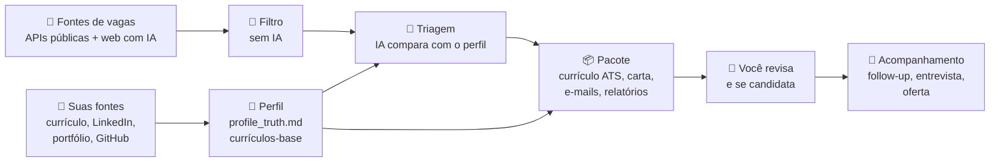
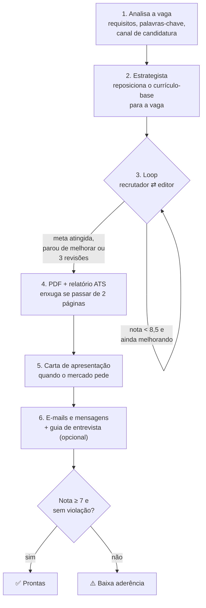
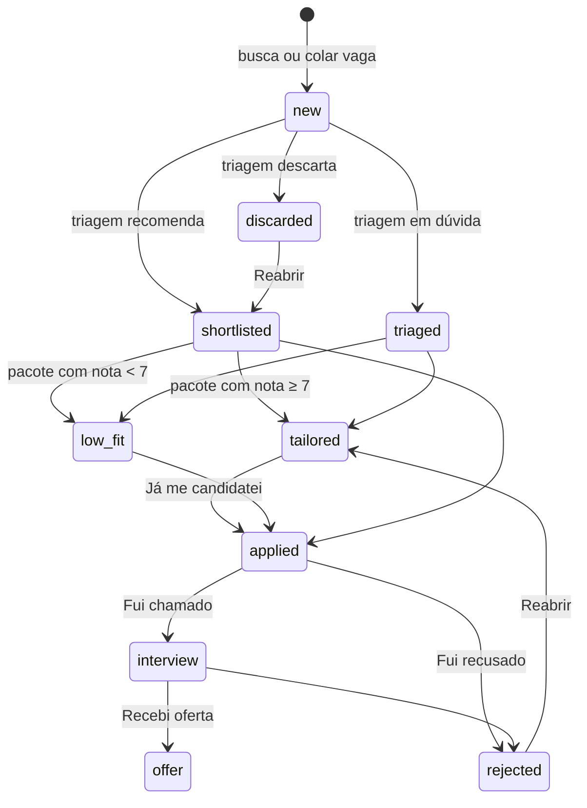
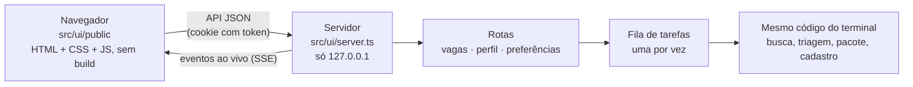

# Como funciona

Como o auto-job-finder vai de "tenho um currículo" a "pacote pronto para enviar", e como o código está organizado. Para usar, veja o [guia de uso](guia-de-uso.md).

- [Visão geral](#visão-geral)
- [1. Perfil: a fonte única de verdade](#1-perfil-a-fonte-única-de-verdade)
- [2. Busca e filtro](#2-busca-e-filtro)
- [3. Triagem pela IA](#3-triagem-pela-ia)
- [4. O pacote de cada vaga](#4-o-pacote-de-cada-vaga)
- [Anti-invenção](#anti-invenção)
- [O caminho de uma vaga](#o-caminho-de-uma-vaga)
- [As IAs](#as-ias)
- [A interface local](#a-interface-local)
- [Organização do código](#organização-do-código)

## Visão geral



O agente **prepara**; quem envia é sempre você. Ele não envia candidatura, não manda e-mail e não muda o seu LinkedIn.

## 1. Perfil: a fonte única de verdade

O cadastro (pela interface ou `ajf init`, em `src/onboarding/`) transforma o que você mandou em arquivos que o resto do agente consulta:

| Arquivo | O que é |
|---|---|
| `profile/profile_truth.md` | Os fatos da sua carreira, em seções: experiências, projetos, formação, competências, idiomas. Também tem **Lacunas**, **A confirmar**, **Nunca afirmar** e **Regras de comunicação**, que **não** contam como evidência |
| `profile/base_resume.pt.json` · `.en.json` | Currículos-base estruturados em português e inglês |
| `profile/rules.json` | Frases que o agente nunca pode escrever (ex.: "inglês fluente" quando o nível é intermediário) |
| `profile/preferences.json` | Cargos, termos de busca, filtros, regiões, cidades e fontes |

Como funciona a montagem:
1. A IA lê as fontes e devolve o que entendeu, mais até 8 perguntas sobre o que falta (`readIntake`).
2. Com as respostas e as suas escolhas, monta o `profile_truth.md`, as regras e os termos de busca (`buildProfile`).
3. Escreve os currículos-base (`buildBaseResume`).

A instrução para a IA é a mesma em todas as etapas: **só registrar o que está nas fontes**. O que falta ou diverge entre as fontes vira "A confirmar".

## 2. Busca e filtro

`src/jobs/search.ts` junta as vagas de todas as fontes ligadas nas preferências (`src/jobs/sources/`) e, se você pedir, da busca na web feita pela IA.

Antes de gastar IA, um **filtro determinístico** (`src/jobs/filter.ts`) corta as vagas que não fazem sentido:
- título sem nenhum dos cargos-alvo, ou com palavra excluída;
- empresa que você não quer;
- vaga publicada há mais dias que o limite;
- presencial ou híbrida fora das suas cidades;
- remota, mas restrita a países que você não aceitou.

As vagas que passam vão para `data/jobs.json` com status `new`. Vagas repetidas (mesmo link, ou mesma empresa e cargo) são ignoradas.

## 3. Triagem pela IA

`src/jobs/triage.ts` manda as vagas novas para a IA em lotes de 6, junto com o seu perfil. Para cada uma, ela devolve:

- **aderência** (alta, média ou baixa) e uma **nota de 0 a 100**;
- **evidências:** trechos do seu perfil que comprovam os requisitos;
- **lacunas:** requisitos obrigatórios sem evidência. São só registradas, nunca preenchidas;
- **sinais de golpe:** pedido de pagamento ou documentos, salário irreal, teste que manda baixar e rodar código;
- **mercado** (BR, US, UK, EU, LATAM...), idioma e senioridade;
- **recomendação:** `candidatar` vira "Para decidir" com ⭐, `decidir` fica em "Para decidir", e `descartar` vai para "Encerradas".

## 4. O pacote de cada vaga

`src/tailor/index.ts#tailorJob` gera o pacote em 6 passos:



- **Loop recrutador ⇄ editor** (`src/tailor/refine.ts`): um agente faz o papel de recrutador e dá nota ao currículo; outro corrige. O loop para quando:
  - atinge a meta (8,5);
  - atinge o limite de revisões (3);
  - ou **para de melhorar**, porque insistir numa lacuna real empurra o modelo a inventar.

  No fim, fica sempre a **melhor versão sem violações**, não necessariamente a última.
- **Mercado** (`src/market.ts`): define papel (A4 ou Letter), idioma, nome do arquivo e se vai carta. Nos EUA: currículo + carta, papel Letter, sem foto, idade ou estado civil.
- **ATS** (`src/tailor/ats.ts`): compara as palavras-chave da vaga com o currículo, em três grupos: *coberto*, *você tem mas não mostrou* e *lacuna real*.
- **LEIA-ME:** explica como se candidatar pelo canal certo (e-mail, LinkedIn, plataforma, site ou WhatsApp), com checklist antes de enviar.

## Anti-invenção

A regra de ouro: **só fatos do `profile_truth.md` e dos currículos-base**. Ela não depende de a IA "se comportar"; está em código, em `src/tailor/guards.ts`, e roda em cada versão do currículo:

| Trava | O que barra |
|---|---|
| Número sem fonte | Qualquer número (%, valores, quantidades) que não aparece nas fontes |
| Posição removida ou inventada | Tirar uma experiência da base ou criar uma que não existe |
| Datas e cargos | Mudar datas ou o título de um cargo |
| Certificação e projeto sem fonte | Certificação ou projeto que não está no perfil |
| Frases proibidas | Tudo o que está em `rules.json → neverClaim` |

As seções "Lacunas", "A confirmar", "Nunca afirmar" e "Regras de comunicação" ficam **fora** do texto usado como evidência (`src/profile.ts#NON_EVIDENCE_HEADING`). Assim, "Kubernetes: sem experiência" não vira prova de que você sabe Kubernetes.

Um pacote com violação nunca fica "pronto". O `coverage_review.md` mostra o que foi barrado.

## O caminho de uma vaga



Cada mudança de status:
- passa por `src/jobs/status.ts#changeStatus`;
- fica registrada em `output/tracker.csv`;
- move a pasta do pacote para a subpasta da etapa (`src/jobs/folders.ts`), mantendo os caminhos em `data/jobs.json` em sincronia.

## As IAs

Todas as chamadas passam por `src/llm.ts`, então os provedores são intercambiáveis. A detecção (`src/providers/index.ts`) procura nesta ordem:

1. **Assinaturas**, sem custo extra:
   - `claude-code`: CLI `claude -p --json-schema`;
   - `codex`: `codex exec --output-schema`;
   - `gemini-cli`: `gemini -p -o json` + validação com Zod.
2. **APIs:**
   - `anthropic`, `bedrock` e `vertex`, pelos SDKs oficiais;
   - `openai`: Responses API, ou Chat Completions com `OPENAI_BASE_URL` para OpenRouter, Groq e Ollama;
   - `gemini`: REST.

As CLIs rodam numa pasta temporária vazia e isolada, sem acesso aos seus arquivos. `AJF_PROVIDER` força uma IA específica.

## A interface local



- **Segurança:**
  - o servidor só escuta em `127.0.0.1`;
  - só aceita quem abriu pelo link com token, que vira um cookie `SameSite=Strict`;
  - confere Host e Origin, para nenhum site aberto no navegador conseguir mandar ações;
  - arquivos só são servidos de dentro de `output/`.
- **Fila de tarefas** (`src/ui/tasks.ts`): busca, pacotes e cadastro rodam um de cada vez, porque usam a mesma IA, o mesmo navegador para PDF e o mesmo `jobs.json`. O que a tarefa escreveria no terminal vira o andamento ao vivo na tela. Entre uma tarefa e outra, o navegador do PDF é fechado.
- **Mesmas ações do terminal:** a interface chama as mesmas funções do `ajf` e do menu (`src/menu.ts`). Nada de lógica duplicada.

## Organização do código

```
src/
  cli.ts                 comandos do terminal (commander)
  menu.ts                menu interativo no terminal
  auto.ts                piloto automático: busca → triagem → pacotes → painel
  dashboard.ts           output/painel.html (resumo estático)
  tracker.ts             output/tracker.csv (histórico de status)
  llm.ts                 ponto único de acesso à IA
  providers/             cada IA + detecção (spawn.ts acha as CLIs instaladas)
  onboarding/            cadastro: leitura de PDF/DOCX/LinkedIn/sites/GitHub, entrevista, montagem
  profile.ts             leitura do perfil, preferências e regras
  prompts.ts · schemas.ts · market.ts
  jobs/
    sources/             fontes de vagas (APIs públicas, páginas de carreira, web com IA)
    search.ts filter.ts  busca e filtro
    triage.ts            triagem pela IA
    store.ts             data/jobs.json
    status.ts folders.ts mudança de status e pastas por etapa
  tailor/
    index.ts             o pacote (tailorJob, guia de entrevista, PDF de novo)
    agents.ts            analista, estrategista, recrutador, editor, enxugador
    refine.ts            loop recrutador ⇄ editor
    guards.ts            travas anti-invenção
    ats.ts               relatório ATS
  writers/               carta, e-mails, guia de entrevista, plano de LinkedIn
  render/                template HTML → PDF (navegador headless)
  ui/
    server.ts http.ts    servidor local, segurança, arquivos
    routes/              API: vagas, perfil e cadastro, preferências
    tasks.ts             fila de tarefas
    public/              a página: index.html, app.css, logo.svg, js/
  util/                  texto, abrir links e pastas (sem shell)
scripts/demo.ts          npm run demo: dados fictícios para testar a interface
examples/profile/        perfil fictício (referência de formato e testes)
tests/                   testes offline (npm test)
```

Quer contribuir? Veja o [CONTRIBUTING.md](../CONTRIBUTING.md).
