# Guia de uso

[English](user-guide.md) · **Português**

Tudo o que você precisa para usar o auto-job-finder, do zero até a candidatura enviada. Os prints usam a demonstração (`npm run demo`), com uma pessoa e empresas fictícias.

> **A interface existe em português e em inglês.** Para trocar, use o **🌐** no pé da barra lateral (veja [Idioma da interface](#idioma-da-interface)). Currículos, cartas e e-mails saem no idioma de cada vaga, qualquer que seja o idioma da interface.

- [1. Instalar](#1-instalar)
- [2. Experimentar sem configurar nada](#2-experimentar-sem-configurar-nada)
- [3. Montar o seu perfil](#3-montar-o-seu-perfil)
- [4. O dia a dia: das vagas à candidatura](#4-o-dia-a-dia-das-vagas-à-candidatura)
- [5. Detalhes da vaga e o pacote](#5-detalhes-da-vaga-e-o-pacote)
- [6. Atalhos e paleta de comandos](#6-atalhos-e-paleta-de-comandos)
- [7. Preferências de busca](#7-preferências-de-busca)
- [8. LinkedIn](#8-linkedin)
- [9. A IA: escolher, testar e diagnosticar](#9-a-ia-escolher-testar-e-diagnosticar)
- [10. Onde ficam os arquivos](#10-onde-ficam-os-arquivos)
- [11. Pelo terminal](#11-pelo-terminal)
- [12. Dúvidas e problemas](#12-dúvidas-e-problemas)

---

## 1. Instalar

Você precisa de três coisas:

1. **Node.js 22.12 ou mais novo.** Baixe a versão LTS em [nodejs.org](https://nodejs.org). Para conferir, rode `node -v` no terminal.
2. **Um navegador Chromium:** Chrome, Edge, Chromium ou Brave. Ele é usado para gerar os PDFs. Na maioria dos computadores já tem.
3. **Uma IA.** O mais simples é usar uma assinatura que você já tenha, sem chave de API:

   | Você tem | O que fazer |
   |---|---|
   | Claude Pro ou Max | Instale o [Claude Code](https://claude.com/claude-code) e rode `claude` uma vez para entrar na conta |
   | ChatGPT Plus ou Pro | `npm i -g @openai/codex` e depois `codex login` |
   | Conta Google | `npm i -g @google/gemini-cli` e rode `gemini` uma vez para entrar |
   | Chave de API | Coloque no arquivo `.env` (veja o [`.env.example`](../.env.example)): Anthropic, OpenAI ou compatível (OpenRouter, Groq, Ollama), Gemini, Bedrock ou Vertex |

Depois, baixe o projeto e instale:

```bash
git clone https://github.com/GabrielMello1407/auto-job-finder.git
cd auto-job-finder
npm install
npm link        # opcional: libera o comando `ajf` em qualquer pasta
```

Sem o `npm link`, troque `ajf` por `npm run ajf --` nos exemplos (ex.: `npm run ajf -- menu`).

Para abrir:

```bash
ajf
```

O terminal mostra um link e o navegador abre sozinho. **Deixe o terminal aberto** enquanto usa; para fechar, Ctrl+C.

> A interface só funciona na sua máquina (`127.0.0.1`) e só abre pelo link com token que o terminal mostra. Nenhum site aberto no navegador consegue mexer nas suas vagas.

## 2. Experimentar sem configurar nada

```bash
npm run demo
```

Abre a interface com a **Ana Souza**, uma pessoa fictícia, e 15 vagas inventadas em todas as etapas. Não usa IA nem os seus dados. É a melhor forma de conhecer as telas antes de montar o seu perfil. A demonstração fica na pasta `demo/` e é recriada a cada execução.

## 3. Montar o seu perfil

Na primeira vez, `ajf` abre direto no cadastro. Ele tem cinco etapas.

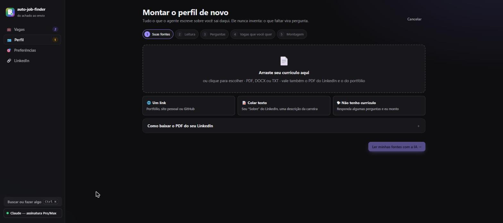

1. **Suas fontes.** Mande o que você tiver, uma ou várias:
   - **Currículo ou portfólio:** arraste o PDF, DOCX ou TXT.
   - **PDF do LinkedIn:** o LinkedIn não deixa programas lerem o perfil. Abra o seu perfil → **Mais** (ou **Recursos**) → **Salvar como PDF**, e arraste o arquivo. O agente reconhece esse PDF.
   - **Um link:** portfólio, site pessoal (inclusive feito em React ou Vue) ou o seu GitHub, de onde ele lê os repositórios públicos.
   - **Colar texto:** o seu "Sobre", uma descrição da carreira.
   - **Não tenho currículo:** responda perguntas sobre experiências, formação, cursos, ferramentas e idiomas.
2. **Leitura.** A IA lê tudo e resume o que entendeu.
3. **Perguntas.** Até 8 perguntas sobre o que falta: datas, resultados com números, se um curso é certificação oficial, divergências entre as fontes. O que você deixar em branco vira um ponto "a confirmar".
4. **Vagas que você quer.** Cargos (com sugestões), senioridade, modalidade (só remoto, remoto ou presencial na sua região, ou qualquer uma), cidades, país e se aceita empresas de fora.
5. **Montagem.** Leva alguns minutos. Saem o seu `profile_truth.md`, os currículos-base em português e inglês, as preferências de busca e as regras do que o agente nunca pode afirmar.

### Revise o perfil

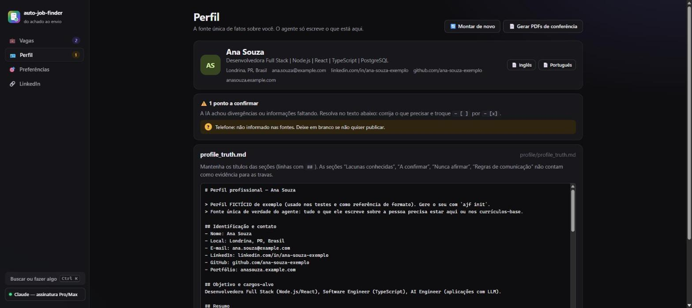

A página **Perfil** é a parte mais importante. **Tudo o que o agente escreve sobre você sai daqui**:

- **Pontos a confirmar:** a IA marca o que estava faltando ou não batia entre as fontes. Corrija no texto e troque `- [ ]` por `- [x]`.
- **Editor do `profile_truth.md`:** ajuste o que quiser. Mantenha os títulos das seções (linhas com `##`). As seções "Lacunas", "A confirmar", "Nunca afirmar" e "Regras de comunicação" **não** contam como prova de nada; elas existem para o agente saber o que você *não* tem. Cada vez que você salva, a versão anterior vai para `profile/backup-edicoes/`.
- **PDFs de conferência:** o currículo-base em português e em inglês, para ver como fica.
- **Montar de novo:** refaz o perfil do zero com fontes novas. O atual só é trocado no fim e vai para um backup.

### Atualizar o perfil depois

Fez um projeto novo, mudou de emprego, terminou um curso? Não precisa montar tudo de novo. Em **Perfil → 🆕 Atualizar o perfil**, clique em **➕ Contar uma novidade**:

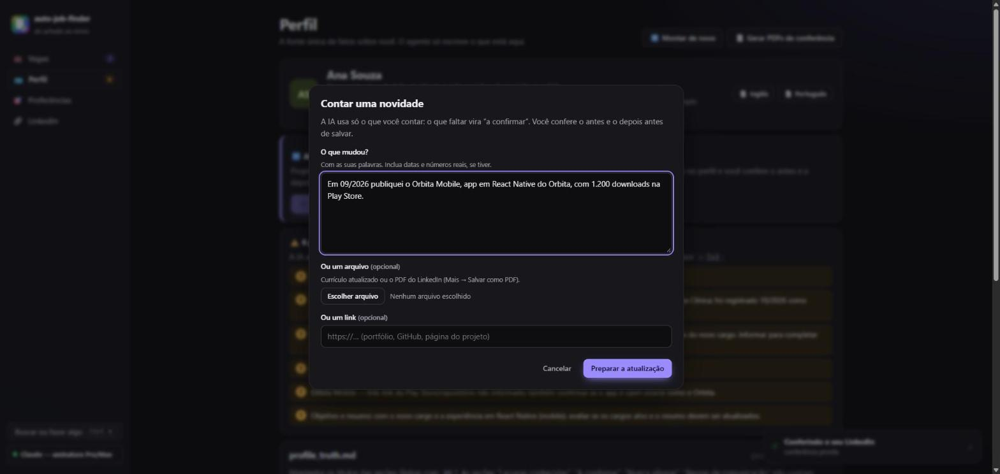

1. **Conte com as suas palavras**, com datas e números reais (por exemplo, "Em 10/2026 saí da Empresa A e entrei na Empresa B como Desenvolvedora Pleno"). Também dá para mandar um currículo atualizado, o PDF do LinkedIn ou um link.
2. **A IA prepara uma proposta.** Ela usa só o que você contou: o que faltar (a data de início, as atividades do cargo novo) vira "a confirmar". Ela também revisa as frases de **nunca afirmar**: tira a que a novidade derrubou (por exemplo, "ISO 27001" quando você conta que trabalhou com a norma) e acrescenta o que a novidade pede (por exemplo, "certificação AWS" quando você fez só o curso). Essas mudanças aparecem na lista do que muda.
3. **Você confere o antes e o depois**, linha por linha, antes de salvar:

   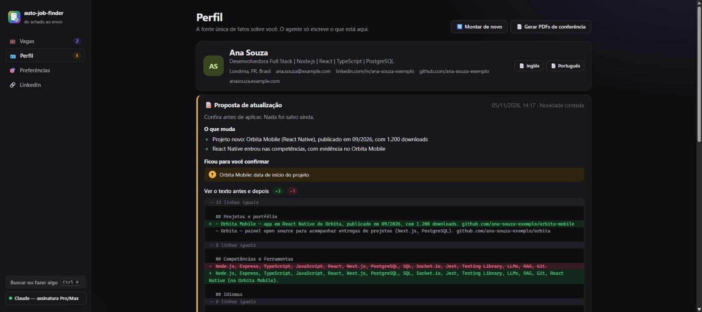

4. **✅ Aplicar e refazer os currículos:** o perfil atual vai para um backup, o `profile_truth.md` e o `rules.json` são atualizados e os currículos-base em português e inglês são refeitos, mantendo a redação do que não mudou. Leva alguns minutos.

Depois de aplicar:
- **Pacotes prontos feitos antes da mudança** aparecem com o aviso **"perfil mudou depois"** e o botão **🔄 Gerar de novo**. Candidaturas já enviadas não são marcadas.
- **O plano do LinkedIn** avisa que ficou desatualizado (veja [LinkedIn](#8-linkedin)).

**Editou o texto do perfil à mão?** Pequenas mudanças (um projeto, um resultado, uma ferramenta) já valem para os próximos pacotes. Mas, se você mexeu numa **experiência** (emprego novo, cargo, datas), clique em **🔄 Refazer currículos-base**: as travas só aceitam experiências que estão nos currículos-base, e eles não mudam sozinhos quando você edita o texto. Se uma trava barrar algo que agora é verdade, confira o `profile/rules.json`: editando o texto à mão, as frases de "nunca afirmar" não são revisadas.

> Se você editar o perfil depois de uma proposta pronta, ela não pode mais ser aplicada: descarte e conte a novidade de novo. Assim nada do que você editou à mão se perde.

## 4. O dia a dia: das vagas à candidatura

A página **Vagas** é um funil com cinco etapas. Clique numa etapa para ver as vagas dela.

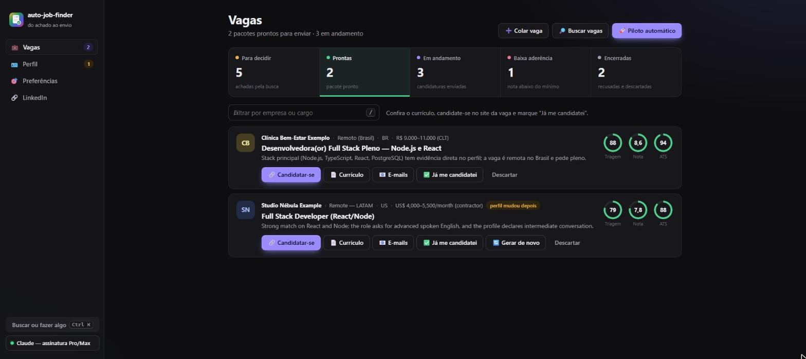

| Etapa | O que tem | O que você faz |
|---|---|---|
| **Para decidir** | Vagas que a busca achou, já avaliadas pela IA | Gerar o pacote das boas, descartar o resto |
| **Prontas** | Pacote pronto (currículo, carta, e-mails) com nota ≥ 7 | Conferir, candidatar-se e marcar "Já me candidatei" |
| **Em andamento** | Candidaturas enviadas, entrevistas e ofertas | Mandar follow-up, registrar entrevista, oferta ou recusa |
| **Baixa aderência** | Pacotes com nota abaixo do mínimo | Ver por quê; a decisão de enviar é sua |
| **Encerradas** | Recusadas e descartadas | Reabrir, se mudar de ideia |

Cada vaga mostra três indicadores:
- **Triagem (0–100):** o quanto a vaga combina com o seu perfil, na avaliação da IA.
- **Nota (0–10):** a nota final do currículo adaptado, dada por um "recrutador" simulado.
- **ATS (%):** quanto das palavras-chave da vaga aparece no currículo.

### Achar vagas

- **🔎 Buscar vagas:** procura nas fontes das suas [preferências](#7-preferências-de-busca), e a IA avalia cada vaga nova. Ligue **busca na web com IA** para incluir LinkedIn, Gupy, Indeed e sites de empresas; dá para acrescentar uma instrução, como "só vagas em Londrina".
- **🚀 Piloto automático:** busca, avalia e já gera os pacotes das melhores vagas (triagem ≥ 70 e sem sinal de golpe). Você escolhe quantos pacotes no máximo. Vaga que já acabou é descartada e o piloto passa para a próxima, sem gastar um dos pacotes.

A busca não traz a mesma vaga duas vezes: a que aparece de novo em outro site (mesma empresa, mesmo cargo, mesmo texto) entra direto em "Encerradas", marcada com **🔁 repetida**, e não é avaliada nem vira outro pacote. Vale também para vagas em que você já se candidatou: aí basta a mesma empresa e o mesmo cargo. Se o agente errar, abra a vaga e clique em **↩ Reabrir** (ou **Não é a mesma vaga**, se ela já tem pacote).
- **➕ Colar vaga:** para a vaga que você viu no LinkedIn, num grupo de WhatsApp ou numa indicação. Cole o texto completo ou, se a página abre sem login (Gupy, site da empresa), só o link.

#### Vaga sem link (indicação, e-mail, WhatsApp)

Um amigo mandou "a Empresa X está contratando, manda o currículo para rh@empresax.com.br"? Use **➕ Colar vaga** do mesmo jeito: cole tudo o que você recebeu (requisitos, como é a equipe, e-mail, prazo), preencha empresa e cargo e deixe o link em branco.

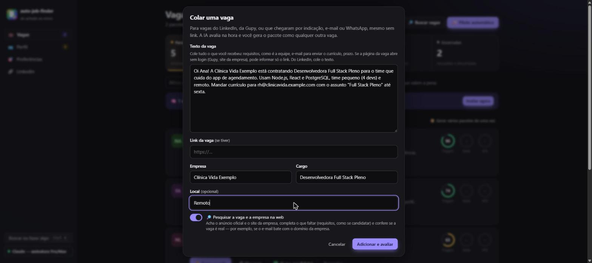

Com **🔎 Pesquisar a vaga e a empresa na web** ligado (vem ligado quando a IA faz busca na web), antes da triagem o agente:
- procura o **anúncio oficial** da mesma vaga (site de carreiras, Gupy, LinkedIn…) e o **site da empresa**;
- acrescenta o que o anúncio traz e o texto recebido não trazia (requisitos, etapas, como se candidatar);
- **confere se a vaga é real**: e-mail de contato fora do domínio da empresa, empresa que não aparece em lugar nenhum, pedido de taxa ou documentos;
- guarda a **missão e os valores** da empresa como a página oficial escreve (site, "sobre nós", página de carreiras), cada um com o link da página. Avaliações, notícias e o que não tem link oficial ficam de fora.

Se achar, a vaga ganha **✓ vaga confirmada na web** e o link oficial vira o **Ver vaga**. Se não achar, ela segue só com o que você colou (**não achada na web**), e a triagem e o pacote funcionam do mesmo jeito. Com sinais de golpe, aparece **🚩 vaga suspeita**.

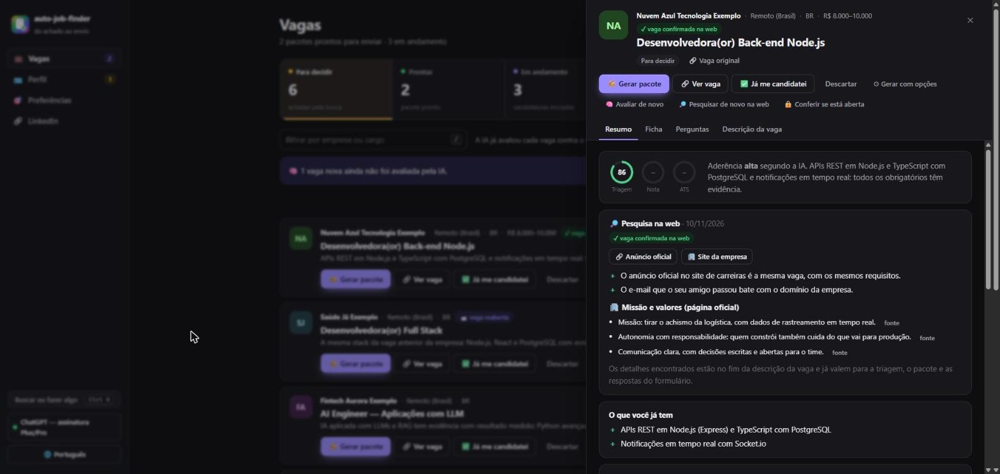

O que foi achado fica no fim da **Descrição da vaga**, marcado como pesquisa, e passa a valer para a triagem e o pacote; nada é inventado. Nos detalhes de qualquer vaga, **🔎 Pesquisar na web** faz a mesma pesquisa depois (e refaz a triagem se o pacote ainda não foi gerado). Se o canal for e-mail, o pacote já traz o e-mail de candidatura pronto para você enviar.

### Decidir

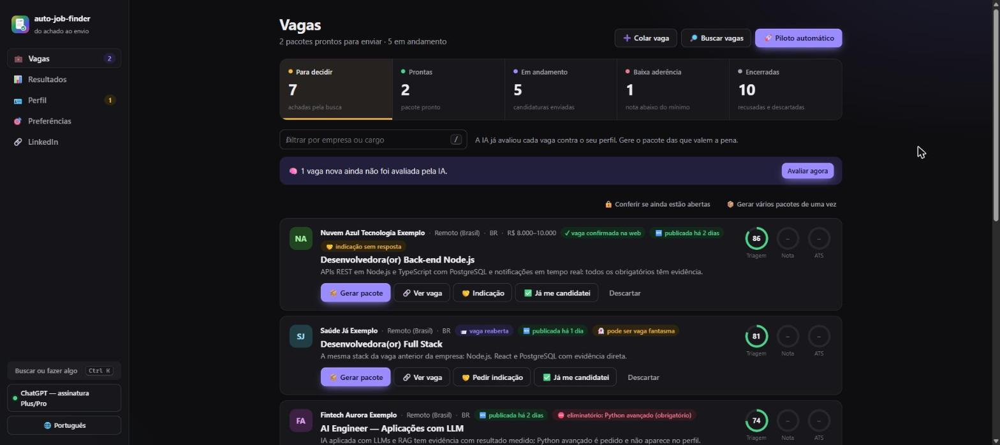

Em **Para decidir**, as vagas recomendadas aparecem primeiro. Você pode:
- **📦 Gerar pacote:** cria o currículo adaptado, a carta (quando o mercado pede), os e-mails e os relatórios. Leva alguns minutos e roda em segundo plano.
- **📦 Gerar vários pacotes de uma vez:** marque as vagas numa lista.
- **✅ Já me candidatei:** se você se candidatou sem pacote.
- **Descartar**, com "Desfazer" logo em seguida.

Vagas com **🚩 sinais de golpe** (pedido de pagamento, documentos ou salário fora da realidade) aparecem marcadas. Desconfie.

**Vaga encerrada.** Antes de gerar o pacote, o agente abre o link da vaga e procura sinais de que ela acabou: página que não existe mais, prazo de inscrição vencido, "vaga encerrada" ou "no longer accepting applications" na página. Se achar, não gasta a IA: a vaga fica com **🔒 vaga encerrada** e o motivo, e o botão vira **📦 Gerar mesmo assim**, para quando você conferiu e ela ainda está aberta. Sem certeza (site que bloqueia robôs ou pede login), segue normalmente.

**🔒 Conferir se ainda estão abertas**, em "Para decidir" e em "Prontas", confere de uma vez todas as vagas que você ainda não enviou. As encerradas sem pacote vão para "Encerradas" (dá para reabrir); as que já têm pacote ficam onde estão, marcadas. Nos detalhes de uma vaga, **🔒 Conferir se está aberta** faz o mesmo só com ela.

### Candidatar-se

Em **Prontas**:
1. Abra o **📄 Currículo** e confira o PDF inteiro.
2. Candidate-se pelo canal da vaga:
   - **Plataforma ou formulário** (Gupy, InHire, Greenhouse, Workday, site da empresa): clique em **🔗 Candidatar-se** e deixe aberta ao lado a **📋 Ficha**, com cada campo que esses formulários pedem de novo, um botão de copiar em cada (veja [Ficha de candidatura](#ficha-de-candidatura)).
   - **E-mail:** na aba **E-mails**, **✉️ Abrir no programa de e-mail, com o currículo anexado** abre o e-mail pronto (destinatário, assunto, texto e o PDF). Usa o Gmail pelo navegador? **Abrir no Gmail** abre o e-mail preenchido; arraste o PDF da **📁 Pasta do PDF**.
   - **LinkedIn:** as mensagens estão na aba **E-mails**.
3. O formulário pede algo como "Por que você quer trabalhar aqui?"? Use a aba **Perguntas** da vaga (veja [Perguntas do formulário](#perguntas-do-formulário)).
4. Depois de enviar, clique em **✅ Já me candidatei** e marque **por onde** foi (plataforma, e-mail, LinkedIn, site, WhatsApp, indicação). O canal provável já vem marcado. Com isso dá para ver depois qual canal responde mais.

**O agente nunca envia nada sozinho.** Ele prepara; você revisa e envia.

#### Ficha de candidatura

Formulários de plataforma pedem de novo o que já está no currículo: nome, telefone, LinkedIn, um resumo com limite de caracteres e cada experiência, campo por campo. A aba **📋 Ficha** da vaga traz tudo pronto para copiar:
- dados pessoais (nome e sobrenome separados, telefone também só com números);
- o resumo em três tamanhos (até 300 e até 600 caracteres, e o completo), cortado em frases inteiras;
- cada experiência: cargo, empresa, local, modalidade, início, fim, "trabalho aqui atualmente" e a descrição;
- formação, certificações, idiomas, competências e projetos.

Tudo sai do currículo adaptado para a vaga (ou do currículo-base, antes do pacote), sem nada novo. A mesma ficha fica em `ficha_de_candidatura.md`, na pasta do pacote.

### Acompanhar

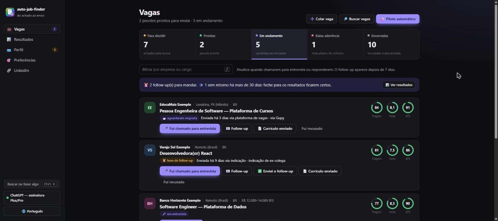

Em **Em andamento**:
- Depois de 7 dias aparece **⏰ hora do follow-up**. O e-mail de follow-up já está pronto em **📧 Follow-up**.
- **🎤 Fui chamado para entrevista:** a vaga vai para "em entrevista", e o agente oferece um **guia de entrevista** com perguntas prováveis e respostas baseadas no currículo que você enviou.
- **🎉 Recebi oferta** e **Fui recusado** registram o resultado.

Toda mudança de status fica registrada em `output/tracker.csv`, que abre no Excel ou no Google Sheets.

## 5. Detalhes da vaga e o pacote

Clique no título de uma vaga para abrir os detalhes.

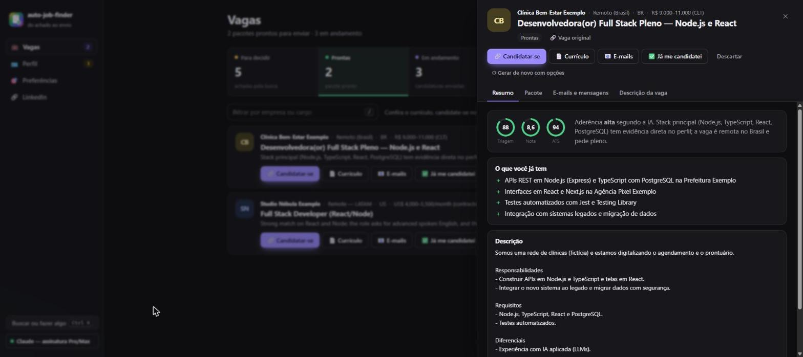

- **Resumo:** a avaliação da IA, o que você já tem (com evidência no perfil), as lacunas e a descrição.
- **Pacote:** os arquivos, o LEIA-ME com o passo a passo de candidatura e os relatórios (ATS, nota do recrutador e conferência com o perfil).
- **E-mails e mensagens:** candidatura, convite e mensagem no LinkedIn, follow-up e agradecimento, cada assunto e cada mensagem com botão de copiar. No topo, **✉️ Abrir no programa de e-mail, com o currículo anexado** abre o e-mail de candidatura pronto, com destinatário (se a vaga traz um e-mail de contato), assunto, texto e o PDF; o Outlook já abre para enviar. **Abrir no Gmail** (em cada e-mail) abre o Gmail pelo navegador com tudo preenchido, menos o anexo: arraste o PDF da **📁 Pasta do PDF**. Você confere e envia.
- **Ficha:** os campos dos formulários de candidatura, prontos para copiar (veja [Ficha de candidatura](#ficha-de-candidatura)).
- **Entrevista:** o guia, quando existir.
- **Perguntas:** respostas para as perguntas do formulário de candidatura (veja abaixo).

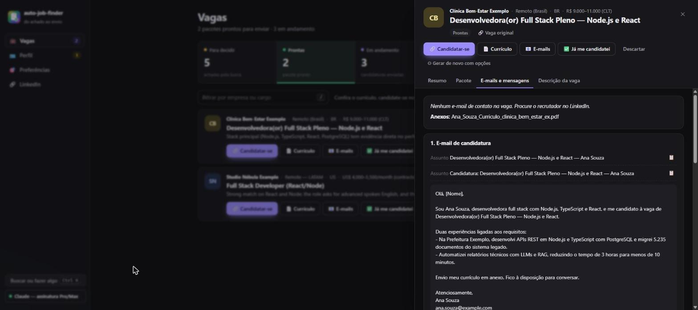

### Perguntas do formulário

Muitos formulários pedem mais que o currículo: "Por que você quer trabalhar aqui?", "Fale de um projeto de que você se orgulha", "O que você acha do nosso app?". Na aba **Perguntas** da vaga:

1. **Cole a pergunta.** Se o campo tiver limite de caracteres, informe. Se quiser, conte algo que só você sabe (motivação, opinião sobre o produto).
2. **✍️ Responder.** Em alguns segundos sai a resposta, no idioma da pergunta. Ela usa fatos do seu perfil e o que a vaga diz da empresa, e passa pelas mesmas travas do currículo (número sem fonte, frases de "nunca afirmar").
3. **Ajuste conversando.** No campo **Ajustar**, peça "mais curto", "cite o projeto X", "em inglês", ou responda o que a IA pediu em **Para ficar com a sua cara, conte**. O que você conta ali vale como fato seu nos próximos ajustes.
4. **📋 Copiar** e colar no formulário.

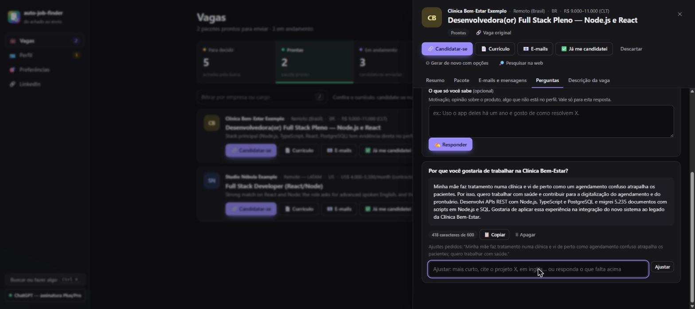

Para escrever, a IA usa a vaga (com a pesquisa na web, se houver), o currículo enviado para ela e o seu perfil, e também o que a análise do pacote achou: o que a empresa faz e valoriza, os requisitos obrigatórios e os diferenciais, e as provas e lacunas da triagem. Ela escolhe as provas do seu perfil que atendem um requisito ou algo que a empresa valoriza, e nunca afirma uma lacuna.

**Perguntas sobre a empresa.** Em "por que essa empresa?", "o que você sabe da nossa cultura?" e afins, o agente confere antes se a missão e os valores da empresa já foram pesquisados. Se não, ele sugere **🔎 Pesquisar primeiro** (cerca de um minuto; depois clique em **✍️ Responder** de novo, a pergunta continua no campo) ou **Responder só com o anúncio**. Com a missão e os valores pesquisados, a resposta pode citar um deles com as palavras da página, ligado a algo concreto que você fez.

Quando a pergunta pede algo que só você sabe (por que essa empresa, pretensão salarial, opinião sobre o produto), a IA escreve o que dá com os fatos e diz o que você precisa contar. Ela nunca inventa motivação, experiência com o produto ou valor de salário.

As respostas ficam salvas na vaga e em `perguntas_e_respostas.md`, na pasta do pacote. Também dá para usar no terminal: `ajf responder <empresa>`, ou **📝 Responder pergunta do formulário** no `ajf menu`.

Mais opções nos detalhes:
- **⚙ Gerar com opções:** escolha idioma, papel (A4 ou Letter), mercado e se quer carta de apresentação.

  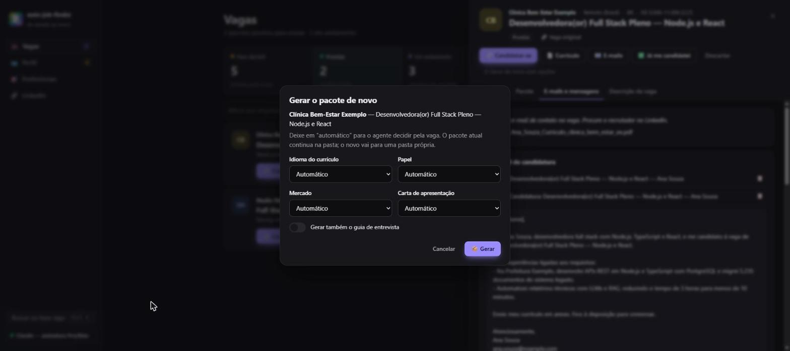

- **🧠 Avaliar de novo:** refaz a triagem (só antes do pacote).
- **🔎 Pesquisar na web:** acha o anúncio oficial e o site da empresa e confere se a vaga é real ([vaga sem link](#vaga-sem-link-indicação-e-mail-whatsapp)).
- **🔄 Gerar o PDF de novo:** depois de editar o `resume.json` da pasta do pacote à mão.

## 6. Atalhos e paleta de comandos

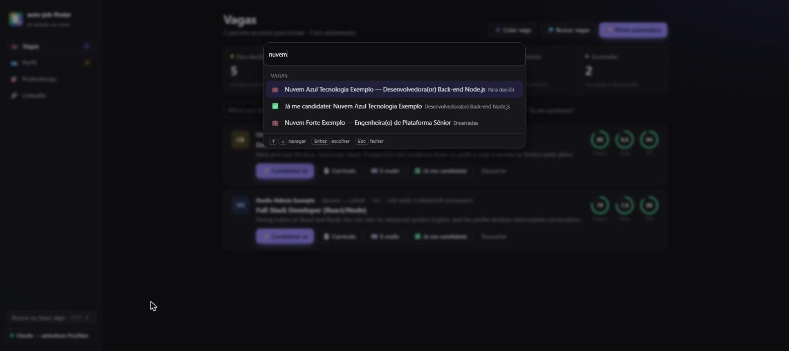

- **Ctrl+K** (⌘K no Mac): digite parte do nome de uma empresa para abrir a vaga ou marcar "Já me candidatei", ou o nome de uma ação ("buscar", "piloto", "preferências").
- Na lista de vagas: **j** e **k** andam entre as vagas, **Enter** abre, **/** vai para o filtro.
- **Esc** fecha janelas e os detalhes.

Tarefas longas (busca, pacotes, cadastro) rodam numa fila, uma de cada vez, com o andamento ao vivo no canto da tela. Você pode continuar usando enquanto isso.

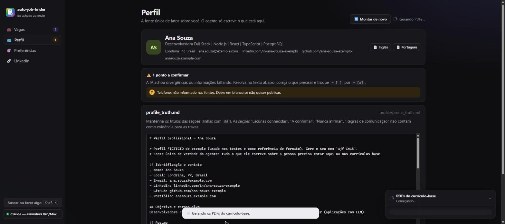

### Idioma da interface

A interface existe em **português** e em **inglês**. Na primeira vez, ela segue o idioma do navegador; para trocar, clique no **🌐** no pé da barra lateral (ou digite "idioma" no **Ctrl+K**), escolha o idioma e clique em **Usar este idioma**. A escolha fica salva neste navegador. No celular, a barra lateral vira uma barra no pé da tela: o **⋯ Mais** abre o mesmo menu, com o idioma e a IA.

O que muda: menus, botões, janelas, avisos e o nome das tarefas. O que não muda:
- **o que vai para o recrutador** (currículo, carta, e-mails, respostas de formulário) sai no idioma de cada vaga;
- **o que a IA escreveu** (o motivo da triagem, o plano do LinkedIn) fica no idioma em que foi escrito;
- **os arquivos da pasta do pacote** (LEIA-ME, `emails.md`, os relatórios), o **andamento das tarefas** no canto da tela e o **terminal** continuam em português por enquanto.

## 7. Preferências de busca

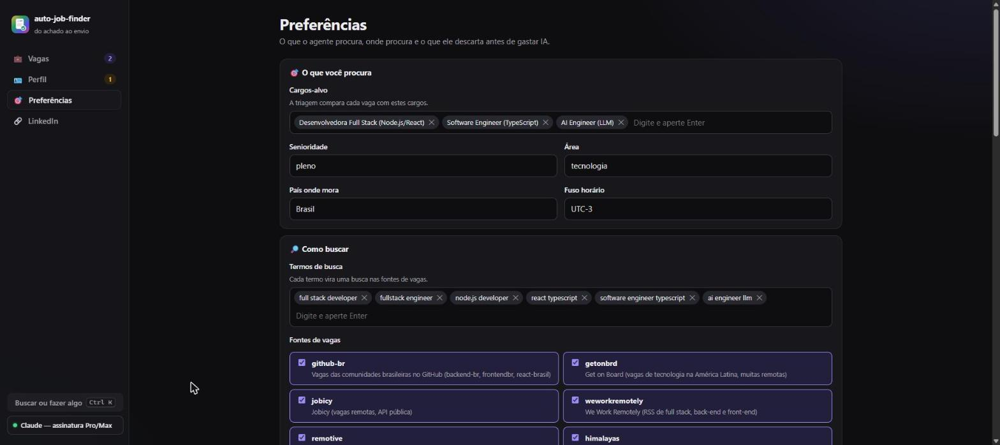

| Seção | Para que serve |
|---|---|
| **O que você procura** | Cargos-alvo e senioridade: a triagem compara cada vaga com eles |
| **Como buscar** | Termos de busca, fontes de vagas, busca na web com IA por padrão e há quantos dias uma vaga pode ter sido publicada |
| **Filtro pelo título** | Palavras que o título precisa ter e palavras que eliminam a vaga. Corta vagas **sem gastar IA** |
| **Onde** | Regiões aceitas em vagas remotas com restrição e cidades para presencial/híbrido |
| **Empresas** | Empresas que você não quer e páginas de carreira (Greenhouse, Lever, Ashby) para monitorar |
| **Notas mínimas** | Triagem mínima para o piloto automático gerar pacote e nota mínima para "pronto para enviar" |

Fontes de vagas:

| Fonte | Foco |
|---|---|
| busca na web com IA | LinkedIn, Gupy, Indeed, Glassdoor, Catho, sites de carreira — **qualquer área** |
| `gupy` | o portal de vagas da Gupy, que boa parte das empresas do Brasil usa — **qualquer área**, sem gastar IA. Só acha vagas com **termos em português** |
| `remotive`, `himalayas`, `jobicy`, `arbeitnow` | remoto internacional, várias áreas |
| `github-br`, `getonbrd`, `remoteok`, `weworkremotely` | tecnologia (Brasil, América Latina, remoto) |
| `greenhouse`, `lever`, `ashby` | páginas de carreira das empresas que você indicar |

**Termos de busca em dois idiomas.** Cada termo vira uma busca em cada fonte. As fontes internacionais acham vagas com termos em inglês ("data analyst"); a Gupy e os sites do Brasil, com termos em português ("analista de dados"). Se você mora no Brasil e aceita vagas de fora, deixe os dois. Quem montou o perfil antes de a Gupy entrar no agente precisa ligá-la aqui, em **Fontes de vagas**.

## 8. LinkedIn

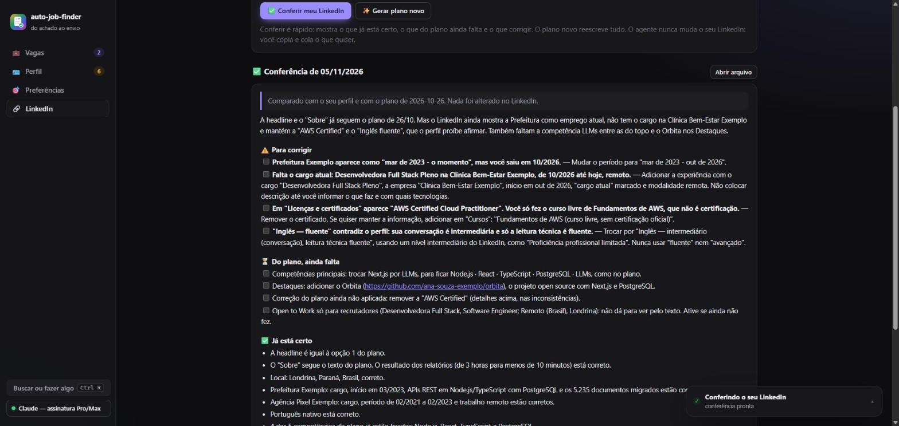

**O agente nunca acessa nem muda o seu LinkedIn.** O LinkedIn bloqueia programas, e a regra do projeto é você aplicar o que quiser. Por isso, para ele saber como o seu perfil está hoje, mande:
- o **PDF do perfil**: no LinkedIn, **Mais → Salvar como PDF**, e depois **📄 Enviar o PDF do LinkedIn**; ou
- o **texto** do perfil, colado na caixa.

Com isso, você tem duas opções:

| | O que faz | Quando usar |
|---|---|---|
| **✅ Conferir meu LinkedIn** | Compara o seu LinkedIn de hoje com o seu perfil e com o último plano. Mostra o que **corrigir** (datas, cargos, "certificado" que é curso, nível de idioma), o que **do plano ainda falta** e o que **já está certo** | Depois de mexer no LinkedIn, para ver o seu progresso. É rápido |
| **✨ Gerar plano novo** | Escreve tudo de novo: headline, "Sobre" em português e inglês, experiências, competências, destaques, Open to Work e checklist | Na primeira vez, ou depois de mudar de objetivo ou de [atualizar o perfil](#atualizar-o-perfil-depois) |

- **Cada plano e cada conferência é um retrato do dia em que foi gerado.** Eles não se atualizam sozinhos.
- **Se o seu perfil mudar depois do plano,** a página avisa e sugere um plano novo.
- **Os anteriores** ficam no **Histórico**.

## 9. A IA: escolher, testar e diagnosticar

O botão no canto inferior da barra lateral mostra qual IA está em uso. Nele você:
- **escolhe** entre as IAs encontradas na máquina;
- **testa** se a IA responde (uma chamada curta);
- vê o **diagnóstico**: navegador para PDF, arquivos do perfil e as notas mínimas.

O agente procura as CLIs (`claude`, `codex`, `gemini`) no PATH, nas pastas de instalação comuns (instalador do Claude Code, Homebrew, nvm, volta, pnpm, npm global, WinGet) e no PATH atual do seu usuário. Se mesmo assim não achar, informe o caminho em `AJF_CLAUDE_BIN`, `AJF_CODEX_BIN` ou `AJF_GEMINI_BIN` no `.env`.

## 10. Onde ficam os arquivos

Tudo fica **só na sua máquina**, fora do git:

```
profile/                   o seu perfil
  profile_truth.md         fatos (fonte única de verdade), lacunas, "a confirmar", "nunca afirmar"
  base_resume.pt.json      currículo-base em português
  base_resume.en.json      currículo-base em inglês
  preferences.json         preferências de busca
  rules.json               frases que o agente nunca pode escrever
  sources/  entrada/       o texto lido das suas fontes e os arquivos enviados pela interface
  atualizacao/             a proposta de atualização, até você aplicar ou descartar
  backup-*/                versões anteriores do perfil (a cada "montar de novo", atualização ou edição)
data/
  jobs.json                todas as vagas e o status de cada uma
  usage.jsonl              tokens usados em cada chamada de IA
output/
  1-prontas-para-enviar/   pacotes prontos, ainda sem candidatura
  2-em-andamento/          enviada, entrevista ou oferta
  3-baixa-aderencia/       nota abaixo do mínimo
  4-encerradas/            recusada ou descartada
  base/  linkedin/         PDFs de conferência, planos e conferências do LinkedIn
  painel.html  tracker.csv resumo estático e histórico de status
```

A pasta de cada pacote muda de lugar sozinha quando o status muda. Dentro dela:

```
LEIA-ME.md                          nota, ATS, COMO SE CANDIDATAR e checklist
<Nome>_Curriculo_<Empresa>.pdf      currículo ATS (Resume_ em vagas de fora)
<Nome>_Cover_Letter_<Empresa>.pdf   quando o mercado pede (EUA, Canadá, Europa) ou você pede
emails.md                           candidatura, LinkedIn, follow-up, agradecimento
rascunho_candidatura.eml            o e-mail de candidatura com o currículo anexado (abre no Outlook e afins)
ficha_de_candidatura.md             os campos dos formulários de candidatura, prontos para copiar
ats_report.md · rating_report.md · coverage_review.md · interview_prep.md
resume.json                         edite à mão e use "Gerar o PDF de novo"
```

**Cover letter × currículo:** nos EUA o padrão é currículo + carta, em papel Letter, sem foto, idade ou estado civil. No Brasil sai o currículo em A4 e a carta é opcional. Vaga em inglês gera currículo em inglês.

Para manter perfis de várias pessoas (por exemplo, ajudar alguém da família), use outra pasta: `AJF_HOME=/caminho/da/pasta`.

## 11. Pelo terminal

Tudo da interface também existe no terminal. O terminal (comandos, menu e mensagens) está em português; só a interface troca de idioma.

- `ajf menu` abre um menu com setas e Enter.
- Os comandos abaixo servem para automatizar ou para quem prefere o terminal:

| Comando | O que faz |
|---|---|
| `ajf` · `ajf ui [--port 4317] [--no-open]` | Interface no navegador |
| `ajf menu` | Menu no terminal |
| `ajf init [arquivos ou links...]` | Monta o perfil do zero |
| `ajf atualizar [arquivos ou links...] [--texto "..."]` | Atualiza o perfil com uma novidade: mostra o antes e o depois e, se você aprovar, refaz os currículos-base. `--aplicar` aplica a proposta salva (feita aqui ou na interface), `--descartar` descarta, `-y` aplica sem perguntar |
| `ajf ia [--escolher] [--testar]` | IAs encontradas e qual usar |
| `ajf doctor` | Confere IA, navegador e arquivos do perfil |
| `ajf base [--refazer]` | PDFs do currículo-base (sem IA). Com `--refazer`, refaz os currículos-base a partir do `profile_truth.md` (usa IA) |
| `ajf search [--web] [--hint "só Londrina"] [-q termos] [-s fontes] [-v]` | Busca vagas (`-v` mostra o que o filtro cortou e de qual vaga cada repetida é cópia) |
| `ajf triage [--id <ids...>] [-l 10]` | Triagem das vagas novas, ou de novo das indicadas |
| `ajf jobs [--status shortlisted] [-a]` · `ajf show <id>` | Lista e detalhes |
| `ajf add --file vaga.md --company X --title Y [--pesquisar]` · `ajf add --url <link>` | Adiciona uma vaga. Com `--pesquisar`, pesquisa a vaga e a empresa na web antes da triagem (vaga sem link) |
| `ajf pesquisar [empresa, cargo ou id]` | Pesquisa na web uma vaga já salva: anúncio oficial, site da empresa, o que faltou no texto e se é real |
| `ajf tailor <id> [--interview] [--market US] [--lang en] [--paper Letter] [--cover/--no-cover] [--mesmo-encerrada]` | Gera o pacote. Antes, confere se a vaga ainda está aberta; `--mesmo-encerrada` gera mesmo assim |
| `ajf conferir [empresa, cargo ou id]` | Confere se as vagas ainda aceitam candidaturas. Sem nada, confere todas que você ainda não enviou |
| `ajf render <pasta ou id>` | PDF de novo depois de editar `resume.json` |
| `ajf responder [empresa, cargo ou id] [-p "pergunta"] [--limite 500] [--contexto "..."] [--pesquisar]` | Responde uma pergunta do formulário de candidatura e deixa ajustar até você dar Enter. Em pergunta sobre a empresa, oferece pesquisar a missão e os valores antes; `--pesquisar` pesquisa sem perguntar |
| `ajf linkedin [--current perfil.pdf]` · `ajf linkedin --conferir --current perfil.pdf` | Plano de LinkedIn, ou a conferência do LinkedIn atual (PDF exportado ou texto em `.md`/`.txt`) |
| `ajf ficha [empresa, cargo ou id]` | Mostra os campos do formulário de candidatura (dados, resumo em 3 tamanhos, cada experiência), prontos para copiar |
| `ajf rascunho [empresa, cargo ou id] [--nao-abrir]` | Abre o e-mail de candidatura no seu programa de e-mail, com o currículo anexado. Quem envia é você |
| `ajf enviei [empresa ou cargo] [--via plataforma\|email\|linkedin\|site\|whatsapp\|indicacao\|outro] [--note "..."]` | Marca que você se candidatou e por onde (acha a vaga pelo nome; sem `--via`, pergunta) |
| `ajf status [empresa, cargo ou id] [status]` | Muda o status (entrevista, oferta, recusa...) |
| `ajf auto [--web/--no-web] [--max 3] [--interview] [--open]` | Piloto automático |
| `ajf painel` | Abre o `output/painel.html`, um resumo que funciona sem o servidor |

O ID da vaga aceita só o começo (`ajf tailor 78cb`).

Configurações extras ficam no `.env` (veja o [`.env.example`](../.env.example)): IA e modelo (`AJF_PROVIDER`, `AJF_MODEL`, `AJF_TRIAGE_MODEL`), notas (`AJF_MIN_RATING`, `AJF_MIN_TRIAGE_SCORE`, `AJF_TARGET_RATING`), por quantos dias a mesma vaga em outro site conta como repetida (`AJF_REPEAT_WINDOW_DAYS`, 90), porta da interface (`AJF_UI_PORT`) e navegador (`CHROME_PATH`).

## 12. Dúvidas e problemas

**A interface não abre ou diz "Abra pelo terminal".**
Rode `ajf` de novo e use o link que aparece no terminal. Por segurança, ela só abre por esse link.

**"Sem conexão com o ajf".**
O terminal onde o `ajf` rodava foi fechado. Rode `ajf` de novo.

**Não encontra a minha IA.**
Abra o botão da IA e veja o diagnóstico. Confira se você já entrou na conta (`claude`, `codex login` ou `gemini`). Se a CLI está instalada num lugar diferente, informe o caminho em `AJF_CLAUDE_BIN` (ou `AJF_CODEX_BIN`, `AJF_GEMINI_BIN`) no `.env`.

**O PDF não é gerado.**
O agente não achou um navegador Chromium. Instale o Chrome, ou informe o caminho do navegador em `CHROME_PATH` no `.env`.

**Aparecem poucas vagas boas.**
- Mora no Brasil? Ligue a fonte **`gupy`** em Preferências e confira se há **termos de busca em português**.
- Ligue a **busca na web com IA**: as fontes padrão são, em boa parte, de vagas internacionais, e a web traz LinkedIn, Gupy e Indeed.
- Veja no andamento da busca quantas vagas cada filtro cortou, e afrouxe os **filtros pelo título** em Preferências.
- Baixe a **triagem mínima** (por exemplo, para 60) e olhe a etapa "Para decidir".

**A mesma vaga aparece duas vezes?**
Não deveria. O agente compara cada vaga nova com todas as salvas, inclusive as que você já enviou: mesmo link, ou mesma empresa, mesmo cargo e mesmo texto em outro site. Se você já se candidatou ou já tem pacote de uma vaga com a mesma empresa e o mesmo cargo, a nova conta como repetida mesmo que o texto venha diferente (a busca na web traz um resumo com outras palavras). A cada busca, ele também confere as vagas que já estavam salvas. A repetida vai para "Encerradas" com **🔁 repetida**, e os detalhes dizem de qual vaga ela é cópia; se ela já tinha pacote, fica onde está, só marcada. Errou? Clique em **↩ Reabrir** ou, numa vaga com pacote, em **Não é a mesma vaga**: o agente não marca essa vaga de novo. Vagas de níveis diferentes (júnior e pleno, "Engineer" e "Senior Engineer") nunca contam como repetidas.

**A empresa abriu de novo uma vaga em que eu já me candidatei.**
Depois de 90 dias da sua candidatura, ou se o anúncio novo foi publicado depois dela, o agente entende que é **outra abertura**: a vaga entra normal, com **📨 vaga reaberta**, e os detalhes mostram quando você se candidatou à antiga e como ela terminou. Assim você decide se vale tentar de novo. Para mudar o prazo, use `AJF_REPEAT_WINDOW_DAYS` no `.env`.

**Gerei o pacote e a vaga já tinha acabado.**
Agora o agente confere antes: se a página diz que a vaga acabou, o pacote não é gerado e a vaga ganha **🔒 vaga encerrada**. Se você tem certeza de que ela está aberta, use **📦 Gerar mesmo assim**. Para limpar a lista de uma vez, use **🔒 Conferir se ainda estão abertas**. Alguns sites (Himalayas, We Work Remotely) não deixam conferir; essas ficam "sem confirmação" e seguem normalmente.

**Fiz um projeto novo ou mudei de emprego. Como atualizo?**
Em **Perfil → ➕ Contar uma novidade** (ou `ajf atualizar --texto "..."`). Você confere o antes e o depois, e os currículos-base são refeitos. Depois, gere de novo os pacotes prontos marcados com "perfil mudou depois". Veja [Atualizar o perfil depois](#atualizar-o-perfil-depois).

**Recebi uma vaga por indicação, sem link. Dá para usar?**
Dá. Em **➕ Colar vaga**, cole o que você recebeu, preencha empresa e cargo e deixe **🔎 Pesquisar a vaga e a empresa na web** ligado: o agente procura o anúncio oficial e o site da empresa, completa o que faltar e confere se a vaga é real. Se não achar nada, a vaga segue com o que você colou. Veja [Vaga sem link](#vaga-sem-link-indicação-e-mail-whatsapp).

**O plano do LinkedIn mostra coisas que eu já mudei.**
O plano é um retrato do dia em que foi gerado, e o agente não acessa o LinkedIn. Mande o PDF ou o texto atual do seu LinkedIn e clique em **✅ Conferir meu LinkedIn**: ele mostra o que já está certo e o que ainda falta. Veja [LinkedIn](#8-linkedin).

**O formulário pergunta por que eu quero trabalhar na empresa. O agente ajuda?**
Ajuda. Na aba **Perguntas** da vaga, cole a pergunta; a IA responde com o seu perfil e o que a vaga diz da empresa, e você ajusta até ficar com a sua cara. Veja [Perguntas do formulário](#perguntas-do-formulário).

**O LinkedIn não é lido.**
O LinkedIn bloqueia leitura automática. No cadastro, use o PDF do perfil (**Mais → Salvar como PDF**); para vagas, cole o texto.

**Quanto custa?**
- **Com assinatura** (Claude, ChatGPT, Gemini), não há cobrança extra; o uso conta no limite da sua conta. Cada pacote faz de 6 a 10 chamadas. Se bater o limite, use um modelo menor em `AJF_MODEL`.
- **Com API**, a triagem custa por volta de US$ 0,02–0,05 por vaga, e um pacote completo, por volta de US$ 0,50–2,00 com modelos de ponta.

O `data/usage.jsonl` registra os tokens de cada chamada.

**A descrição da vaga veio com "Vagas semelhantes", "Salvar", "143 candidaturas"…**
Isso é o resto da página do site (o LinkedIn mostra tudo junto). O agente agora tira esse resto: corta no começo de "Vagas semelhantes" e afins e remove botões, contadores, menu e tela de login. Vale para vaga baixada, para texto colado da página inteira e para vagas que já estavam salvas. Se uma vaga já tinha pacote, gere de novo para o pacote usar a descrição limpa.

**O currículo tinha "—" (travessão) nos títulos e no texto.**
Travessão soa como texto de IA. Agora o currículo, a carta, os e-mails e as respostas saem sem ele: em títulos, o resto vai entre parênteses ("TV Box Educacional (UENP, em desenvolvimento)"); no texto, vira vírgula; entre datas, hífen comum ("02/2025 - atual"). Nenhum "—" ou "–" aparece no currículo. Para um pacote que já existe, **🔄 Gerar o PDF de novo** (aba Pacote) refaz o PDF sem travessão, sem usar a IA.

**O agente pode inventar coisas no meu currículo?**
Ele é feito para não inventar. Só usa fatos do seu perfil, e travas em código barram número sem fonte, cargo ou data alterados, certificação inventada e as frases de "nunca afirmar". Mesmo assim, **leia sempre o PDF antes de enviar**. Veja [como funciona](como-funciona.md#anti-invenção).

**Como atualizo o projeto?**
`git pull` e depois `npm install`. Seus dados ficam em `profile/`, `data/` e `output/` e não são afetados.

**Cuidado com golpes.**
Recuse vaga que peça pagamento, "kit", documentos na candidatura ou para baixar e rodar código num "teste". A triagem marca esses sinais com 🚩. Para vaga que chegou por mensagem, use **🔎 Pesquisar na web**: ela confere se o anúncio existe e se o e-mail de contato é mesmo da empresa.
