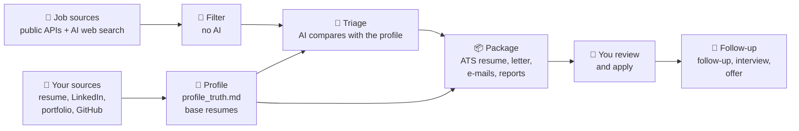
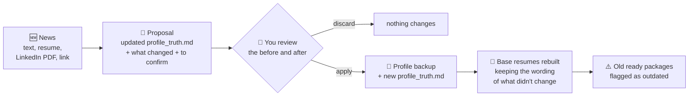
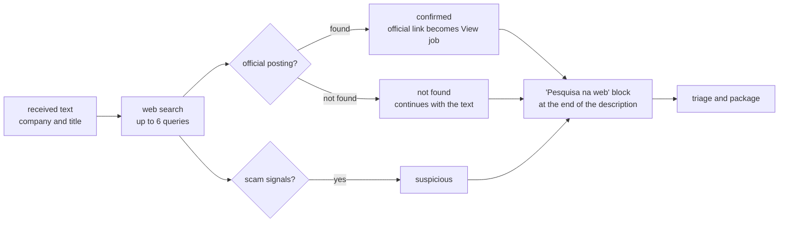
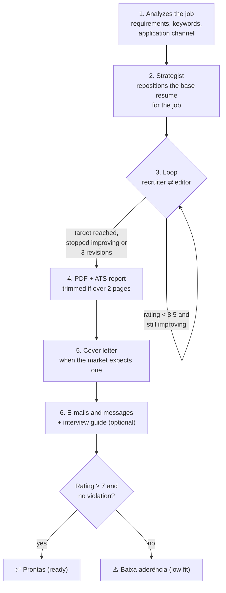
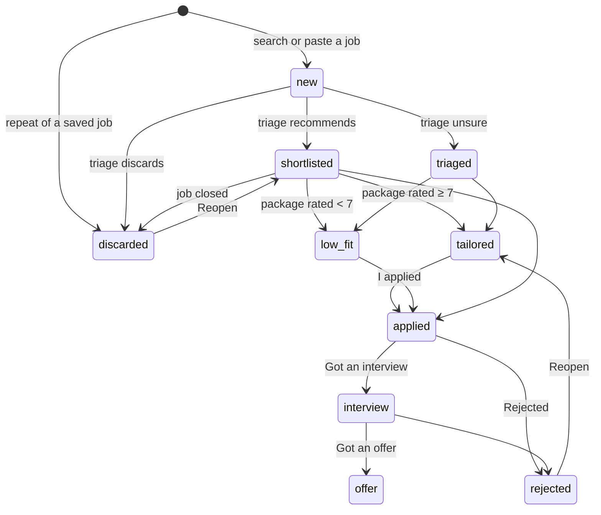
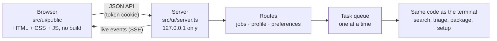

# How it works

**English** · [Português](como-funciona.md)

How auto-job-finder goes from "I have a resume" to "package ready to send", and how the code is organized. To use it, see the [user guide](user-guide.md).

- [Overview](#overview)
- [1. Profile: the single source of truth](#1-profile-the-single-source-of-truth)
- [2. Search and filter](#2-search-and-filter)
- [3. AI triage](#3-ai-triage)
- [4. The package for each job](#4-the-package-for-each-job)
- [No made-up facts](#no-made-up-facts)
- [A job's journey](#a-jobs-journey)
- [Application-form questions](#application-form-questions)
- [LinkedIn](#linkedin)
- [The AIs](#the-ais)
- [The local interface](#the-local-interface)
- [Code map](#code-map)

## Overview



The agent **prepares**; you are always the one who sends. It doesn't submit applications, send e-mails or change your LinkedIn.

## 1. Profile: the single source of truth

The setup (in the interface or `ajf init`, in `src/onboarding/`) turns what you sent into files the rest of the agent reads:

| File | What it is |
|---|---|
| `profile/profile_truth.md` | The facts of your career, in sections: experience, projects, education, skills, languages. It also has **Lacunas** (gaps), **A confirmar** (to confirm), **Nunca afirmar** (never claim) and **Regras de comunicação** (communication rules), which do **not** count as evidence |
| `profile/base_resume.pt.json` · `.en.json` | Structured base resumes in Portuguese and English |
| `profile/rules.json` | Phrases the agent may never write (e.g. "fluent English" when the level is intermediate) |
| `profile/preferences.json` | Titles, search terms, filters, regions, cities and sources |

How the build works:
1. The AI reads the sources and returns what it understood, plus up to 8 questions about what is missing (`readIntake`).
2. With the answers and your choices, it builds `profile_truth.md`, the rules and the search terms (`buildProfile`).
3. It writes the base resumes (`buildBaseResume`).

The instruction to the AI is the same at every step: **only record what is in the sources**. Anything missing or contradictory between sources becomes "A confirmar".

### Updating without rebuilding

When your career changes, `src/onboarding/update.ts` updates the profile from a piece of news:



- **The proposal** is saved in `profile/atualizacao/proposta.json`, so you can close `ajf` and come back later. It stores a hash of the profile at the time it was made: if you edit the profile afterwards, it can no longer be applied, so nothing you edited by hand gets lost.
- **Rules for the AI:**
  - keep the section headings and the text that didn't change;
  - a new experience goes in chronological order;
  - a course doesn't become a certification;
  - whatever is missing goes to "A confirmar";
  - a proposal that removes any section of the profile is rejected.
- **"Never claim" rules:** news can make a rule false (it blocked "ISO 27001" and now there is evidence) or call for a new one (a course that is not a certification). The AI only points out what to remove, copying the exact rule, and what to add; `applyRuleChanges` applies that to `rules.json` when the proposal is applied, and the other rules, including the hand-written ones, stay as they are. The changes show up in the list of what changes.
- **Why rebuild the base resumes:** the guards only accept experiences that are in the base resumes. A new job only in `profile_truth.md` would make the package come out with a violation. `rebuildBaseResumes` hands the current base resume to the AI to update, instead of writing from scratch; it can also be called on its own, after editing the profile by hand.
- **Outdated package:** a ready or low-fit package is flagged when the profile or the base resumes changed after it was made. The comparison uses the files' modification dates.

## 2. Search and filter

`src/jobs/search.ts` gathers the jobs from every source turned on in the preferences (`src/jobs/sources/`) and, if you ask, from the AI web search.

**Gupy** (`sources/gupy.ts`) is the job portal many companies in Brazil use, in every field. The portal's search page (`portal.gupy.io/job-search/term=...`) already carries the jobs as JSON (`__NEXT_DATA__`), 12 per page; the source reads up to 3 pages per term and skips jobs with an expired application deadline or from a deactivated career page. It only finds jobs with Portuguese terms, so the setup generates terms in the language of the person's country and turns Gupy on for people who live in Brazil.

Before spending the AI, a **deterministic filter** (`src/jobs/filter.ts`) cuts jobs that make no sense:
- a title without any target title, or with an excluded word;
- a company you don't want;
- a job posted more days ago than the limit;
- on-site or hybrid outside your cities;
- remote, but restricted to countries you didn't accept.

The jobs that pass go to `data/jobs.json` with status `new`.

### Repeated jobs

The same job shows up on several sites: Remotive and We Work Remotely, two GitHub repositories, Gupy and an aggregator that copied it. `src/jobs/dedupe.ts` compares each job found with every saved one, including the ones you already sent, without AI:

1. **Same link.** The link is reduced to the form that identifies the job (`canonicalUrl`): no tracking (`utm_*`, `ref`, `trackingId`...), no `www.` and no trailing slash, keeping the parameters that matter, such as Indeed's `jk`. LinkedIn (`/jobs/view/slug-123`, `?currentJobId=123`), Gupy (`/job/<token>` and `/jobs/123`) and Indeed (`jk`, `vjk`) collapse into one form. The job ID comes from this link (`sources/index.ts#jobId`). The same link is ignored.
2. **Same job under another link.** All three have to match:
   - **title:** every word of one is in the other, or nearly all match, ignoring accents, punctuation and gender markers ("Desenvolvedor(a)"), with Sr/Jr/Pl spelled out; "full stack" and "fullstack" count as the same. A **different level** (junior vs. mid-level, "Software Engineer" vs. "Senior Software Engineer", II vs. III) is always another job;
   - **company:** the same one, ignoring "Ltda", "Inc.", "Group" and the like. When the source didn't give it ("(ver na vaga)", "Confidencial"), the company isn't compared and the text must match more;
   - **text:** at least 60% of the three-word chunks of the shorter description appear in the longer one (75% without a known company). This is what separates the same job from different jobs at the same company, which repeat the company blurb but not the requirements.

   With the same company and the **same title** (after normalizing), the text doesn't decide in two cases:
   - **it can't be compared:** a short description, or an **AI web-search summary**, which the AI writes in other words (`page.ts#isWebSummary`);
   - **you already handled the other one** (package, application, interview, offer or rejection): applying twice costs more than hiding a job, which you can reopen.

   The repeated job is saved **discarded**, with `duplicateOf` pointing to the original (the first one, if the job found was already a repeat of another), so it doesn't spend a triage or become another package. Reopening it, or "Não é a mesma vaga" (Not the same job), removes the flag and sets `notDuplicate`, so it is never flagged again. A job you **paste** comes in normally, only flagged, and the warning says which one it looks like; the autopilot doesn't build a package for a flagged job.

   **Reopened job.** The rules above only apply within a window (`AJF_REPEAT_WINDOW_DAYS`, 90 days) counted from your application, or from the day the other job was saved. Outside it, or if the job found was posted at least 14 days after your application, it is **another opening** of the same job: it comes in normally, and if you had already handled the old one it gets `reopenedFrom` and the "📨 vaga reaberta" (reopened job) badge. The same link is still the same posting, no matter when.
3. **Already saved jobs.** After every search, `store.ts#flagHandledTwins` looks, among jobs not sent yet, for the same job as one you already handled (`dedupe.ts#handledTwins`): it catches what slipped through and what was saved before this check existed. Without a package, it goes to "Encerradas" (closed); with a package, it is only flagged. Between two jobs with packages, the newer one is the repeat. The autopilot checks again before each package (`handledTwin`).

The thresholds were calibrated on real jobs: the repeats across sites were found (including three jobs the person had already applied to, which came back through another site via the web search), and different jobs at the same company with the same blurb (up to 80% of chunks in common) stayed apart because of the title.

### Closed jobs

`src/jobs/open.ts` opens the job link and decides (`pageVerdict`, tested offline):

| What the site answers | Result |
|---|---|
| Error 404 or 410 | closed |
| A link that now leads to the job list (Greenhouse's `?error=true`) or to the home page | closed |
| A Gupy job with a status other than published, or an expired application deadline | closed |
| A JobPosting `validThrough` in the past | closed |
| Visible text with "vaga encerrada", "inscrições encerradas", "no longer accepting applications" and the like (Portuguese, English and Spanish; text hidden in scripts doesn't count) | closed |
| A closed GitHub issue (community job boards) | closed |
| Error 403, 429, login, a JavaScript-only page, a timeout | unconfirmed |
| Anything else | open |

When unsure, it never blocks: "unconfirmed" is treated as open. The result goes in `Job.openCheck`. When it runs:
- **before each package** (`tailorJob`): if closed, the package is not built (`JobClosedError`), unless with "Gerar mesmo assim" (Generate anyway; `ignoreClosed`, `--mesmo-encerrada`). The autopilot discards the job and moves on to the next one in the list, without using up one of the slots;
- **when you ask** (`ajf conferir`, the menu, the interface button): every job not sent yet, four at a time. A closed job without a package goes to "Encerradas"; with a package, it is only flagged.

### Text from the job page

The AI web search only brings a summary of each job, and the Gupy search only the description, without the requirements. Before the package (in the same visit as the open check), and when you paste only a link, the agent downloads the page and extracts the job text from it (`src/jobs/page.ts#jobPageText`):

1. **JobPosting in JSON-LD**, the format job sites publish for Google (Greenhouse, Lever, Workday, Wellfound, Indeed...). It brings the clean description, plus company, location, accepted countries, contract type, salary and date.
2. **A Gupy job page**, which has no JSON-LD: the job data (`__NEXT_DATA__`) brings the description, responsibilities, requirements and additional information separately.
3. **A LinkedIn job page**: the description block (`show-more-less-html__markup`), with title, company, location and criteria, without the similar jobs.
4. Otherwise, only the page's **main content** (`<main>` or `<article>`), without header, menu, footer, sidebars and forms.

Job sites also put the rest of the page in the main content. `cleanJobText` removes it, without AI:
- it cuts at the start of "Vagas semelhantes" (similar jobs), "As pessoas também visualizaram" (people also viewed), "Pesquisas semelhantes" (similar searches) and the like (Portuguese, English and Spanish; only short headings, after the first lines);
- it drops interface lines: buttons ("Salvar", "Denunciar esta vaga"), counters ("Há 14 horas", "143 candidaturas"), menus, the login screen and site prompts;
- it drops the repeated header (title, company and location twice at the top);
- it leaves the "Pesquisa na web" (web research) block as it is and can run again without changing anything.

It applies to the downloaded page, to pasted text (people who copy the whole LinkedIn page) and, when reading, to jobs already saved: triage, package, form answers, web research and the description in the interface.

A list marker alone on a line is joined to the next line's text (RSS feeds send `<li><p>text</p></li>`); consecutive markers, from empty menu items, are removed. Repeated blank lines are removed too (`util/text.ts#tidyText`), including when showing old jobs.

### Pasted jobs and jobs without a link

A pasted job (`src/jobs/search.ts#addJob`) goes straight in, without the filter: you already decided it is interesting. When it comes without a link (referral, e-mail, WhatsApp), `src/jobs/research.ts#researchJob` can research it before the triage. It needs an AI that can search the web (`llm.ts#canWebSearch`).



- The AI returns a validated object (`JobResearchSchema`): official posting, company site and summary, details the text didn't have, how to apply, the company's e-mail domains, a verdict and notes.
- The result goes at the end of the description, separated by `---` under the heading `## Pesquisa na web`, making clear it came from the web and not from whoever passed on the job. Researching again replaces that block (`withoutResearch`) instead of piling up.
- The verdict and the links go in `Job.research` for the interface to show the badge (confirmed, not found, suspicious). Only `http(s)` links are kept.
- **Mission and values** (`companyCulture`): what the company states on its official page, each item with the page link. `officialCulture` keeps only links on the domain of the company site or the official posting, an address with the company's name, or its careers page on a recruiting platform (Gupy, Greenhouse, Lever...). Glassdoor, news, LinkedIn and items without a link are dropped. They go in the research block and in `Job.research.culture` (empty when the official page doesn't mention them, so the agent doesn't suggest researching again).
- The research doesn't make things up: what doesn't show up on the web stays "not found", and the job continues with the received text. Facts about you still come only from the profile.

## 3. AI triage

`src/jobs/triage.ts` sends new jobs to the AI in batches of 6, together with your profile. For each one, it returns:

- **fit** (high, medium or low) and a **score from 0 to 100**;
- **evidence:** parts of your profile that prove the requirements;
- **gaps:** required items with no evidence. They are only recorded, never filled in;
- **scam signals:** requests for payment or documents, an unrealistic salary, a test that asks you to download and run code;
- **market** (BR, US, UK, EU, LATAM...), language and seniority;
- **recommendation:** `candidatar` (apply) goes to "Para decidir" with ⭐, `decidir` (decide) stays in "Para decidir", and `descartar` (discard) goes to "Encerradas".

## 4. The package for each job

`src/tailor/index.ts#tailorJob` first checks whether the job is still open ([closed jobs](#closed-jobs)) and completes the description with the page when it came with only a summary. Then it builds the package in 6 steps:



- **Recruiter ⇄ editor loop** (`src/tailor/refine.ts`): one agent plays the recruiter and rates the resume; another fixes it. The loop stops when:
  - it reaches the target (8.5);
  - it reaches the revision limit (3);
  - or it **stops improving**, because insisting on a real gap pushes the model to make things up.

  In the end, the **best version without violations** is kept, not necessarily the last one.
- **Market** (`src/market.ts`): sets the paper (A4 or Letter), language, file name and whether a letter goes. In the US: resume + letter, Letter paper, no photo, age or marital status.
- **ATS** (`src/tailor/ats.ts`): compares the job's keywords with the resume, in three groups: *covered*, *you have it but didn't show it* and *real gap*.
- **LEIA-ME** (README): explains how to apply through the right channel (e-mail, LinkedIn, platform, site or WhatsApp), with a checklist before sending.
- **No dashes:** "—" and "–" used as punctuation read like AI-written text. The prompts forbid them, and `util/text.ts#withoutDashes` enforces it without AI: in titles (project, job title, company, education), the rest goes in parentheses ("TV Box Educacional — UENP — em desenvolvimento" becomes "TV Box Educacional (UENP, em desenvolvimento)"); in text, it becomes a comma; in e-mail subjects, a hyphen. Date and number ranges get a plain hyphen ("02/2025 - present", "10-20"): no "—" or "–" is left. It applies to the resume (`profile.ts#withoutDashesResume`: package, base resumes, PDF and sheet), the letter, the e-mails and the form answers. The PDF template also uses a hyphen between dates and a comma between course and institution.
- **Job title in one language:** in a Portuguese resume, a title with its translation in parentheses ("Analista Desenvolvedor (Developer Analyst)") loses the English part when it has the words of the English resume's title for the same position (`profile.ts#withoutTranslatedTitles`, no AI; a single word, like "(Sênior)", is never removed). It applies to the package, the base resumes and the sheet. The profile keeps the English name in a "Cargo em inglês: ..." line.
- **E-mail draft** (`writers/emailDraft.ts`): `rascunho_candidatura.eml` with the recipient (the job's contact e-mail), subject, text and the PDFs in base64. The `X-Unsent: 1` header makes Outlook open it as a new e-mail, ready to send; a line break in the subject doesn't become a header. For Gmail in the browser, `gmailComposeUrl` builds the "compose" link with recipient, subject and text (the attachment goes by hand). The agent never sends: the person clicks Send. "Gerar o PDF de novo" (rebuild the PDF) rebuilds the draft with the new PDF.
- **Application sheet** (`writers/applicationSheet.ts`): the platform-form fields from the package's `resume.json` (or the base resume in the job's language): personal details, the summary in 3 sizes (whole sentences, `fitText`), each experience field by field, education, certifications, languages, skills and projects. No AI and nothing new; it lives in `ficha_de_candidatura.md` and in the Ficha (Sheet) tab.
- **Application channel:** "Já me candidatei" (I applied) stores `Job.appliedVia` (platform, e-mail, LinkedIn, site, WhatsApp, referral, other), preselected with the likely channel (`status.ts#guessApplyVia`: the analysis's `applyChannel`, otherwise the site of the link). It goes into `tracker.csv` as "via ...".

## No made-up facts

The golden rule: **only facts from `profile_truth.md` and the base resumes**. It doesn't depend on the AI "behaving"; it lives in code, in `src/tailor/guards.ts`, and runs on every version of the resume:

| Guard | What it blocks |
|---|---|
| Number without a source | Any number (%, amounts, quantities) that doesn't appear in the sources |
| Removed or invented position | Dropping an experience from the base or creating one that doesn't exist |
| Dates and titles | Changing dates or a job title |
| Certification or project without a source | A certification or project that is not in the profile |
| Forbidden phrases | Everything in `rules.json → neverClaim` |

The sections "Lacunas", "A confirmar", "Nunca afirmar" and "Regras de comunicação" stay **out** of the text used as evidence (`src/profile.ts#NON_EVIDENCE_HEADING`). That way, "Kubernetes: no experience" doesn't become proof that you know Kubernetes.

A package with a violation is never "ready". `coverage_review.md` shows what was blocked.

## A job's journey



Every status change:
- goes through `src/jobs/status.ts#changeStatus`;
- is logged in `output/tracker.csv`;
- moves the package folder to the stage's subfolder (`src/jobs/folders.ts`), keeping the paths in `data/jobs.json` in sync.

## Application-form questions

`src/writers/answers.ts` answers the questions application forms ask ("Why do you want to work here?"):

- **Context:** the job (with the web research, if any), the resume sent for it (the package's `resume.json`), what the person told for that answer and the other answers already given in the same application, so it doesn't repeat the same proof.
- **Focus** (`jobFocus`): the package's analysis (`analysis.json`: what the company does and values, required and nice-to-have skills, responsibilities), the triage's proof and gaps, and the mission and values from the official page with their links. The prompt asks for proof that meets a requirement or something the company values, and forbids claiming a gap.
- **Question from a screenshot** (`readQuestionsFromImage`): a short call that only transcribes the open questions and their character limits from the image (no profile data goes along; personal-data fields, buttons and menus are ignored), cleaned by `cleanImageQuestions`. The page shrinks big screenshots to 2000 px before sending (`POST /api/jobs/:id/answers/image`); the CLI takes `--imagem` or a dropped file path (`imageFile`). The person checks the text before answering.
- **Research first** (`isCompanyQuestion`, `shouldSuggestResearch`, no AI): a question about the company (why this company, culture, values, mission, "our product", the company's name; cues in Portuguese, English and Spanish), on a job whose mission and values were never researched, with an AI that searches the web. The route returns `{ suggestResearch }` instead of writing, and the page offers to research first or to answer with the posting only (`skipResearch`). `ajf responder` and the menu ask the same; `--pesquisar` researches without asking.
- **Validated output** (`AnswerSchema`): the answer and `needsYou`, what only the person knows and would make the answer stronger (motivation, opinion of the product, salary expectations).
- **Guards:** numbers that are not in the profile, the job or what the person told, and the phrases in `rules.json → neverClaim`. With a character limit, the length is checked too. If something fails, there is one correction round; whatever is left shows up as a warning.
- **Refinements:** each request ("shorter", "I've used the app for a year") is kept in `adjustments` and keeps applying in the next ones, including as a fact told by the person.
- **Where it lives:** in `Job.answers` (`data/jobs.json`) and in `perguntas_e_respostas.md` in the job's folder, which is also written when the package is built later.
- In the interface, the answer doesn't go through the task queue: it is a seconds-long conversation, and the queue may be busy with a package that takes minutes. One answer per job at a time.

## LinkedIn

`src/writers/linkedin.ts` does two things, without ever accessing LinkedIn: LinkedIn blocks programs, and the agent doesn't change anything on the person's behalf.
- **Plan:** headline, "About" in Portuguese and English, experiences, skills, featured items, Open to Work and a checklist, only with facts from the profile.
- **Review:** takes today's LinkedIn (the PDF exported with "Save to PDF", read the same way as in the setup, or the text) and compares it with `profile_truth.md` and the last plan. It returns:
  - what to **fix**, with the fix;
  - what **from the plan is still missing**;
  - what is **already right**.

Each plan and each review becomes a dated file in `output/linkedin/`. The interface shows the latest ones, the history, and warns when the profile changed after the plan.

## The AIs

Every call goes through `src/llm.ts`, so providers are interchangeable. Detection (`src/providers/index.ts`) looks in this order:

1. **Subscriptions**, at no extra cost:
   - `claude-code`: the `claude -p --json-schema` CLI;
   - `codex`: `codex exec --output-schema`;
   - `gemini-cli`: `gemini -p -o json` + validation with Zod.
2. **APIs:**
   - `anthropic`, `bedrock` and `vertex`, through the official SDKs;
   - `openai`: the Responses API, or Chat Completions with `OPENAI_BASE_URL` for OpenRouter, Groq and Ollama;
   - `gemini`: REST.

The CLIs run in an empty, isolated temporary folder, with no access to your files. `AJF_PROVIDER` forces a specific AI.

**Images** (`CallOptions.images`, `src/providers/images.ts`): a call can carry images, today the screenshot of a form question. The APIs get them in the request body (Anthropic/Bedrock/Vertex content blocks, OpenAI `input_image` or `image_url`, Gemini `inline_data`); `codex exec` gets `--image`; Claude Code and Gemini CLI get a copy in the call's isolated folder and open it with their file-reading tool (`Read`, `read_file`), the only tool enabled besides web search. The copy is deleted after the call. The type is checked by the first bytes (PNG, JPG, WEBP, GIF), up to 5 MB.

## The local interface



- **Security:**
  - the server only listens on `127.0.0.1`;
  - it only accepts whoever opened it through the tokened link, which becomes a `SameSite=Strict` cookie;
  - it checks Host and Origin, so no website open in the browser can send actions;
  - files are only served from inside `output/`.
- **Task queue** (`src/ui/tasks.ts`): search, packages and setup run one at a time, because they use the same AI, the same browser for PDFs and the same `jobs.json`. What a task would print in the terminal becomes live progress on screen. Between tasks, the PDF browser is closed.
- **Same actions as the terminal:** the interface calls the same functions as `ajf` and the menu (`src/menu.ts`). No duplicated logic.
- **Language (English and Portuguese):** the Portuguese text is the translation key, gettext style. `src/ui/public/locales/en.json` maps each Portuguese text to English, with `{variables}`.
  - On the page, `js/i18n.js` exports `t("Texto {n}", { n })`. `js/boot.js` loads the dictionary before `main.js`, so module-level texts are translated too. The choice lives in `localStorage` (`ajf.lang`); the first visit follows the browser's language. Switching reloads the page.
  - Every API call carries the `x-ajf-lang` header. On the server, `src/ui/i18n.ts` reads the same dictionary: routes use `c.t(...)` for task names and results, and `new HttpError(status, "Texto {x}", { x })` is translated when the error is sent.
  - Labels the server sends ready-made (status names, channels, job sources, AI names) are translated on the page or in the route.
  - `scripts/i18n.ts` (`npm run i18n`) finds every key in the code and lists what is missing or unused in each dictionary; `tests/i18n.test.ts` fails if a text has no translation, if a translation has other `{variables}` or if a key is no longer used.
  - Not translated yet: what goes to recruiters follows the job's language; AI-written text, package files, task progress and the terminal are in Portuguese.

## Code map

```
src/
  cli.ts                 terminal commands (commander)
  menu.ts                interactive terminal menu
  auto.ts                autopilot: search → triage → packages → dashboard
  dashboard.ts           output/painel.html (static summary)
  tracker.ts             output/tracker.csv (status history)
  llm.ts                 single entry point to the AI
  providers/             each AI + detection (spawn.ts finds the installed CLIs)
  onboarding/            setup: reading PDF/DOCX/LinkedIn/sites/GitHub, interview, building
    update.ts            update with news (proposal, apply) and rebuild the base resumes
  profile.ts             reading the profile, preferences and rules
  prompts.ts · schemas.ts · market.ts
  jobs/
    sources/             job sources (public APIs, Gupy, career pages, AI web search)
    search.ts filter.ts  search and filter (addJob: pasted job or by link)
    dedupe.ts            repeated jobs: canonical link, title, company and text
    open.ts              closed jobs: checks the link before the package and in ajf conferir
    page.ts              job text from the page (JobPosting, Gupy, LinkedIn or main content) and cleanJobText
    research.ts          web research for a job received without a link
    triage.ts            AI triage
    store.ts             data/jobs.json
    status.ts folders.ts status changes and folders per stage
  tailor/
    index.ts             the package (tailorJob, interview guide, rebuild PDF)
    agents.ts            analyst, strategist, recruiter, editor, trimmer
    refine.ts            recruiter ⇄ editor loop
    guards.ts            anti-fabrication guards
    ats.ts               ATS report
  writers/               letter, e-mails, interview guide, form questions, LinkedIn plan and review
    emailDraft.ts        .eml draft with the resume attached and the Gmail link
    applicationSheet.ts  application sheet (form fields, no AI)
  render/                HTML template → PDF (headless browser)
  ui/
    server.ts http.ts    local server, security, files
    i18n.ts              server-side translation (x-ajf-lang header)
    routes/              API: jobs, profile (setup and update), LinkedIn, preferences
    tasks.ts             task queue
    public/              the page: index.html, app.css, logo.svg, js/ (boot.js, i18n.js), locales/en.json
  util/                  text, line-by-line diff, opening links and folders (no shell)
scripts/demo.ts          npm run demo: fictional data to test the interface
scripts/i18n.ts          npm run i18n: interface texts missing or unused in each dictionary
examples/profile/        fictional profile (format reference and tests)
tests/                   offline tests (npm test)
```

Want to contribute? See [CONTRIBUTING.md](../CONTRIBUTING.md).
