# User guide

**English** · [Português](guia-de-uso.md)

Everything you need to use auto-job-finder, from zero to a sent application. The screenshots come from the demo (`npm run demo`), with a fictional person and fictional companies.

> **The interface comes in English and Brazilian Portuguese.** Switch it with **🌐** at the bottom of the sidebar (see [Interface language](#interface-language)). This guide uses the English labels you see on screen. Resumes, cover letters and e-mails come out in the language of each job, whatever the interface language.

- [1. Install](#1-install)
- [2. Try it without setting anything up](#2-try-it-without-setting-anything-up)
- [3. Build your profile](#3-build-your-profile)
- [4. Day to day: from jobs to applications](#4-day-to-day-from-jobs-to-applications)
- [5. Job details and the package](#5-job-details-and-the-package)
- [6. Shortcuts and command palette](#6-shortcuts-and-command-palette)
- [7. Search preferences](#7-search-preferences)
- [8. LinkedIn](#8-linkedin)
- [9. The AI: choose, test and diagnose](#9-the-ai-choose-test-and-diagnose)
- [10. Where files live](#10-where-files-live)
- [11. From the terminal](#11-from-the-terminal)
- [12. FAQ and troubleshooting](#12-faq-and-troubleshooting)

---

## 1. Install

You need three things:

1. **Node.js 22.12 or newer.** Download the LTS version at [nodejs.org](https://nodejs.org). To check, run `node -v` in the terminal.
2. **A Chromium browser:** Chrome, Edge, Chromium or Brave. It is used to make the PDFs. Most computers already have one.
3. **An AI.** The simplest is a subscription you already have, with no API key:

   | You have | What to do |
   |---|---|
   | Claude Pro or Max | Install [Claude Code](https://claude.com/claude-code) and run `claude` once to sign in |
   | ChatGPT Plus or Pro | `npm i -g @openai/codex`, then `codex login` |
   | A Google account | `npm i -g @google/gemini-cli` and run `gemini` once to sign in |
   | An API key | Put it in the `.env` file (see [`.env.example`](../.env.example)): Anthropic, OpenAI or compatible (OpenRouter, Groq, Ollama), Gemini, Bedrock or Vertex |

Then download the project and install it:

```bash
git clone https://github.com/GabrielMello1407/auto-job-finder.git
cd auto-job-finder
npm install
npm link        # optional: makes the `ajf` command available in any folder
```

Without `npm link`, replace `ajf` with `npm run ajf --` in the examples (e.g. `npm run ajf -- menu`).

To open it:

```bash
ajf
```

The terminal shows a link and the browser opens by itself. **Keep the terminal open** while you use it; to close it, press Ctrl+C.

> The interface only runs on your machine (`127.0.0.1`) and only opens through the tokened link the terminal shows. No website open in your browser can touch your jobs.

## 2. Try it without setting anything up

```bash
npm run demo
```

It opens the interface with **Ana Souza**, a fictional person, and 15 made-up jobs in every stage. It uses no AI and none of your data. It is the best way to get to know the screens before building your profile. The demo lives in the `demo/` folder and is rebuilt on every run.

## 3. Build your profile

The first time, `ajf` opens straight into the setup. It has five steps.

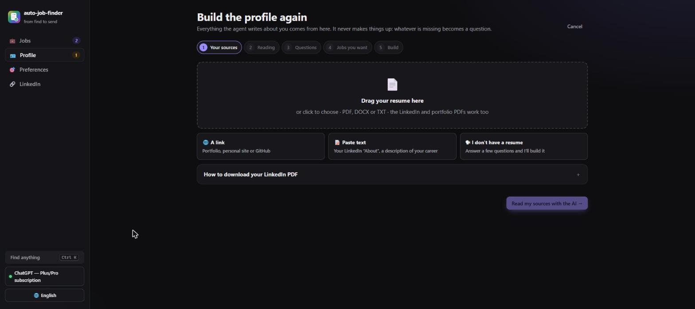

1. **Your sources.** Send whatever you have, one or several:
   - **Resume or portfolio:** drop in the PDF, DOCX or TXT.
   - **LinkedIn PDF:** LinkedIn doesn't let programs read your profile. Open your profile → **More** (or **Resources**) → **Save to PDF**, and drop in the file. The agent recognizes this PDF.
   - **A link:** a portfolio, a personal site (including ones built with React or Vue) or your GitHub, from which it reads your public repositories.
   - **Pasted text:** your "About", a description of your career.
   - **I don't have a resume:** answer questions about your experience, education, courses, tools and languages.
2. **Reading.** The AI reads everything and summarizes what it understood.
3. **Questions.** Up to 8 questions about what is missing: dates, results with numbers, whether a course is an official certification, disagreements between sources. Whatever you leave blank becomes an item "to confirm".
4. **The jobs you want.** Titles (with suggestions), seniority, work mode (remote only, remote or on-site in your area, or any), cities, country and whether you accept companies from abroad.
5. **Building.** It takes a few minutes. Out come your `profile_truth.md`, base resumes in Portuguese and English, search preferences and the rules for what the agent may never claim.

### Review your profile

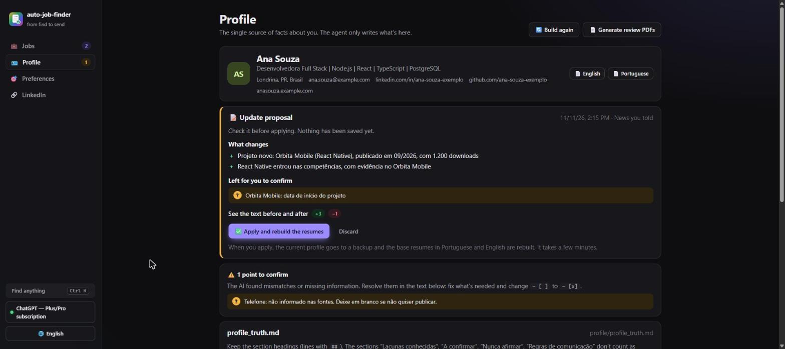

The **Profile** page is the most important part. **Everything the agent writes about you comes from here**:

- **Items to confirm:** the AI flags what was missing or didn't match between sources. Fix it in the text and change `- [ ]` to `- [x]`.
- **`profile_truth.md` editor:** adjust anything you want. Keep the section headings (lines starting with `##`). The sections "Lacunas" (gaps), "A confirmar" (to confirm), "Nunca afirmar" (never claim) and "Regras de comunicação" (communication rules) do **not** count as proof of anything; they exist so the agent knows what you *don't* have. Every time you save, the previous version goes to `profile/backup-edicoes/`.
- **Review PDFs:** the base resume in Portuguese and English, to see how it looks.
- **Build again:** rebuilds the profile from scratch with new sources. The current one is only replaced at the end and goes to a backup.

### Updating your profile later

Did a new project, changed jobs, finished a course? You don't need to rebuild everything. In **Profile → 🆕 Update the profile**, click **➕ Tell us something new**:

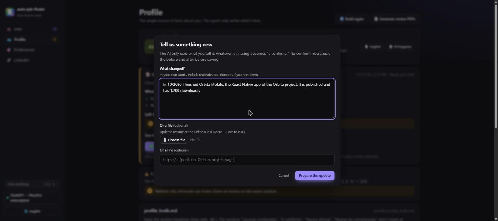

1. **Tell it in your own words**, with real dates and numbers (for example, "In 10/2026 I left Company A and joined Company B as a Mid-level Developer"). You can also send an updated resume, the LinkedIn PDF or a link.
2. **The AI prepares a proposal.** It only uses what you said: anything missing (the start date, the new role's activities) becomes "to confirm". It also reviews the **never claim** phrases: it removes the one the news makes obsolete (for example, "ISO 27001" when you say you worked with the standard) and adds what the news calls for (for example, "AWS certification" when you only took the course). These changes show up in the list of what changes.
3. **You review the before and after**, line by line, before saving:

   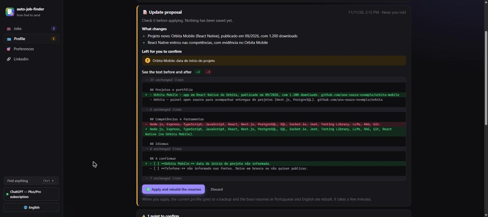

4. **✅ Apply and rebuild the resumes**: the current profile goes to a backup, `profile_truth.md` and `rules.json` are updated, and the base resumes in Portuguese and English are rebuilt, keeping the wording of what didn't change. It takes a few minutes.

After applying:
- **Ready packages made before the change** show the warning **"profile changed since"** and the **🔄 Generate again** button. Applications already sent are not flagged.
- **The LinkedIn plan** tells you it is out of date (see [LinkedIn](#8-linkedin)).

**Edited the profile text by hand?** Small changes (a project, a result, a tool) already apply to the next packages. But if you touched an **experience** (new job, title, dates), click **🔄 Rebuild base resumes**: the guards only accept experiences that are in the base resumes, and those don't change on their own when you edit the text. If a guard blocks something that is now true, check `profile/rules.json`: when you edit the text by hand, the "never claim" phrases are not reviewed.

> If you edit the profile after a proposal is ready, it can no longer be applied: discard it and tell the news again. That way nothing you edited by hand gets lost.

## 4. Day to day: from jobs to applications

The **Jobs** page is a funnel with five stages. Click a stage to see its jobs.

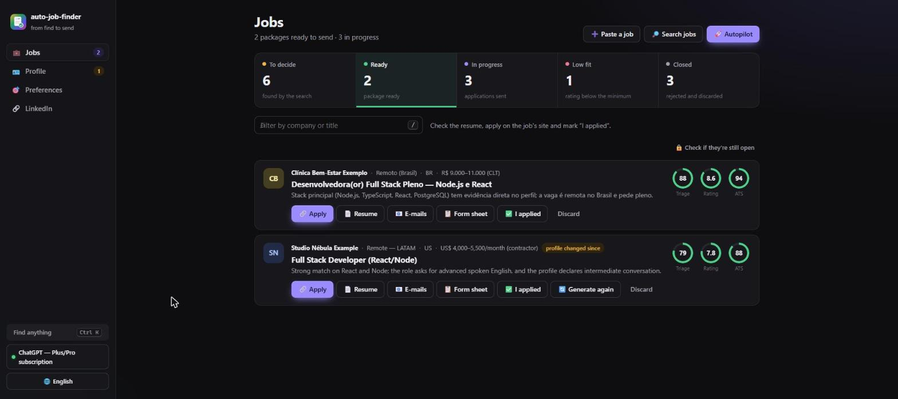

| Stage | What's in it | What you do |
|---|---|---|
| **To decide** | Jobs found by the search, already scored by the AI | Build the package for the good ones, discard the rest |
| **Ready** | Ready package (resume, letter, e-mails) with a rating ≥ 7 | Check it, apply and mark "I applied" |
| **In progress** | Sent applications, interviews and offers | Send the follow-up, record interviews, offers or rejections |
| **Low fit** | Packages rated below the minimum | See why; sending is your call |
| **Closed** | Rejected and discarded | Reopen, if you change your mind |

Each job shows three indicators:
- **Triage** (0 to 100): how well the job fits your profile, according to the AI.
- **Rating** (0 to 10): the final rating of the tailored resume, given by a simulated "recruiter".
- **ATS** (%): how many of the job's keywords appear in the resume.

### Finding jobs

- **🔎 Search jobs**: searches the sources in your [preferences](#7-search-preferences), and the AI scores each new job. Turn on **Include AI web search** to include LinkedIn, Gupy, Indeed and company sites; you can add an instruction, like "only jobs in Londrina".
- **🚀 Autopilot**: searches, scores and builds packages for the best jobs (triage ≥ 70 and no scam signals). You choose the maximum number of packages. A job that already closed is discarded and the autopilot moves on to the next one, without using up one of the packages.
- **➕ Paste a job**: for a job you saw on LinkedIn, in a WhatsApp group or through a referral. Paste the full text or, if the page opens without login (Gupy, the company site), just the link.

The search never brings the same job twice: a job that shows up again on another site (same company, same title, same text) goes straight to "Closed", marked **🔁 duplicate**, and is not scored and doesn't become another package. This also covers jobs you already applied to: then the same company and the same title are enough. If the agent gets it wrong, open the job and click **↩ Reopen**, or **It's not the same job** if it already has a package.

#### Job without a link (referral, e-mail, WhatsApp)

A friend sent "Company X is hiring, send your resume to hr@companyx.com"? Use **➕ Paste a job** the same way: paste everything you received (requirements, what the team is like, the e-mail, the deadline), fill in the company and title and leave the link blank.

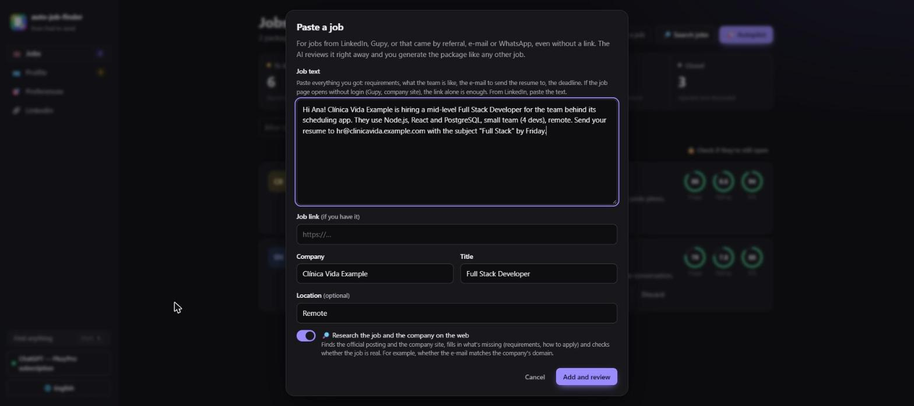

With **🔎 Research the job and the company on the web** turned on (it is on by default when the AI can search the web), before the triage the agent:
- looks for the **official posting** of the same job (careers site, Gupy, LinkedIn…) and the **company site**;
- adds what the posting has that the text you received didn't (requirements, stages, how to apply);
- **checks whether the job is real**: a contact e-mail outside the company's domain, a company that shows up nowhere, a request for fees or documents.

If it finds it, the job gets **✓ job confirmed on the web** and the official link becomes **🔗 View job**. If not, it continues with what you pasted (**not found on the web**), and the triage and the package work the same way. With scam signals, **🚩 suspicious job** appears.

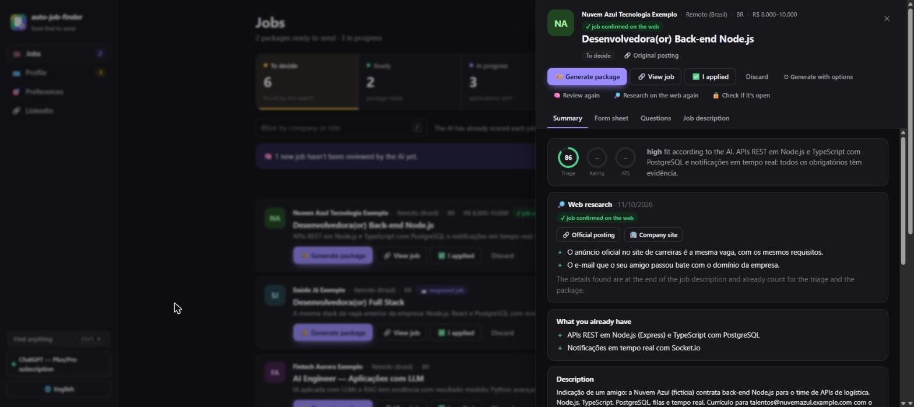

What was found goes at the end of the **Job description**, marked as research, and counts for the triage and the package; nothing is made up. In the details of any job, **🔎 Research on the web** runs the same research later (and redoes the triage if the package was not built yet). If the channel is e-mail, the package already has the application e-mail ready for you to send.

### Deciding

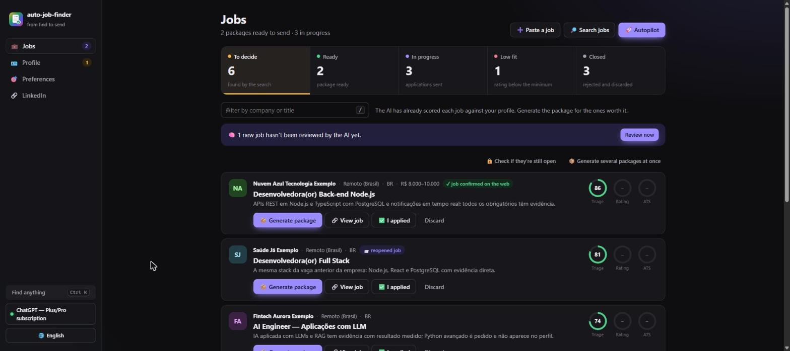

In **To decide**, recommended jobs come first. You can:
- **📦 Generate package**: builds the tailored resume, the letter (when the market expects one), the e-mails and the reports. It takes a few minutes and runs in the background.
- **📦 Generate several packages at once**: tick the jobs in a list.
- **✅ I applied**: if you applied without a package.
- **Discard**, with "Undo" right after.

Jobs with **🚩 scam signals** (requests for payment or documents, or an unrealistic salary) are flagged. Be careful.

**Closed jobs.** Before building the package, the agent opens the job link and looks for signs that it is over: a page that no longer exists, an expired application deadline, "vaga encerrada" or "no longer accepting applications" on the page. If it finds one, it doesn't spend the AI: the job gets **🔒 job closed** with the reason, and the button becomes **📦 Generate anyway**, for when you checked and it is still open. When unsure (a site that blocks bots or asks for login), it goes ahead normally.

**🔒 Check if they're still open**, in "To decide" and "Ready", checks every job you haven't sent yet at once. Closed ones without a package go to "Closed" (you can reopen them); those with a package stay where they are, flagged. In a job's details, **🔒 Check if it's open** does the same for that job only.

### Applying

In **Ready**:
1. Open the **📄 Resume** and check the whole PDF.
2. Apply through the job's channel:
   - **Platform or form** (Gupy, InHire, Greenhouse, Workday, the company site): click **🔗 Apply** and keep the **📋 Form sheet** open beside it, with every field those forms ask for again, each with a copy button (see [Application sheet](#application-sheet)).
   - **E-mail:** in the **E-mails and messages** tab, **✉️ Open in your e-mail app, with the resume attached** opens the e-mail ready (recipient, subject, text and the PDF). Using Gmail in the browser? **Open in Gmail** opens the e-mail filled in; drag the PDF from **📁 PDF folder**.
   - **LinkedIn:** the messages are in the **E-mails and messages** tab.
3. Does the form ask something like "Why do you want to work here?"? Use the job's **Questions** tab (see [Application-form questions](#application-form-questions)).
4. After sending, click **✅ I applied** and pick **where** you applied (platform, e-mail, LinkedIn, site, WhatsApp, referral). The likely channel is already selected. This lets you see later which channel answers the most.

**The agent never sends anything on its own.** It prepares; you review and send.

#### Application sheet

Platform forms ask again for what is already in the resume: name, phone, LinkedIn, a summary with a character limit and each experience, field by field. The job's **Form sheet** tab has all of it ready to copy:
- personal details (first and last name separately, the phone also as digits only);
- the summary in three sizes (up to 300 and up to 600 characters, plus the full one), cut at whole sentences;
- each experience: title, company, location, work mode, start, end, "I currently work here" and the description;
- education, certifications, languages, skills and projects.

Everything comes from the resume tailored for the job (or from the base resume, before the package), with nothing new. The same sheet is saved as `ficha_de_candidatura.md` in the package folder.

### Following up

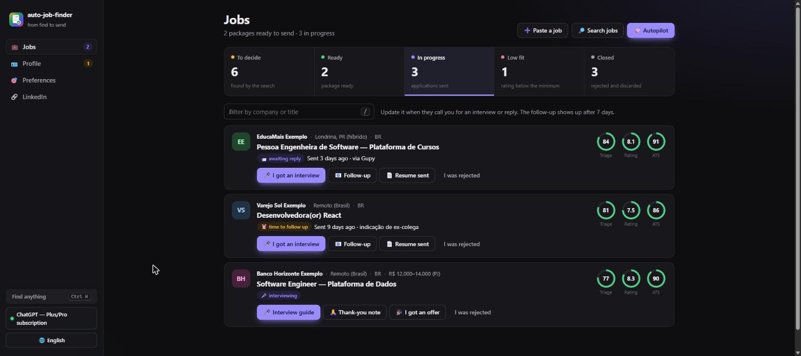

In **In progress**:
- After 7 days, **⏰ time to follow up** shows up. The follow-up e-mail is ready in **📧 Follow-up**.
- **🎤 I got an interview**: the job moves to "🎤 interviewing", and the agent offers an **interview guide** with likely questions and answers based on the resume you sent.
- **🎉 I got an offer** and **I was rejected** record the outcome.

Every status change is logged in `output/tracker.csv`, which opens in Excel or Google Sheets.

## 5. Job details and the package

Click a job's title to open its details.

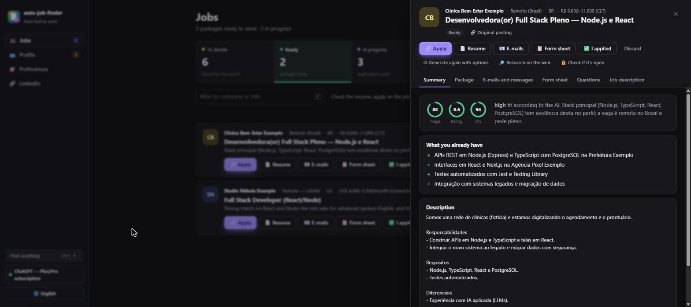

- **Summary**: the AI's assessment, what you already have (with evidence from your profile), the gaps and the description.
- **Package**: the files, the LEIA-ME (README) with the step-by-step to apply, and the reports (ATS, recruiter rating and profile check).
- **E-mails and messages**: application, LinkedIn invitation and message, follow-up and thank-you, each subject and message with a copy button. At the top, **✉️ Open in your e-mail app, with the resume attached** opens the application e-mail ready, with the recipient (if the job has a contact e-mail), subject, text and the PDF; Outlook opens it ready to send. **Open in Gmail** (on each e-mail) opens Gmail in the browser with everything filled in except the attachment: drag the PDF from **📁 PDF folder**. You review and send.
- **Form sheet**: the application-form fields, ready to copy (see [Application sheet](#application-sheet)).
- **Interview**: the guide, when there is one.
- **Questions**: answers to application-form questions (see below).

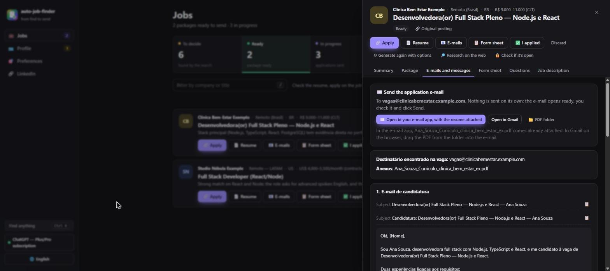

### Application-form questions

Many forms ask for more than the resume: "Why do you want to work here?", "Tell us about a project you are proud of", "What do you think of our app?". In the job's **Questions** tab:

1. **Paste the question.** If the field has a character limit, enter it. If you want, tell something only you know (motivation, your opinion of the product).
2. **✍️ Answer**. In a few seconds the answer comes out, in the question's language. It uses facts from your profile and what the job says about the company, and goes through the same guards as the resume (numbers without a source, "never claim" phrases).
3. **Refine it in a chat.** In the **Adjust** field, ask for "shorter", "mention project X", "in English", or answer what the AI asked in **To make it sound like you, tell us**. What you tell there counts as your own fact in the next refinements.
4. **📋 Copy** and paste it into the form.

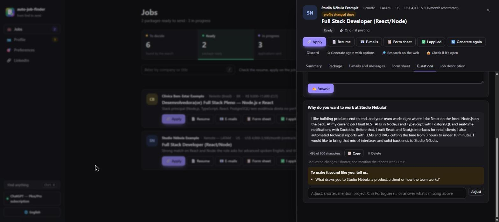

When the question asks for something only you know (why this company, salary expectations, your opinion of the product), the AI writes what it can with the facts and says what you need to tell it. It never makes up motivation, experience with the product or a salary figure.

Answers are saved in the job and in `perguntas_e_respostas.md`, in the package folder. You can also use it from the terminal: `ajf responder <company>`, or **📝 Responder pergunta do formulário** (Answer a form question) in `ajf menu`.

More options in the details:
- **⚙ Generate with options**: choose the language, paper (A4 or Letter), market and whether you want a cover letter.

  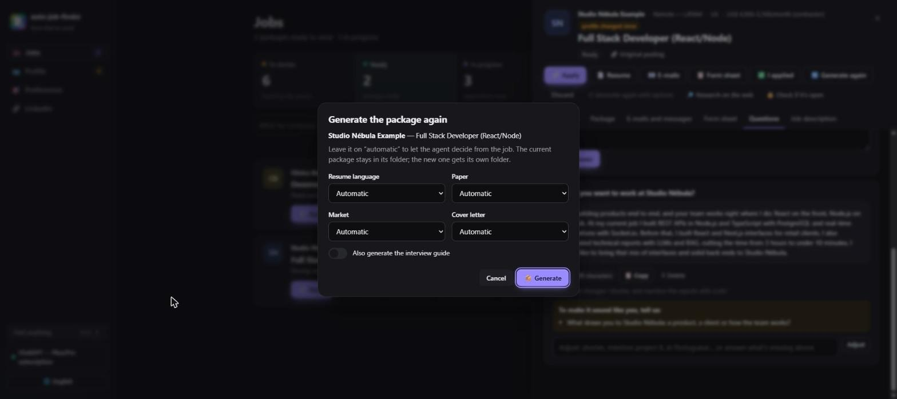

- **🧠 Review again**: redoes the triage (only before the package).
- **🔎 Research on the web**: finds the official posting and the company site and checks whether the job is real ([job without a link](#job-without-a-link-referral-e-mail-whatsapp)).
- **🔄 Generate the PDF again**: after editing the package folder's `resume.json` by hand.

## 6. Shortcuts and command palette

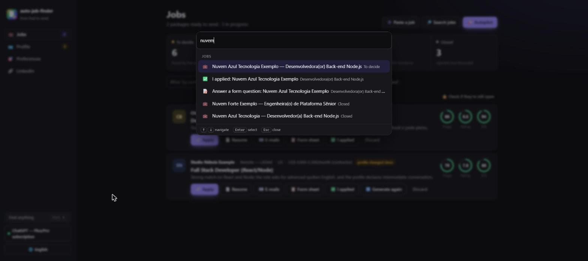

- **Ctrl+K** (⌘K on Mac): type part of a company's name to open the job or mark "I applied", or the name of an action ("search", "autopilot", "preferences").
- In the job list: **j** and **k** move between jobs, **Enter** opens, **/** goes to the filter.
- **Esc** closes dialogs and the details.

Long tasks (search, packages, setup) run in a queue, one at a time, with live progress in the corner of the screen. You can keep using the interface meanwhile.

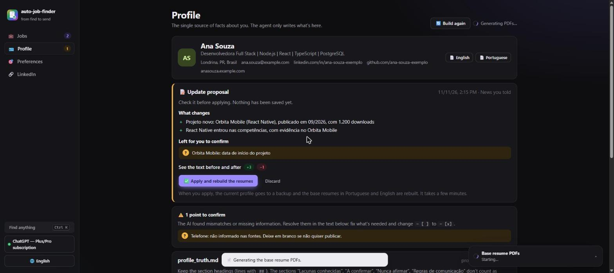

### Interface language

The interface comes in **English** and **Brazilian Portuguese**. On the first visit it follows your browser's language; to switch, click **🌐** at the bottom of the sidebar (or type "language" in **Ctrl+K**), pick the language and click **Use this language**. The choice is saved in this browser. On a phone, the sidebar becomes a bar at the bottom of the screen: **⋯ More** opens the same menu, with the language and the AI.

What changes: the menus, buttons, dialogs, messages and the names of tasks. What stays as it is:
- **what goes to recruiters** (resume, cover letter, e-mails, form answers) comes out in the language of each job;
- **what the AI wrote** (the triage's reasons, the LinkedIn plan) stays in the language it was written in;
- **the files in the package folder** (LEIA-ME, `emails.md`, the reports), the **task progress** in the corner of the screen and the **terminal** are in Portuguese for now.

## 7. Search preferences

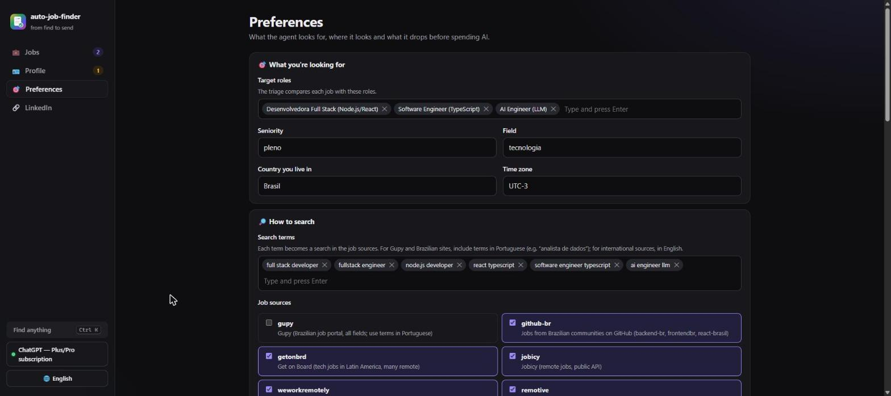

| Section | What it's for |
|---|---|
| **🎯 What you're looking for** | Target titles and seniority: the triage compares each job with them |
| **🔎 How to search** | Search terms, job sources, AI web search by default and how many days old a job can be |
| **🧹 Title filter** | Words the title must have and words that rule the job out. Cuts jobs **without spending the AI** |
| **📍 Where** | Accepted regions for remote jobs with restrictions, and cities for on-site/hybrid |
| **🏢 Companies** | Companies you don't want and career pages (Greenhouse, Lever, Ashby) to watch |
| **⭐ Minimum scores** | Minimum triage for the autopilot to build a package and minimum rating for "ready to send" |

Job sources:

| Source | Focus |
|---|---|
| AI web search | LinkedIn, Gupy, Indeed, Glassdoor, Catho, careers sites: **any field** |
| `gupy` | the Gupy job portal, used by many companies in Brazil: **any field**, without spending the AI. It only finds jobs with **Portuguese search terms** |
| `remotive`, `himalayas`, `jobicy`, `arbeitnow` | international remote, several fields |
| `github-br`, `getonbrd`, `remoteok`, `weworkremotely` | tech (Brazil, Latin America, remote) |
| `greenhouse`, `lever`, `ashby` | career pages of the companies you choose |

**Search terms in two languages.** Each term becomes a search in each source. International sources find jobs with English terms ("data analyst"); Gupy and Brazilian sites, with Portuguese terms ("analista de dados"). If you live in Brazil and accept jobs from abroad, keep both. If you built your profile before Gupy was added to the agent, turn it on here, under **Job sources**.

## 8. LinkedIn

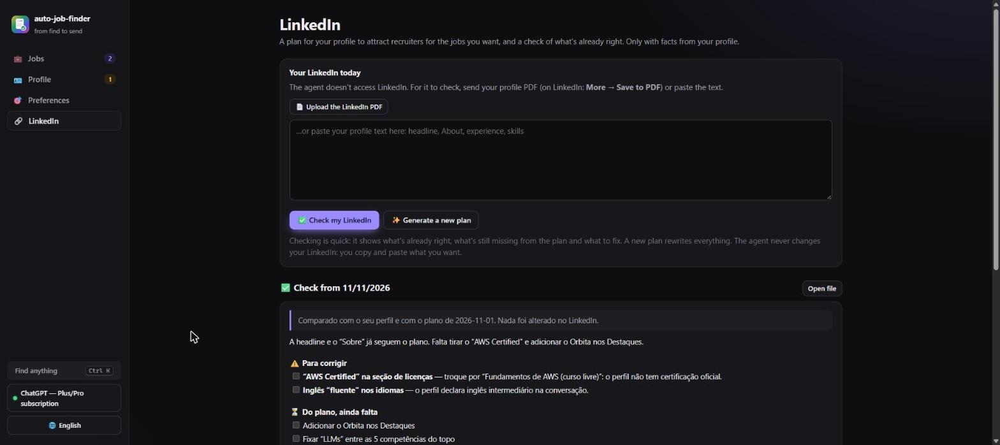

**The agent never accesses or changes your LinkedIn.** LinkedIn blocks programs, and the project's rule is that you apply whatever you want. So, for it to know what your profile looks like today, send:
- the **profile PDF**: on LinkedIn, **More → Save to PDF**, then **📄 Upload the LinkedIn PDF**; or
- the profile **text**, pasted in the box.

With that, you have two options:

| | What it does | When to use it |
|---|---|---|
| **✅ Check my LinkedIn** | Compares your LinkedIn today with your profile and the last plan. Shows what to **fix** (dates, titles, a "certificate" that is a course, language level), what **from the plan is still missing** and what is **already right** | After changing your LinkedIn, to see your progress. It is quick |
| **✨ Generate a new plan** | Writes everything again: headline, "About" in Portuguese and English, experiences, skills, featured items, Open to Work and a checklist | The first time, or after changing your goal or [updating your profile](#updating-your-profile-later) |

- **Each plan and each review is a snapshot of the day it was made.** They don't update on their own.
- **If your profile changes after the plan,** the page tells you and suggests a new plan.
- **Previous ones** are in **History**.

## 9. The AI: choose, test and diagnose

The button at the bottom of the sidebar shows which AI is in use. In it you:
- **choose** among the AIs found on the machine;
- **test** whether the AI answers (one short call);
- see the **diagnosis**: the browser for PDFs, the profile files and the minimum scores.

The agent looks for the CLIs (`claude`, `codex`, `gemini`) in PATH, in the usual install folders (Claude Code installer, Homebrew, nvm, volta, pnpm, global npm, WinGet) and in your user's current PATH. If it still can't find one, set the path in `AJF_CLAUDE_BIN`, `AJF_CODEX_BIN` or `AJF_GEMINI_BIN` in `.env`.

## 10. Where files live

Everything stays **only on your machine**, out of git:

```
profile/                   your profile
  profile_truth.md         facts (single source of truth), gaps, "to confirm", "never claim"
  base_resume.pt.json      base resume in Portuguese
  base_resume.en.json      base resume in English
  preferences.json         search preferences
  rules.json               phrases the agent may never write
  sources/  entrada/       the text read from your sources and the files uploaded in the interface
  atualizacao/             the update proposal, until you apply or discard it
  backup-*/                previous versions of the profile (on every rebuild, update or edit)
data/
  jobs.json                every job and its status
  usage.jsonl              tokens used in each AI call
output/
  1-prontas-para-enviar/   ready packages, not applied yet
  2-em-andamento/          sent, interviewing or offer
  3-baixa-aderencia/       rated below the minimum
  4-encerradas/            rejected or discarded
  base/  linkedin/         review PDFs, LinkedIn plans and reviews
  painel.html  tracker.csv static summary and status history
```

Each package folder moves on its own when the status changes. Inside it:

```
LEIA-ME.md                          rating, ATS, HOW TO APPLY and a checklist
<Name>_Curriculo_<Company>.pdf      ATS resume (Resume_ for jobs abroad)
<Name>_Cover_Letter_<Company>.pdf   when the market expects one (US, Canada, Europe) or you ask for it
emails.md                           application, LinkedIn, follow-up, thank-you
rascunho_candidatura.eml            the application e-mail with the resume attached (opens in Outlook and similar)
ficha_de_candidatura.md             the application-form fields, ready to copy
ats_report.md · rating_report.md · coverage_review.md · interview_prep.md
resume.json                         edit by hand and use "Generate the PDF again"
```

**Cover letter vs. resume:** in the US the norm is resume + cover letter, on Letter paper, with no photo, age or marital status. In Brazil the resume comes out on A4 and the letter is optional. A job in English produces a resume in English.

To keep profiles for several people (for example, helping a family member), use another folder: `AJF_HOME=/path/to/folder`.

## 11. From the terminal

Everything in the interface also exists in the terminal. The terminal (commands, menu and messages) is in Portuguese for now; only the interface switches language.

- `ajf menu` opens a menu you drive with the arrow keys and Enter.
- The commands below are for automation or for people who prefer the terminal:

| Command | What it does |
|---|---|
| `ajf` · `ajf ui [--port 4317] [--no-open]` | Interface in the browser |
| `ajf menu` | Terminal menu |
| `ajf init [files or links...]` | Builds the profile from scratch |
| `ajf atualizar [files or links...] [--texto "..."]` | Updates the profile with something new: shows the before and after and, if you approve, rebuilds the base resumes. `--aplicar` applies the saved proposal (made here or in the interface), `--descartar` discards it, `-y` applies without asking |
| `ajf ia [--escolher] [--testar]` | AIs found and which one to use |
| `ajf doctor` | Checks the AI, the browser and the profile files |
| `ajf base [--refazer]` | Base resume PDFs (no AI). With `--refazer`, rebuilds the base resumes from `profile_truth.md` (uses the AI) |
| `ajf search [--web] [--hint "only Londrina"] [-q terms] [-s sources] [-v]` | Searches jobs (`-v` shows what the filter cut and which job each repeated one copies) |
| `ajf triage [--id <ids...>] [-l 10]` | Triage of new jobs, or again for the given ones |
| `ajf jobs [--status shortlisted] [-a]` · `ajf show <id>` | List and details |
| `ajf add --file job.md --company X --title Y [--pesquisar]` · `ajf add --url <link>` | Adds a job. With `--pesquisar`, researches the job and the company on the web before the triage (job without a link) |
| `ajf pesquisar [company, title or id]` | Researches a saved job on the web: official posting, company site, what the text was missing and whether it is real |
| `ajf tailor <id> [--interview] [--market US] [--lang en] [--paper Letter] [--cover/--no-cover] [--mesmo-encerrada]` | Builds the package. First checks whether the job is still open; `--mesmo-encerrada` builds it anyway |
| `ajf conferir [company, title or id]` | Checks whether jobs still take applications. With nothing, checks every job you haven't sent |
| `ajf render <folder or id>` | Rebuilds the PDF after editing `resume.json` |
| `ajf responder [company, title or id] [-p "question"] [--limite 500] [--contexto "..."]` | Answers an application-form question and lets you refine it until you press Enter |
| `ajf linkedin [--current profile.pdf]` · `ajf linkedin --conferir --current profile.pdf` | LinkedIn plan, or a review of your current LinkedIn (exported PDF or text in `.md`/`.txt`) |
| `ajf ficha [company, title or id]` | Shows the application-form fields (details, summary in 3 sizes, each experience), ready to copy |
| `ajf rascunho [company, title or id] [--nao-abrir]` | Opens the application e-mail in your mail program, with the resume attached. You send it |
| `ajf enviei [company or title] [--via plataforma\|email\|linkedin\|site\|whatsapp\|indicacao\|outro] [--note "..."]` | Marks that you applied and where (finds the job by name; without `--via`, it asks) |
| `ajf status [company, title or id] [status]` | Changes the status (interview, offer, rejection...) |
| `ajf auto [--web/--no-web] [--max 3] [--interview] [--open]` | Autopilot |
| `ajf painel` | Opens `output/painel.html`, a summary that works without the server |

A job ID accepts just its beginning (`ajf tailor 78cb`).

Extra settings live in `.env` (see [`.env.example`](../.env.example)): AI and model (`AJF_PROVIDER`, `AJF_MODEL`, `AJF_TRIAGE_MODEL`), scores (`AJF_MIN_RATING`, `AJF_MIN_TRIAGE_SCORE`, `AJF_TARGET_RATING`), for how many days the same job on another site counts as repeated (`AJF_REPEAT_WINDOW_DAYS`, 90), the interface port (`AJF_UI_PORT`) and the browser (`CHROME_PATH`).

## 12. FAQ and troubleshooting

**The interface doesn't open or says "Open it from the terminal".**
Run `ajf` again and use the link the terminal shows. For security, it only opens through that link.

**"No connection to ajf".**
The terminal where `ajf` was running was closed. Run `ajf` again.

**It doesn't find my AI.**
Open the AI button and look at the diagnosis. Check that you signed in (`claude`, `codex login` or `gemini`). If the CLI is installed somewhere else, set its path in `AJF_CLAUDE_BIN` (or `AJF_CODEX_BIN`, `AJF_GEMINI_BIN`) in `.env`.

**The PDF is not generated.**
The agent didn't find a Chromium browser. Install Chrome, or set the browser path in `CHROME_PATH` in `.env`.

**Few good jobs show up.**
- Live in Brazil? Turn on the **`gupy`** source in the preferences and make sure you have **search terms in Portuguese**.
- Turn on the **AI web search**: the default sources are largely international jobs, and the web brings LinkedIn, Gupy and Indeed.
- Look at the search progress to see how many jobs each filter cut, and loosen the **title filters** in the preferences.
- Lower the **minimum triage** (for example, to 60) and look at the "To decide" stage.

**Does the same job show up twice?**
It shouldn't. The agent compares each new job with every saved one, including the ones you already sent: same link, or same company, same title and same text on another site. If you already applied to, or have a package for, a job with the same company and the same title, the new one counts as repeated even if the text comes out different (the web search brings a summary in other words). On every search, it also checks the jobs that were already saved. The repeated job goes to "Closed" with **🔁 duplicate**, and the details say which job it copies; if it already had a package, it stays where it is, only flagged. Got it wrong? Click **↩ Reopen** or, on a job with a package, **It's not the same job**: the agent won't flag that job again. Jobs at different levels (junior and mid-level, "Engineer" and "Senior Engineer") never count as repeated.

**The company reopened a job I already applied to.**
90 days after your application, or if the new posting was published after it, the agent treats it as **a new opening**: the job comes in normally, with **📨 reopened job**, and the details show when you applied to the old one and how it ended. That way you decide whether it is worth trying again. To change the window, use `AJF_REPEAT_WINDOW_DAYS` in `.env`.

**I built a package and the job had already closed.**
The agent now checks first: if the page says the job is over, the package is not built and the job gets **🔒 job closed**. If you are sure it is open, use **📦 Generate anyway**. To clean up the list at once, use **🔒 Check if they're still open**. Some sites (Himalayas, We Work Remotely) don't allow the check; those stay "unconfirmed" and go ahead normally.

**I did a new project or changed jobs. How do I update?**
In **Profile → ➕ Tell us something new** (or `ajf atualizar --texto "..."`). You review the before and after, and the base resumes are rebuilt. Then rebuild the ready packages flagged "profile changed since". See [Updating your profile later](#updating-your-profile-later).

**I got a job through a referral, with no link. Can I use it?**
Yes. In **➕ Paste a job**, paste what you received, fill in the company and title and keep **🔎 Research the job and the company on the web** on: the agent looks for the official posting and the company site, fills in what is missing and checks whether the job is real. If it finds nothing, the job continues with what you pasted. See [Job without a link](#job-without-a-link-referral-e-mail-whatsapp).

**The LinkedIn plan shows things I already changed.**
The plan is a snapshot of the day it was made, and the agent doesn't access LinkedIn. Send the PDF or the current text of your LinkedIn and click **✅ Check my LinkedIn**: it shows what is already right and what is still missing. See [LinkedIn](#8-linkedin).

**The form asks why I want to work at the company. Can the agent help?**
Yes. In the job's **Questions** tab, paste the question; the AI answers with your profile and what the job says about the company, and you refine it until it sounds like you. See [Application-form questions](#application-form-questions).

**LinkedIn is not read.**
LinkedIn blocks automated reading. In the setup, use the profile PDF (**More → Save to PDF**); for jobs, paste the text.

**How much does it cost?**
- **With a subscription** (Claude, ChatGPT, Gemini) there is no extra charge; usage counts against your plan's limits. Each package makes 6 to 10 calls. If you hit the limit, use a smaller model in `AJF_MODEL`.
- **With an API**, the triage costs about US$ 0.02 to 0.05 per job, and a full package about US$ 0.50 to 2.00 with frontier models.

`data/usage.jsonl` logs the tokens of every call.

**The job description came with "Vagas semelhantes" (Similar jobs), "Salvar" (Save), "143 candidaturas" (143 applicants)…**
That is the rest of the site's page (LinkedIn shows everything together). The agent now removes it: it cuts at the start of "Similar jobs" and the like, and drops buttons, counters, menus and the login screen. This covers downloaded jobs, text pasted from a whole page and jobs that were already saved. If a job already had a package, rebuild it so the package uses the clean description.

**My resume had "—" (em dashes) in titles and text.**
Dashes used as punctuation read like AI-written text. Resumes, letters, e-mails and answers now come out without them: in titles, the rest goes in parentheses ("TV Box Educacional (UENP, em desenvolvimento)"); in text, it becomes a comma; between dates, a plain hyphen ("02/2025 - present"). No "—" or "–" shows up in the resume. For an existing package, **🔄 Generate the PDF again** (in the Package tab) rebuilds the PDF without dashes, without using the AI.

**Can the agent make things up on my resume?**
It is built not to. It only uses facts from your profile, and guards in code block numbers without a source, changed titles or dates, made-up certifications and the "never claim" phrases. Even so, **always read the PDF before sending it**. See [how it works](how-it-works.md#no-made-up-facts).

**How do I update the project?**
`git pull`, then `npm install`. Your data lives in `profile/`, `data/` and `output/` and is not affected.

**Watch out for scams.**
Turn down jobs that ask for payment, a "kit", documents with the application, or to download and run code for a "test". The triage flags these signs with 🚩. For a job that came through a message, use **🔎 Research on the web**: it checks whether the posting exists and whether the contact e-mail really belongs to the company.
